<div align="center">

# Личный VPN на своём сервере
### 3X-UI и Nginx с маскировкой под сайт

Надёжный персональный VPN на VPS, устойчивый к блокировкам операторов связи.  
Работает на смартфонах (iOS, Android), компьютерах (Windows, macOS) и роутерах.

[Инструкция для новичков](docs/BEGINNER_GUIDE.md) • [Руководство Dokploy](docs/DOKPLOY_SETUP_GUIDE.md) • [Техническая архитектура](docs/ARCHITECTURE.md) • [Бэклог задач (РФ)](docs/BACKLOG.md) • [Быстрый старт](#-быстрый-старт-установка-в-1-команду)

[](https://github.com/torrua/Nginx-L4-Stream-Router-Mask-for-3x-ui/actions/workflows/ci.yml)
[](https://github.com/torrua/Nginx-L4-Stream-Router-Mask-for-3x-ui)
[](docs/BEGINNER_GUIDE.md#1-сервер-vps)
[](LICENSE)

</div>

---

## ⚡ Быстрый старт (Установка в 1 команду)

Подключитесь к VPS по SSH под пользователем `root` и запустите единый установщик:

```bash
curl -sSL "https://raw.githubusercontent.com/torrua/Nginx-L4-Stream-Router-Mask-for-3x-ui/main/setup.sh?v=$(date +%s)" | sudo bash
```

> **Нужно продолжить после сбоя или перезагрузки?**  
> Выполните `bash setup.sh -r` — мастер автоматически продолжит установку с сохранёнными параметрами с последнего незавершённого шага.

---

## 🗺️ Схема движения трафика (Traffic Flow)

```mermaid
flowchart TD
    subgraph Clients["📱 Клиенты (iOS, Android, Windows, macOS, Linux, Keenetic / OpenWrt)"]
        BrowserUser["🌐 Обычный браузер / Поисковый бот / Сканер Censys"]
        VpnReality["🛡️ VPN: VLESS REALITY (Happ / v2rayNG / v2rayN)"]
        VpnWeb["🔒 VPN: VLESS xHTTP / Wstunnel (Строгие корпоративные сети)"]
        AmneziaClient["⚡ AmneziaWG v3.1 / v2.0 (Мобильные операторы 4G/5G / Keenetic)"]
        NextGenClient["🚀 Next-Gen: Hysteria 2 / TUIC v5 / MASQUE / Shadowsocks 2022 / MTProxy"]
    end

    subgraph Port443["🚪 Единый входной порт: TCP 443 (Nginx Stream L4 Router)"]
        StreamRouter{"Nginx L4 Stream SNI Router\n(Определение домена без расшифровки TLS)"}
    end

    subgraph DedicatedPorts["📡 Выделенные порты протоколов"]
        PortHy2["UDP 443: Hysteria 2 (QUIC Brutal CC)"]
        PortAWG["UDP 8443 (v3.1) / UDP 8444 (v2.0): 3X-UI AmneziaWG"]
        PortAWGStand["UDP 8445: Автономный сервер AmneziaWG (awg-mgr)"]
        PortTUIC["UDP 8448: TUIC v5 (QUIC 0-RTT BBR)"]
        PortMASQUE["UDP 8449: MASQUE (Sing-box HTTP/3 Datagrams)"]
        PortSS["TCP/UDP 8388: Shadowsocks 2022"]
        PortMTP["TCP 8444: Telegram MTProxy (FakeTLS)"]
        PortNaive["TCP 8446: NaïveProxy (Caddy)"]
        PortDNSTT["UDP 53053: DNSTT DoH Tunnel"]
    end

    subgraph Inbounds["⚙️ Внутренние службы и ядро Xray"]
        NginxL7["Nginx L7 Web-Server\n(unix:/dev/shm/nginx-http.sock)"]
        MirrorSite["🎭 Сайт-маскировка (Decoy Mirror)\n/var/www/html"]
        Panel3XUI["🎛️ Защищенная панель 3X-UI\nПорт 10443 (Секретный путь)"]
        SubService["📋 Сервер подписок\nПорт 55443 (JSON / Base64 / Clash)"]
        XrayRealitySteal["🛡️ Xray: VLESS Steal-Oneself\n(Поддомен cdn.* :45443)"]
        XrayRealityClassic["🕶️ Xray: VLESS Classic External\n(Внешние SNI :46443)"]
        XrayXHTTP["🚀 Xray: VLESS xHTTP Stream\n(:50443 через Nginx H2C/gRPC)"]
        AmneziaCore["⚡ AmneziaWG Kernel DKMS (awg0)"]
        SingBox["📦 Sing-box (MASQUE RFC 9484)"]
        ShadowTLS["🍏 ShadowTLS v4 -> SS-2022 :8388 / Apple Decoy"]
        WstunnelServ["🌐 Wstunnel Server :8080"]
        AdGuard["🛡️ AdGuard Home DNS (:3000 / DoH)"]
    end

    subgraph Outbound["🌍 Умная маршрутизация исходящего трафика (Smart Outbound Routing)"]
        DirectOut["⚡ DIRECT (Прямой выход с IP вашего VPS)\nYouTube, Российские сервисы (.ru, Госуслуги, Банки)"]
        WarpOut["🛡️ Cloudflare WARP Outbound (WireGuard MTU 1280)\nGoogle, OpenAI ChatGPT, Claude, Gemini, Cloudflare Turnstile"]
    end

    %% Маршрутизация соединений
    BrowserUser -->|"HTTPS GET / Сканирование IP"| StreamRouter
    VpnReality -->|"SNI: cdn.domain.com"| StreamRouter
    VpnReality -->|"SNI: gateway.icloud.com"| StreamRouter
    VpnWeb -->|"SNI: domain.com (xHTTP/Wstunnel)"| StreamRouter

    StreamRouter -->|"SNI: основной домен"| NginxL7
    StreamRouter -->|"SNI: cdn.* (Свой сайт)"| XrayRealitySteal
    StreamRouter -->|"SNI: внешний сайт"| XrayRealityClassic
    StreamRouter -->|"SNI: Apple gateway.icloud.com"| ShadowTLS

    NginxL7 -->|"Обычный посетитель / Бот"| MirrorSite
    NginxL7 -->|"/secret-panel-path/"| Panel3XUI
    NginxL7 -->|"/secret-sub-path/"| SubService
    NginxL7 -->|"/secret-xhttp-path/"| XrayXHTTP
    NginxL7 -->|"/wstunnel-prefix/"| WstunnelServ

    AmneziaClient --> PortAWG & PortAWGStand
    NextGenClient --> PortHy2 & PortTUIC & PortMASQUE & PortSS & PortMTP & PortNaive & PortDNSTT

    PortAWG --> AmneziaCore
    PortAWGStand --> AmneziaCore
    PortMASQUE --> SingBox
    WstunnelServ --> AmneziaCore
    PortDNSTT --> PortSS

    %% Исходящий трафик
    XrayRealitySteal & XrayRealityClassic & XrayXHTTP & SingBox & PortSS & PortHy2 & PortTUIC -->|"Умная маршрутизация Xray"| DirectOut
    XrayRealitySteal & XrayRealityClassic & XrayXHTTP & SingBox & PortSS & PortHy2 & PortTUIC -->|"AI & Обход капч"| WarpOut
```



---

## 📌 Архитектура устойчивости к цензуре и глубокому анализу трафика (DPI)

Обычные протоколы (WireGuard, OpenVPN) легко вычисляются и блокируются провайдерами по характерным признакам трафика.

В этом проекте защита устроена иначе:

1. **Сервер выглядит как обычный сайт.** Снаружи это сайт компании с настоящим SSL-сертификатом.
2. **Один порт 443 для всего.** И сайт, и VPN работают на стандартном HTTPS-порту `443`. Провайдер видит только обычные зашифрованные веб-сессии.
3. **Nginx распределяет запросы:**
   * Открыли сайт в браузере или пришёл бот-сканер → Nginx показывает веб-сайт.
   * Подключилось приложение с вашим VPN-ключом → Nginx сразу передаёт трафик ядру Xray, и у вас работает интернет.
   * Открыли секретный адрес панели управления → загружается веб-интерфейс 3X-UI.
4. **Защита для мобильных сетей (AmneziaWG 3.1):**
   * Поддержка AmneziaWG 3.1 с обфускацией заголовков (`HeaderProtectionKey`, `RandomTrailers`, DNS CPS-эмуляция `I1`).
   * Встроенные сценарии выдачи в `awg-cli` (`--preset=stealth`, `--preset=fast`, `--preset=base`). Подробнее: [Руководство по клиентам AmneziaWG](docs/AWG_CLIENT_CONFIGURATION_GUIDE.md).
   * Автономный режим (`awg-mgr`): возможность развернуть AmneziaWG как системную службу ядра Linux без Nginx и веб-сервера. Для подключения клиентов достаточно обычной A-записи домена или IP (SSL-сертификаты не требуются).
5. **Входящие подключения нового поколения (Next-Gen Inbounds):**
   * **TUIC v5** (порт `8448/udp`) на базе QUIC 0-RTT с бесшовной миграцией сессий (Connection Migration) при смене сотовых вышек и сетей Wi-Fi.
   * **Shadowsocks 2022** (порт `8388` TCP/UDP, метод `2022-blake3-aes-128-gcm`) с защитой от атак повторного воспроизведения пакетов.
   * **Telegram MTProxy с маскировкой FakeTLS** (порт `8444/tcp`) для прямого подключения в Telegram без сторонних VPN-приложений.
   * **MASQUE (RFC 9484 / RFC 9298 via Sing-box 1.14+)** (порт `8449/udp`): датаграммное проксирование HTTP/3 с нативной поддержкой в iOS 17+ и macOS 14+.
   * **ShadowTLS v4 + Shadowsocks-2022** (`udp_over_tcp: true`, порт `8543/tcp`): подлинный TLS Apple (`gateway.icloud.com`) с защитой от активных зондов ТСПУ.
   * **NaïveProxy + Caddy** (порт `8446/tcp`): сетевой стек Chromium и выпуск SSL через Cloudflare DNS-01 ACME.
   * **Server-Side Zapret** (`nfqws` с `connbytes 1:6`): серверная десинхронизация DPI ТСПУ без снижения скорости.
   * **Wstunnel поверх Dokploy Traefik**: туннелирование WireGuard/AmneziaWG через порт `443` Dokploy без конфликтов с Traefik.
   * **Mieru Proxy** (порт `8450` TCP/UDP, либо диапазон портов `8450-8455`): криптографически стойкий прокси на базе шифрования XChaCha20-Poly1305, устойчивый к активному зондированию (active probing) и блокировкам по TLS-отпечаткам (JA3/JA4).
6. **Умный исходящий трафик (Cloudflare WARP Smart Routing):**
   * Запросы к Google, AI-сервисам (ChatGPT, Claude, Gemini) и сайтам с капчей Cloudflare идут через чистый IP Cloudflare WARP (MTU 1280).
   * Видео YouTube и российские сервисы (банки, Госуслуги) идут напрямую с VPS для максимальной скорости и отсутствия блокировок.
7. **Автоматическая проверка занятости портов (Preflight Inspector) и изоляция DNS:**
   * Автоматически проверяет порты (53, 80/443, 3000 и внутренние порты стека) перед установкой.
   * Если порт 3000 уже занят другими сервисами или контейнерами, скрипт автоматически подберёт свободный порт для AdGuard Home из диапазона 3001–3053.
   * AdGuard Home изолируется на локальном порту `10053` (`PORT_AGH_DNS`), полностью устраняя конфликт со стандартным портом 53 `systemd-resolved`, а запросы клиентов туннелей направляются на локальный фильтр `127.0.0.1:10053`.
   * Поддерживает режим бесконфликтного сосуществования с Dokploy (`DOKPLOY_COEXISTENCE=y`).
8. **Безопасная настройка UFW, Nginx и защита Anti-Loop:**
   * UFW настраивается без сброса существующих правил (`ufw reset`), полностью сохраняя существующие правила и SSH-доступ администратора.
   * Nginx точечно размещает конфигурации без удаления сторонних сайтов в `sites-enabled/`.
   * Разделение Proxy Protocol: для маскировки под свой сайт (`Steal-Oneself`) запрос перенаправляется на Anti-Loop порт `9443` с `xver: 1`, а для маскировки под внешние сервисы (`Classic External`) Proxy Protocol отключен (`xver: 0`), предотвращая сброс соединения целевым сервером.
9. **Автономный REALITY сканер и построение пула SNI (`reality_scanner.py`):**
   * Встроенный сканер кандидатов маскировки на чистом Python: выполняет проверку TLS 1.3, ALPN `h2`, Curve X25519 и замеряет сетевую задержку (RTT latency) от вашего VPS.
   * Автоматически извлекает Subject Alternative Names (SAN) из сертификатов целевых сайтов, фильтрует служебные поддомены и собирает пул из 3–5 доменов с клиентской авторотацией (`shuffle_host=1`).
10. **Резервный режим VLESS Steal-Oneself Backup (`ENABLE_STEAL_COMPAT`, :47443):**
   * Отдельный инбаунд VLESS REALITY с `flow: ""` (без XTLS-Vision), маскирующийся под собственный сервер через поддомен `static.<домен>` для гарантированной совместимости с любыми клиентами и сетевыми окружениями.
11. **Защищенный мультиканальный экспорт отладочных логов (`log-export.sh`):**
   * Генерация команд SCP/SFTP для Windows/macOS/Linux с автоопределением IP и реального порта SSH, одноразовая веб-ссылка Nginx с 15-минутным таймером самоуничтожения, загрузка на защищенный pastebin и tail в терминале.
   * Принцип *Fail-Closed*: обязательное маскирование секретов, ключей WireGuard/AmneziaWG (`PrivateKey = ...`), JSON-учетных данных и блоков приватных ключей перед любой отдачей.
12. **Безопасная деинсталляция и гарантированный откат системы (`uninstall.sh`):**
   * Восстановление исходных файлов из снимка состояния (`snapshot.tar.gz`), сохранение пользовательских сайтов в `/var/www/html`, селективная очистка правил UFW по маркеру `[vpn-stack]` и удаление пакетов строго по белому списку.

---

## 📚 Документация

| Руководство | Описание |
| :--- | :--- |
| 🚀 **[Инструкция для новичков](docs/BEGINNER_GUIDE.md)** | Пошаговый запуск с нуля: аренда VPS и домена, укрепление ОС (`prepare-server.sh`), настройка Nginx (`setup.sh`) и подключение устройств. |
| 🐳 **[Руководство Dokploy & AmneziaWG](docs/DOKPLOY_SETUP_GUIDE.md)** | Пошаговая настройка VPN и AmneziaWG на сервере с Dokploy: два сценария (Гибридный режим для максимальной скорости AWG и 100% All-in-One Compose). |
| ⚙️ **[Техническое описание архитектуры](docs/ARCHITECTURE.md)** | Полная инженерная документация: схема Nginx L4 Stream, ручная настройка инбаундов 3X-UI, правила UFW от сканирования, Anti-Loop порт 9443, тюнинг буферов HTTP/2 xHTTP, диагностика (Health Check) и бэкапы. |
| 🛡️ **[Протоколы следующего поколения & Dokploy](docs/NEXTGEN_PROTOCOLS_DOKPLOY.md)** | Развертывание MASQUE, ShadowTLS v4, NaïveProxy, Zapret и Wstunnel через Docker Compose с нулевым конфликтом с Dokploy Traefik на портах 80/443. |
| 🎛️ **[Автонастройка 3X-UI (`configure-panel.sh`)](#-ручная-пошаговая-установка-для-экспертов)** | Скрипт, который сам создаёт подключения в панели, генерирует клиентские ссылки `:443` через `externalProxy`, настраивает Cloudflare WARP, задает часовой пояс, ежемесячный сброс трафика, защиту от SMTP-спама (порт 25) и блокировку SSRF к локальным службам VPS. |
| ✍️ **[Редакционная политика](docs/EDITORIAL_POLICY.md)** | Стандарт коммуникации проекта: Tone of Voice, словарь понятных терминов для новичков, запрет пафоса и псевдомаркетинга. |
| 📝 **[История версий и Release Notes](docs/RELEASE_NOTES_v9.5.0.md)** | Подробные отчеты о релизах: [v9.5.0](docs/RELEASE_NOTES_v9.5.0.md) (Автономный REALITY сканер, Steal Backup (Compat), безопасный экспорт отладочных логов и надежный откат системы), [v9.4.0](docs/RELEASE_NOTES_v9.4.0.md) (Multi-SNI Reality Pool, Client Auto-Rotation & Configurable Fingerprint), [v9.3.0](docs/RELEASE_NOTES_v9.3.0.md) (Consolidated Python Engines, AdGuard 3X-UI Integration & Safe Reconcile), [v9.2.0](docs/RELEASE_NOTES_v9.2.0.md) (SSO Diagnostics, Transactional Backup & DNS Isolation), [v9.1.0](docs/RELEASE_NOTES_v9.1.0.md) (Mieru Proxy Protocol, User Management & UX Optimization), [v9.0.0](docs/RELEASE_NOTES_v9.0.0.md) (Unified Engine, Snapshot Rollback & Offline Autonomy), [v8.2.2](docs/RELEASE_NOTES_v8.2.2.md) (Случайные пути и сохранение действующих настроек), [v8.2.1](docs/RELEASE_NOTES_v8.2.1.md) (Stability & UX Polish), [v8.2.0](docs/RELEASE_NOTES_v8.2.0.md) (Next-Gen & Extreme Stealth Suite), [v8.1.0](docs/RELEASE_NOTES_v8.1.0.md), [v8.0.2](docs/RELEASE_NOTES_v8.0.2.md), [v8.0.1](docs/RELEASE_NOTES_v8.0.1.md), [v8.0.0](docs/RELEASE_NOTES_v8.0.0.md). Сводная история всех версий: **[CHANGELOG.md](CHANGELOG.md)**. |

---

## 🚀 Быстрый старт (Установка в 1 команду)

### Скрипты и конфигурация

| Файл | Назначение |
| :--- | :--- |
| [`setup.sh`](setup.sh) | Единый установщик: Express/Expert настройка, проверка, продолжение и аудит. |
| [`uninstall.sh`](uninstall.sh) | Полное удаление стека и возврат сервера к исходному состоянию из снимка. |
| [`configure-panel.sh`](configure-panel.sh) | Настройка подключений и параметров панели. |
| [`maintain.sh`](maintain.sh) | Обслуживание, аудит (`--dry-run`), транзакционный бэкап/восстановление и откат. |
| [`prepare-server.sh`](prepare-server.sh) | Первичная подготовка ОС, SSH и файрвола. |
| [`manage-services.sh`](manage-services.sh) | Управление дополнительными сервисами через Docker Compose. |
| [`src/awg/manage-clients.sh`](src/awg/manage-clients.sh) | Управление клиентами; реализация — `manage_clients.py` рядом с лаунчером. |
| [`server-setup.env.example`](server-setup.env.example) | Шаблон основного конфига `server-setup.env`. |

Начиная с мажорного релиза v9.0.0, проект использует исключительно каноническую линейку утилит (kebab-case). Ранее сохранённые файлы конфигурации `setup_mask.env` на сервере распознаются автоматически при обновлении; переносить параметры вручную не требуется.

### Подготовка: VPS и домен (DNS-записи)
1. Арендуйте виртуальный сервер (VPS) с **Ubuntu 22.04 / 24.04** или **Debian 11 / 12**.
2. В панели управления DNS создайте **две A-записи** на IP-адрес вашего VPS:
   * `@` (или ваш основной поддомен, например `vpn.domain.com`) → для веб-маскировки, панели и VLESS xHTTP.
   * `cdn` (или поддомен `cdn.domain.com` / `*.domain.com`) → **обязательно** для VLESS REALITY Steal-Oneself (маскировка под свой поддомен).
   *(Если используете Cloudflare: обязательно режим **DNS Only / Серое облако**).*

Подробно: [порядок установки, ошибки и возобновление](docs/INSTALLATION_FLOW.md).

### Бесшовный интерактивный запуск (`setup.sh`)
Подключитесь к серверу по SSH под пользователем `root` и запустите единый мастер:

```bash
curl -sSL "https://raw.githubusercontent.com/torrua/Nginx-L4-Stream-Router-Mask-for-3x-ui/main/setup.sh?v=$(date +%s)" | sudo bash
```

> **Что произойдет автоматически:**
> 1. **Интуитивный CLI-интерфейс:** выберите **Express Режим** (всего 2 вопроса: домен и email) или **Expert Режим** (с выбором префикса сервера, логина/пароля панели и детальной настройкой портов).
> 2. **Проверка плана:** параметры и порты проверяются до изменений системы; установка начинается после подтверждения состава и порядка этапов.
> 3. **Укрепление ОС и изоляция:** включается **TCP BBR**, настраивается фаервол UFW, отключается IPv6 (чтобы трафик не уходил мимо VPN).
> 4. **Развертывание стека и автосинхронизация:** выпускаются SSL-сертификаты Let's Encrypt, разворачивается сайт-маскировка, создаются протоколы с префиксом подключений `<Префикс> (<Метод>)` (например: `Server (VLESS Steal-Oneself)`), а клиенты автоматически синхронизируются с вкладкой «Клиенты» в 3X-UI.
> 5. **Итоговый дашборд:** на экран выводятся персональная ссылка на защищенную панель, логин и пароль администратора, статус изоляции портов (данные надёжно сохраняются в `/root/vpn_credentials.txt` и `server-setup.env` с правами 600).

<details>
<summary><b>🔧 Ручная пошаговая установка (для экспертов)</b></summary>

Если вам требуется ручной контроль над каждым шагом и точечный ввод нестандартных параметров:

1. **Защита ОС и установка 3X-UI:**
   ```bash
   curl -sSLO https://raw.githubusercontent.com/torrua/Nginx-L4-Stream-Router-Mask-for-3x-ui/main/prepare-server.sh && sudo bash prepare-server.sh
   ```
2. **Настройка Nginx, SSL и SNI-маскировки:**
   ```bash
   curl -sSLO https://raw.githubusercontent.com/torrua/Nginx-L4-Stream-Router-Mask-for-3x-ui/main/setup.sh && sudo bash setup.sh
   ```
3. **Автосоздание входящих подключений (Inbounds):**
   ```bash
   curl -sSL https://raw.githubusercontent.com/torrua/Nginx-L4-Stream-Router-Mask-for-3x-ui/main/configure-panel.sh | sudo bash
   ```
</details>

---

## 💡 Какой протокол когда использовать

| Протокол | Для чего подходит | Как работает |
| :--- | :--- | :--- |
| **AmneziaWG (v3.1 / v2.0)** | Смартфоны на мобильном интернете (4G/5G) и роутеры Keenetic/OpenWrt | Добавляет случайный шум в заголовки пакетов (Junk) и подбирает размер кадра (MTU 1280), защищая от замедлений и блокировок в сетях сотовых операторов. |
| **VLESS Reality** | Домашний Wi-Fi, компьютеры и ноутбуки | Высокая скорость без дополнительной криптографической нагрузки на процессор, маскировка сессии под стандартное открытие защищенного сайта (TLS 1.3). |
| **VLESS xHTTP** | Сети со строгой фильтрацией (офисы, публичный Wi-Fi) | Работает поверх протокола HTTP/2 с дополнительным шифрованием (`vlessenc`). Трафик передаётся внутри обычных веб-запросов и маскируется под загрузку страниц. |
| **Hysteria 2** | Нестабильные линии с потерями пакетов | Работает по UDP (QUIC/HTTP/3) с протоколом контроля перегрузок BBR для ускорения передачи данных. |
| **TUIC v5** | Мобильные устройства при частой смене сетей (Wi-Fi ↔ сотовая связь) | Высокоскоростной транспорт на базе QUIC с 0-RTT установлением сессий и бесшовной миграцией соединений (Connection Migration) без разрыва связности. |
| **Shadowsocks 2022** | Компьютеры, игры и приложения с чувствительностью к задержкам | Современный стандарт с аутентифицированным шифрованием Blake3-AES-128-GCM и защитой от атак повторного воспроизведения сессий (порт 8388 TCP/UDP). |
| **Telegram MTProxy (FakeTLS)** | Мессенджер Telegram на смартфонах и компьютерах | Подключается прямо внутри Telegram в 1 клик без сторонних VPN-клиентов. Маскирует служебный трафик MTProto под защищенное TLS-соединение с сайтом (порт 8444/tcp). |
| **Mieru Proxy** | Сети с жесткой фильтрацией TLS-отпечатков (JA3/JA4) и активным зондированием | Работает по TCP и UDP на базе шифрования XChaCha20-Poly1305 без использования TLS. Случайный пул портов и аутентификация до рукопожатия защищают от идентификации DPI-системами (порт 8450 TCP/UDP). |
| **AdGuard Home DoH** | Защита от рекламы, трекеров и обход блокировок DNS | Шифрованный DNS (DoH) с раздельными маршрутами: запросы к российским сайтам (.ru, банки, Госуслуги) идут через быстрые локальные DNS, а зарубежные — через зашифрованные апстримы. |

---

## 📱 Приложения для устройств

| Устройство | Рекомендуемые программы | Как настроить |
| :--- | :--- | :--- |
| **iPhone / iPad** | **Happ Proxy** (VLESS, TUIC v5, SS-2022, Hysteria 2, Mieru), **FoXray**, **Streisand**, **Telegram** | Открыть приложение → отсканировать QR-код из панели 3X-UI (или нажать ссылку `tg://proxy` для Telegram) |
| **Android** | **v2rayNG**, **Happ Proxy**, **NekoBox** (включая Mieru), **Flclash**, **Telegram** | Скопировать ссылку `vless://` / `tuic://` / `ss://` → импортировать из буфера или по QR |
| **Windows** | **v2rayN**, **Happ**, **Flclash**, **Telegram Desktop**, **Mieru Client** | Скопировать ссылку → нажать `Ctrl + V` → включить системный прокси |
| **macOS** | **FoXray**, **V2RayXS**, **Karing**, **Flclash**, **Telegram** | Добавить подключение по ссылке или QR-коду |
| **Роутеры Keenetic** | Встроенный клиент WireGuard / AmneziaWG, Shadowsocks | Скачать `.conf` файл AmneziaWG в панели и загрузить в меню роутера |

---

## 🛠️ Автоматизация, отказоустойчивость и CLI для сисадминов

Скрипт `setup.sh` оснащён встроенной системой надёжности и автоматизации:

### 🩺 Экспресс-диагностика (`--check` / `--doctor`)
Быстрая проверка состояния сервера за 2 секунды:
* Статус и целостность Nginx, 3X-UI, Xray, AdGuard Home
* Доступность портов (TCP 443, 80, 9443, входящих подключений; UDP 443, 8443)
* Срок действия SSL-сертификатов
* Аудит маскировки Censys (проверка скрытности при сканировании по IP: сброс TLS Handshake)

### 🛡️ Автоматический повтор при сбоях (Smart Retry)
Все ключевые операции (установка пакетов, BBR, выпуск SSL, запуск Nginx, ядро 3X-UI) защищены перехватом ошибок в реальном времени:
* При сбое операция не прерывает скрипт аварийно: выводится полный лог ошибки и интерактивное меню:
  * **`[1] Повторить попытку (Retry)`** *(по умолчанию)* — исправьте причину (например, DNS A-запись или открытый порт) и продолжите без перезапуска.
  * **`[2] Прервать установку (Abort)`** — безопасный выход с сохранением состояния.

### 📍 Система контрольных точек и возобновления
* Скрипт сохраняет имена завершённых этапов и подписи параметров в файле `<конфиг>.state`; перед пропуском проверяется фактический результат. При повторном запуске после сбоя или обрыва связи предлагается выбор:
  * `[1] Продолжить установку с шага N` (Enter — опросник пропускается, настройки берутся из сохранённого `.env`)
  * `[2] Начать заново (с шага 1)`
* При штатном завершении отметка незавершённой установки сбрасывается; итоговая проверка сервисов выполняется при каждом запуске.

### ⏱️ Хронометраж этапов и экспресс-проверка служб
В финале скрипта запускается автоматическая экспресс-проверка всех служб и выводится детальный хронометраж каждого из этапов установки.

### 🔍 Отладка, аудит и передача ключей в 1 команду

#### Передача ключей в основную строку запуска (`curl | bash`):
Чтобы передать ключи командной строки скрипту, запускаемому через `curl | sudo bash`, используйте разделитель Bash `-s --`:
```bash
# Запуск установки с подробной отладкой (--debug):
curl -sSL "https://raw.githubusercontent.com/torrua/Nginx-L4-Stream-Router-Mask-for-3x-ui/main/setup.sh" | sudo bash -s -- --debug

# Экспресс-диагностика сервера одной строкой без установки (--check):
curl -sSL "https://raw.githubusercontent.com/torrua/Nginx-L4-Stream-Router-Mask-for-3x-ui/main/setup.sh" | sudo bash -s -- --check

# Холостой аудит базы 3X-UI и конфигов Nginx без записи изменений (--dry-run):
curl -sSL "https://raw.githubusercontent.com/torrua/Nginx-L4-Stream-Router-Mask-for-3x-ui/main/maintain.sh" | sudo bash -s -- --dry-run
```

#### Режимы `--debug`, `--check` и `--dry-run`:
* **`--debug` (или `DEBUG_MODE=1`)**: Отключает TUI-спиннеры, выводит весь поток команд в консоль в реальном времени, собирает детальную трассировку ошибок `[ERROR-TRACE]` (команда, строка, функция) и статусы аварийных служб `journalctl`. Все логи параллельно пишутся в `/var/log/server-setup.log`.
* **`--check` (или `--doctor`)**: Неразрушающий аудит работающего сервера в `setup.sh` (проверка ОС, портов, служб, SSL Let's Encrypt и маскировки от сканеров Censys) без изменения системы.
* **`--dry-run`**: Безопасный холостой аудит в `maintain.sh` и `configure-panel.sh` (проверка базы SQLite 3X-UI, шаблона Xray, маршрутов и сокетов) без записи в базу данных и без перезапуска служб (работает даже без root).

#### Как выгрузить и сохранить отчет:
```bash
# 1. Сохранить отчет аудита в чистый текстовый файл (без ANSI-кодов цветов):
./maintain.sh --dry-run | sed 's/\x1b\[[0-9;]*m//g' > audit-report.txt

# 2. Сохранить диагностический отчет состояния сервера:
sudo ./setup.sh --check | sed 's/\x1b\[[0-9;]*m//g' > doctor-report.txt

# 3. Просмотреть или отфильтровать системный журнал отладки:
cat /var/log/server-setup.log
grep -E '=== (START|END) TASK|ERROR-TRACE' /var/log/server-setup.log
```

### 🌐 Встроенный веб-портал диагностики (LibreSpeed + MTR)
В комплекс интегрирован изолированный портал диагностики сетевого подключения и скорости канала:
* **Единая точка входа (SSO):** Портал доступен по адресу `https://<ваш_домен>/<секретный_путь_панели>/diag` (например, `https://domain.online/panel-xxx/diag`).
* **Безопасная авторизация Nginx:** Защищен сессионной кукой `diag_key` и токеном `DIAG_TOKEN`. Nginx валидирует токен на лету, не допуская неавторизованных внешних сканеров к API.
* **Инструменты:**
  * **LibreSpeed HTML5:** замер пинга, джиттера, скорости загрузки (download) и отдачи (upload) прямо в браузере клиента.
  * **MTR Traceroute:** сетевая трассировка маршрута до сервера через бэкенд на Python/systemd (`vpn-diagnostics.service`), изолированный через сокет в оперативной памяти `/dev/shm/mtr-backend.sock`.
* **Реквизиты:** Персональный URL и токен выводятся в итоговом отчете установщика и сохраняются в `/root/vpn_credentials.txt`.

### 💾 Транзакционный бэкап и безопасное восстановление (`maintain.sh`)
Утилита `maintain.sh` обеспечивает полное обслуживание, создание резервных копий и аварийный откат:
```bash
# 1. Создать резервную копию всей системы:
# (горячий снимок SQLite WAL без остановки x-ui, селективный SSL, конфиги Mieru)
sudo ./maintain.sh backup

# 2. Восстановить систему из архива с валидацией ключей RSA/ECDSA и автооткатом:
sudo ./maintain.sh restore /var/backups/vpn-stack/vpn-backup-20261021_120000.tar.gz

# 3. Аварийно извлечь файлы бэкапа без root на любой машине (защита PEP 706):
./maintain.sh extract /var/backups/vpn-stack/vpn-backup-20261021_120000.tar.gz ./backup_files

# 4. Мгновенный откат к последнему сохраненному бэкапу при сбое:
sudo ./maintain.sh --rollback

# 5. Управление пользователями Mieru Proxy:
sudo ./maintain.sh --mieru-mgr list
sudo ./maintain.sh --mieru-mgr add client-1
sudo ./maintain.sh --mieru-mgr del client-1
```

### Ключи командной строки:
```bash
# Интерактивный запуск с мастером настройки (b — назад, экран проверки)
sudo ./setup.sh

# Экспресс-диагностика всех сервисов, портов и SSL за 2 секунды
sudo ./setup.sh --check

# Создание полной резервной копии стека (WAL-safe + селективный SSL)
sudo ./maintain.sh backup

# Безопасное восстановление из резервной копии с валидацией SSL
sudo ./maintain.sh restore /var/backups/vpn-stack/vpn-backup-<дата>.tar.gz

# Холостой аудит базы 3X-UI и Nginx без внесения изменений
sudo ./maintain.sh --dry-run

# Полное удаление и возврат сервера к исходному состоянию (по снимку)
sudo ./uninstall.sh
# или через флаг установщика:
sudo ./setup.sh --uninstall

# Развёртывание через файл конфигурации (.env) / CI / Ansible
sudo ./setup.sh -c server-setup.env -y --force
```

---

## 🛠️ Разработка и модульная архитектура (`src/`)

Начиная с версии v7.5.0, все скрипты проекта декомпозированы на независимые модули в каталоге `src/` (подсистемы `common/`, `tui/`, `system/`, `nginx/`, `ssl/`, `adguard/`, `xray/`, `installer/`, `entrypoints/`).

Для сохранения удобства установки в 1 команду (`curl -sSL ... | sudo bash`) дистрибутивные файлы в корне собираются автоматически через `scripts/build.py`:

```bash
# Сборка всех дистрибутивных скриптов из исходников src/
python scripts/build.py

# Проверка синхронизации (контроль дрифта) и синтаксиса bash/python
python scripts/build.py --check --lint

# Единое обновление версии проекта во всех скриптах и документации (SSOT)
python scripts/build.py --bump 8.0.0

# Запуск тестов сборщика
python tests/test_builder.py
```

В GitHub Actions CI настроен строгий контроль дрифта: попытка изменить только собранные файлы в корне или только модули в `src/` без сборки автоматически блокируется.

---

## 📄 Лицензия
Проект распространяется под свободной лицензией **MIT**.
