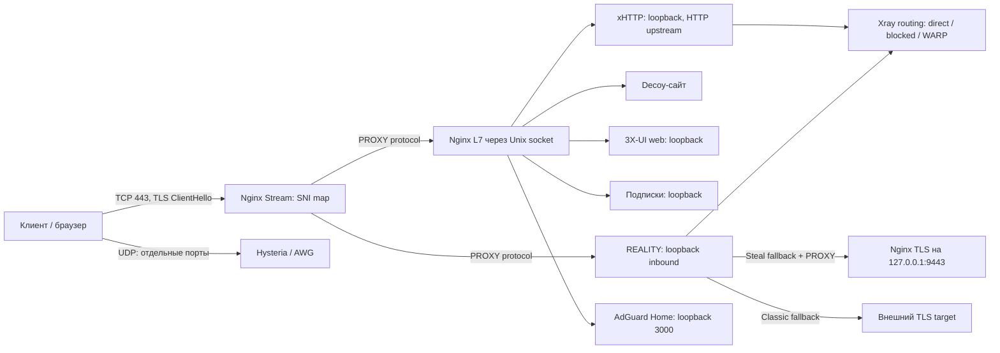

# Всесторонний технический аудит Nginx L4 Stream Router Mask for 3X-UI

**Дата:** 14 октября 2026 года, Europe/Moscow.  
**Аудируемая версия:** `v7.3.4`, локальная ветка `main`, commit `955ac281314e988423c4bccb72fe9be3dc079852`.  
**Объект:** форк `torrua/Nginx-L4-Stream-Router-Mask-for-3x-ui` и дополнительные локальные файлы управления AmneziaWG.  
**Назначение отчета:** оценка технических решений, безопасности, надежности, эффективности и готовности к сопровождению; реестр дефектов и план исправлений. Исходные установочные скрипты в ходе аудита не изменялись.

## 1. Основной вывод

В проекте есть полезная архитектурная основа: вход через Nginx Stream, разделение L4/L7, локальные слушатели панели и TCP-инбаундов, отдельный REALITY fallback, автоматизация сертификатов и настройка клиентских подписок. Для выделенного персонального VPS такой подход оправдан.

Однако **версию v7.3.4 нельзя считать надежным универсальным установщиком или безопасным средством обновления существующего сервера**. Главный риск — изменение рабочего состояния без строгого контракта сохранности данных, согласованного rollback и проверок фактической работоспособности. Обнаружены сценарии удаления клиентов, восстановления отключенного доступа, замены ключей, неконсистентного backup, неполной инициализации неинтерактивной установки и нарушения приватности DoH.

На сервере с Dokploy, Docker, другими сайтами или собственными правилами firewall текущая установка особенно опасна: скрипты предполагают владение значительной частью ОС и глобальной конфигурацией Nginx/UFW. Название локального каталога с Dokploy не означает наличия такого режима в коде.

Рекомендуемый следующий этап — **стабилизация установки, обновлений и сохранности клиентов**, затем модульность и расширение функций. Добавление новых протоколов до этого увеличит число непроверенных комбинаций.

## 2. Область, методика и ограничения

### 2.1. Что проверено

- Все основные Bash-скрипты, Python-контроллер AmneziaWG, встроенные Python-блоки управления SQLite.
- README, техническая архитектура, руководство для новичков, шаблоны конфигурации, CI, Git-атрибуты и MIT-лицензия.
- Локальная Git-история и различия относительно имеющегося `upstream/main`; без обновления удаленных refs.
- Сценарии первой установки, повторной установки, reconcile, dry-run, backup/rollback, обновления ядра и GeoData.
- Nginx L4/L7, REALITY, xHTTP, Hysteria 2, AWG, WARP, DNS/DoH, SSH/UFW, обработка ошибок, секреты и наблюдаемость.
- Инвентаризация `scratch/` и поиск признаков литеральных паролей в операционных Python-скриптах. Значения секретов не включены в отчет.
- Безопасные воспроизведения на синтетических SQLite-базах и временных файлах; внешние операции подменены mock-объектами.
- Сверка существенных предпосылок с официальной документацией и исходниками компонентов.

### 2.2. Что не выполнялось

Не запускались установка на VPS, команды SSH к реальным узлам, изменение серверной БД, регистрация WARP, отправка сообщений/backup в Telegram, изменение DNS, production-сканирование и нагрузочные испытания. Файлы `scratch/` не исполнялись. Рабочие учетные данные не проверялись.

Среда аудита — Windows, Python 3.13, Git Bash 5.2.37. Доступ к WSL и Docker daemon в текущей среде ограничен; поэтому **не подтверждены на живой Linux-системе** запуск systemd, `nginx -t` для итоговой конфигурации, реальный TLS/ACME renewal и соединения клиентских VPN-приложений. Это ограничение полноты проверки, а не доказательство неработоспособности каждого протокола.

Проверки синтаксиса не заменяют интеграционные тесты. Оценки скорости, DPI-устойчивости и емкости по числу клиентов ниже являются инженерными оценками решений, а не измеренными характеристиками данного развертывания.

### 2.3. Как читать выводы

**R — воспроизведено:** исходный код или его точный выделенный фрагмент выполнен на тестовых данных.  
**S — установлено статически:** причина непосредственно видна в коде; эксплуатационное проявление зависит от среды.  
**D — сверено с документацией:** код сопоставлен с контрактом внешнего компонента.  
**H — требует проверки:** гипотеза или зависимость от версии/сети, не объявленная подтвержденной уязвимостью.

Приоритеты: **P1** — исправить до следующего рекомендованного массового использования/обновления; **P2** — следующий цикл стабилизации; **P3** — последующее улучшение. **P0 не назначен:** аудит не установил безусловную удаленную компрометацию развернутого сервера. P1 для локальных путей/ключей учитывает привилегии root, под которыми работает инструмент, и явно указанные условия эксплуатации.

## 3. Состав проекта и состояние форка

### 3.1. Карта исходников

| Файл | Строк | Роль | Основная зона риска |
| --- | ---: | --- | --- |
| [install.sh](<C:/Users/User/Dropbox/Python/PRIZI/gemini-discussions/how-to-setup-awg-on-dokploy/install.sh>) | 823 | Верхнеуровневый Express/Expert installer | Глобальный hardening, повторная установка, подавление ошибок |
| [secure-vps.sh](<C:/Users/User/Dropbox/Python/PRIZI/gemini-discussions/how-to-setup-awg-on-dokploy/secure-vps.sh>) | 628 | Интерактивная подготовка ОС/SSH/UFW | SSH lockout, изменение политики ОС |
| [setup_mask.sh](<C:/Users/User/Dropbox/Python/PRIZI/gemini-discussions/how-to-setup-awg-on-dokploy/setup_mask.sh>) | 6019 | Мастер, Nginx, сертификаты, decoy, DNS | Большой монолит, неполная автоматическая ветка, destructive apply |
| [configure_3xui.sh](<C:/Users/User/Dropbox/Python/PRIZI/gemini-discussions/how-to-setup-awg-on-dokploy/configure_3xui.sh>) | 2233 | Reconcile SQLite, клиенты, WARP, core update | Миграции идентичностей, сохранность состояния, версии схем |
| [update_repair.sh](<C:/Users/User/Dropbox/Python/PRIZI/gemini-discussions/how-to-setup-awg-on-dokploy/update_repair.sh>) | 1088 | Второй reconcile engine и rollback | Расхождение с configurator, отсутствие аварийного cleanup |
| [manage_amneziawg.py](<C:/Users/User/Dropbox/Python/PRIZI/gemini-discussions/how-to-setup-awg-on-dokploy/manage_amneziawg.py>) | 615 | Контроллер AWG в Docker для awg_bot | Пути, конкуренция, блокировка, состояние host/container |
| [manage_amneziawg.sh](<C:/Users/User/Dropbox/Python/PRIZI/gemini-discussions/how-to-setup-awg-on-dokploy/manage_amneziawg.sh>) | 3 | Launcher Python-контроллера | Жесткий путь `/root/awg`, не включен в поставку |

Итого: **11 409 строк исполняемых исходников**. Значительная часть `setup_mask.sh` — HTML/CSS/JS двух decoy-сайтов; это увеличивает размер поставки и связность без соответствующего усложнения самой маршрутизации.

Дополнительно: README — пользовательский вход; `docs/ARCHITECTURE.md` — 896 строк; `docs/BEGINNER_GUIDE.md` — 245 строк; `setup_mask.env.example` — 164 строки; `.github/workflows/ci.yml` — 122 строки.

### 3.2. Отношение к upstream

Remote `upstream` указывает на `Itman75/Nginx-L4-Stream-Router-Mask-for-3x-ui`, `origin` — на форк torrua. В имеющихся локальных refs:

- `upstream/main`: `382038b`, 13 октября 2026 года;
- merge base с текущим HEAD: `f2aa6971d788081cab66b6a76ffdde63a3ffce47`;
- 115 коммитов в `upstream/main..HEAD`;
- diff `upstream/main...HEAD`: 12 файлов, 10 672 добавления и 1903 удаления.

Это показатели локального состояния Git, а не утверждение о последнем состоянии GitHub. `secure-vps.sh` в трехточечном diff не изменен: часть проблем унаследована, остальные связаны с расширениями форка. За поддержку поставляемого поведения отвечает форк независимо от происхождения дефекта.

`manage_amneziawg.py`, `manage_amneziawg.sh` и `__pycache__/` были **untracked до аудита**. Поэтому Docker-контроллер существует в рабочем каталоге, но не входит в воспроизводимую Git-поставку. `scratch/` и `remote_setup_mask.env` игнорируются. Следует отдельно оформить поддержку Docker AWG, не смешивая ее с AWG-инбаундами, настраиваемыми в 3X-UI.

MIT-лицензия и copyright upstream сохранены. Это положительно для происхождения форка. Дополнительно нужны перечень сторонних компонентов, политика поддерживаемых версий и описание отличий от upstream; этот аудит не является отдельной юридической экспертизой сторонних лицензий.

## 4. Фактическая архитектура и границы доверия



Управляющий контур: root-скрипты → системные файлы → SQLite → CLI 3X-UI → сервисы. Отдельный локальный Docker-контроллер управляет `awg0`, `awg0.conf`, `clientsTable` и экспортами клиентов.

**SNI — механизм маршрутизации, а не проверка клиентского ключа.** Nginx Stream читает ClientHello; авторизацию выполняет REALITY/VLESS/другой backend. Для обычного браузера основной домен попадает в L7. При включенном Classic неизвестный непустой SNI может попадать в Classic backend через default map; поэтому общий тезис «все сканеры всегда получают только decoy» не описывает все ветки.

Есть минимум четыре доверительные границы:

1. **Публичная сеть → ingress.** Здесь нужны TLS, ограничения запросов, проверка реальных VPN-сессий и политика публичных UDP-портов.
2. **VPN-клиент → egress/local services.** Здесь важны запрет приватных сетей, metadata endpoints, DNS rebinding и доступ к собственному публичному IP VPS.
3. **root provisioning → ОС/3X-UI.** Здесь нужны безопасные загрузки, валидация ввода, миграции, backup, rollback и ограничение побочных эффектов.
4. **Оператор/бот → Docker AWG.** Здесь нужны allowlist контейнера, безопасные аргументы процессов, контроль имен клиентов и согласованный lifecycle.

## 5. Оценка используемых решений и эффективности

Оценки ниже — экспертные по качеству реализации: **1/5** означает высокий эксплуатационный риск, **3/5** — работоспособная идея с существенными пробелами, **5/5** — подтвержденная зрелая реализация. Они не являются бенчмарками.

| Решение | Соответствие задаче | Реализация | Эффективность / ограничения | Решение на развитие |
| --- | --- | ---: | --- | --- |
| Nginx Stream + SNI | Высокое для совмещения HTTPS/REALITY | 3/5 | Сохраняет TLS до backend; добавляет proxy-hop и общий failure domain | Сохранить, проверять модули/версии и все SNI-ветки |
| Steal-Oneself с loopback 9443 | Высокое | 3/5 | Разрывает логический возврат на публичный 443; зависит от согласования SNI и PROXY | Сохранить, покрыть fallback реальным handshake-тестом |
| Classic REALITY | Высокое как альтернативный профиль | 3/5 | Зависит от доступности/свойств внешнего target и клиента | Проверять TLS/ALPN target, поддерживать несколько валидированных профилей |
| xHTTP Stream-One через Nginx | Потенциально высокое | 2/5 | Установлен HTTP/1.1 upstream при заявленном H2C; stream-one требует проверки duplex | Выбрать и испытать согласованный транспортный профиль |
| Прямой reconcile SQLite | Умеренное для offline migration | 1/5 | Быстро, но связан с внутренней схемой и нарушает сохранность клиентов | API/CLI для поддерживаемых операций; versioned adapter для offline migration |
| Bash wizard + фоновые шаги | Высокое для bootstrap | 2/5 | Удобный ввод; ошибки и порядок инициализации сложны; фон меняет ОС до Review | Оставить Bash как оболочку, разделить plan/apply |
| Certbot HTTP-01 | Высокое | 2/5 | Нормальный выбор для DNS-only доменов; fallback маскирует отказ CA | Доверенный TLS как обязательный критерий успешного deploy |
| acme.sh DNS-01 | Высокое для wildcard/DNS API | 2/5 | Требует защиты CF token и private key; renewal hook нарушает права | Изолировать секреты, исправить hook, тестировать renewal |
| UFW + Fail2ban + SSH | Высокое на выделенном VPS | 2/5 | Есть защита активного SSH в Express, но политики переписываются | Не сбрасывать глобальный firewall; transactional SSH change |
| WARP selective egress | Умеренно высокое как optional feature | 2/5 | Добавляет зависимость/API/UDP-hop; доступность AI/капчи не гарантируются | Использовать проверяемый provider contract, readiness/fallback и routing tests |
| AdGuard Home + DoH/Split-DNS | Высокое при необходимости DNS-фильтрации | 2/5 | Дополнительная память/сервис; ACL неверно размещен, resolver state изменяется глобально | Optional module с закрытым доступом и миграцией существующего конфига |
| Hysteria 2 и AWG | Полезные альтернативы TCP | 2/5 | UDP блокируется независимо от TCP; параметры/версии/клиенты не испытаны матрицей | Не включать все профили без capability checks |
| Docker AWG controller | Подходит как самостоятельный backend | 1/5 | Ошибки lifecycle, путей, persistence и конкуренции | Оформить отдельный пакет и transactional peer management |
| Checkpoint + doctor | Полезное направление | 2/5 | Проверяет наличие части файлов/портов; не дает надежного exit status | State fingerprints, JSON health, protocol probes |
| CI | Необходим | 2/5 | Проверяет синтаксис/CLI; контейнерный job не проверяет deploy | Данные/конфиги в unit tests, systemd VM в integration tests |

### 5.1. Производительность

BBR/fq может быть полезен на TCP-каналах с конкретными RTT/потерями. Установка sysctl сама по себе не доказывает ускорение; ошибки `sysctl --system` в коде подавляются. TCP BBR не является автоматической настройкой congestion control для Hysteria/QUIC или AWG.

MTU 1280 — консервативный профиль, который иногда помогает на проблемном пути, но уменьшает payload/packet и может повышать packets-per-second и нагрузку CPU. Он не гарантирует отсутствие потерь. Два пользовательских proxy-hop не всегда означают вложение двух IP-туннелей на одном физическом кадре: VLESS/REALITY может завершаться на VPS до исходящего WireGuard. Размеры следует оценивать отдельно на ingress и egress.

`http2_recv_buffer_size 16m` выделяет крупный входной буфер **на worker**, а не автоматически 16 MiB на каждый клиент. При двух workers это примерно 32 MiB только для данного вида буфера; дополнительно существуют TLS, upstream, cache zones, ядро Xray/AWG, DNS cache и conntrack. Официальная документация описывает эту область буферизации; преимущество именно значения 16m проект не измеряет. [Nginx HTTP/2](https://nginx.org/en/docs/http/ngx_http_v2_module.html#http2_recv_buffer_size).

`worker_connections 65535` и `LimitNOFILE=524288` — верхние ограничения, не подтвержденная емкость. Proxy-сессия использует несколько соединений/дескрипторов. Подсеть /22 предоставляет 1022 адреса хостов математически, но после резервов адресов и с учетом CPU/канала реальная емкость иная. Локальный AWG allocator вообще выбирает адреса по жесткому алгоритму 10.8.x.x.

MSS clamping в цепочке `FORWARD` может быть полезен для маршрутизируемого VPN/Docker-трафика. Он не является универсальным исправлением для всех локально завершаемых Xray-соединений. Проверка наличия правила без counters не доказывает, что правило участвует в нужном пути. Глобальные sysctl должны следовать профилю хоста, а не универсальному набору «ускорителей». [Linux IP sysctl](https://docs.kernel.org/networking/ip-sysctl.html).

### 5.2. Маскировка и эксплуатационная безопасность

Decoy-сайт и обычный TLS уменьшают очевидность при некоторых проверках, но не обеспечивают гарантированную устойчивость к DPI/active probing. Упрощенная формулировка README «почему этот VPN не блокируют» не подтверждена тестами операторов/сетей. Uniform decoy, постоянный набор заголовков и `X-DataSphere-Engine: v4.0.2` могут сами стать узнаваемыми признаками.

Unix socket в `/dev/shm` — удобный локальный transport, но не полноценная «отказоустойчивость через RAM». Он разделяет общий writable namespace, не заменяет supervision/health checks и не дает автоматического failover. Более естественное место — управляемый каталог `/run/<service>` с заданными владельцем/режимом.

Отключение IPv6 на VPS уменьшает поверхность сервера, но **не доказывает отсутствие IPv6/DNS leak на клиенте**. Для этого нужны клиентские AllowedIPs/TUN routes, DNS-policy, проверка reconnect и split-tunnel. Отключение IPv6 через GRUB влияет на весь хост и требует осознанного профиля.

Base64 подписки — представление данных, не шифрование. Конфиденциальность подписки обеспечивают HTTPS, непредсказуемый bearer identifier и его lifecycle. `SUB_ENCRYPT=true` следует объяснять с учетом реальной семантики панели, а не как криптографическую защиту Base64.

## 6. Реестр находок

### A01 — P1: неинтерактивная ветка обходит полную инициализацию

**Доказательства:** `setup_mask.sh:2126–2167`, `2453–2600`, `5337–5339`, `5476`; `install.sh:621–632`. **Уверенность: R.**

Для `-y/--auto` устанавливается `SKIP_INTERVIEW=1`. Эта ветка вызывает только `reconstruct_arrays_from_vars`, а полная функция `run_non_interactive_setup` находится внутри альтернативной ветки. На чистом окружении отсутствуют `HY2_PORT_HOPPING`, `AUTO_SETUP_3XUI`, `CF_AUTH_METHOD`; AWG/AGH/WARP получаются отключенными вместо обещанного Express-профиля. Точный условный фрагмент Port Hopping завершается `HY2_PORT_HOPPING: unbound variable` при включенном Hy2.

Второе воспроизведение: для `HY2_DOMAIN=hy.audit.example` и `AGH_MODE=2`, `AGH_DOMAIN=dns.audit.example` массив SSL-доменов содержит только основной и cdn-домен. Эти домены добавляются другой функцией, не вызванной в данной ветке.

**Последствие:** автоматическая установка может остановиться после изменения ОС или собрать конфигурацию без нужных сертификатов/компонентов. Запуск с полным ранее сохраненным `.env` способен скрыть часть дефектов.

**Исправление:** единая unconditional стадия normalize/defaults/validate перед выбором wizard/resume/auto; полный список SSL-доменов и проверка всех зависимостей профиля. **Приемка:** clean env + `--auto`, минимальный config + `-y`, повторный запуск и отдельные HY2/AGH-домены проходят без undefined variables и с правильным набором SAN/cert paths.

### A02 — P1: консолидация удаляет клиентов и смешивает идентичности

**Доказательства:** `configure_3xui.sh:1390–1484`, `1533–1565`. **Уверенность: R.**

Клиенты признаются устаревшими по суффиксу имени `-classic`, `-steal`, `-hy2`, `-awg-v2` и нескольким префиксам. Из `clients`, `client_inbounds`, `client_traffics` удаляются записи. При поиске единых реквизитов UUID/subId/password/ключи собираются из любых клиентов, не из доказанно одной идентичности.

В синтетической базе существующий `alice-classic` удален, а новый `Client` получил его UUID/subId. В multi-user базе сбор разных реквизитов может создать гибрид учетных данных разных людей. Имя не является надежным признаком владения объектом установщиком.

**Последствие:** потеря записей/учета, инвалидирование доступа и расширение доступа через переиспользование персональной подписки. Это прямо противоречит обещанию «100% сохранность».

**Исправление:** убрать автоматическое объединение из reconcile. Ввести отдельную versioned migration с preview, явными source IDs, проверкой уникальности и переносом лимитов/статистики; отмечать installer-managed объекты собственным metadata. **Приемка:** произвольные имена клиентов, включая эти суффиксы, остаются неизменными; ни один UUID/subId/ключ не переносится между клиентами без явной миграции.

### A03 — P1: отключенный доступ повторно включается

**Доказательства:** `configure_3xui.sh:695–702`, `734–758`, `1547–1551`, `1757–1762`; `update_repair.sh:886–889`. **Уверенность: R/S.**

Reconcile записывает `enable=1` в существующие клиентские таблицы и инбаунды. При замене unified client значение `enable` не входит в сохраняемые поля. В тестовой базе отключенные inbound, client и client_traffics после configurator стали включенными; JSON unified client также получил `enable=true`.

**Последствие:** пользователь, которому отключили доступ, снова может подключиться; reconcile нельзя безопасно запускать как периодический repair.

**Исправление:** сохранять административный статус, quota/expiry и policy; создание нового объекта и ремонт структуры не должны активировать существующий. **Приемка:** blocked/disabled/expired fixtures не меняют доступность; операция enable существует отдельно и явно указана в плане.

### A04 — P1: configurator не сохраняет ключи VLESSENC xHTTP

**Доказательства:** `configure_3xui.sh:1521–1522`, `1631–1637`, `1809–1814`; для сравнения `update_repair.sh:942–965`. **Уверенность: R.**

Configurator каждый раз вызывает `generate_vlessenc_keypair`, начинает с новых default settings и сохраняет только часть xHTTP stream. Старые `decryption`/`encryption` не переносятся. При невозможности генерации результатом становится `decryption=none`. В тесте существующий ключ заменен на `none`.

`update_repair.sh` уже содержит другой алгоритм сохранения прежних ключей. Это конкретное проявление drift двух реализаций.

**Последствие:** разрыв существующих подключений либо незаявленное изменение уровня защиты. **Исправление:** сохранять существующие ключи; rotation только отдельной операцией с планом перехода клиентов. **Приемка:** ключи и клиентские ссылки неизменны при повторном apply; отсутствие crypto capability приводит к понятному отказу или явно выбранному профилю.

### A05 — P1: fallback на системный Nginx несовместим с генерируемым конфигом

**Доказательства:** `setup_mask.sh:1876–1880`, `1918–1929`, `4545`, `4695`, `4924`, `5123`, `5277`. **Уверенность: S/D.**

Наличие запускающегося `nginx -v` считается достаточным. Не проверены минимальная версия, `stream`, `ssl_preread`, realip/http2 и загрузка модулей. После fallback из distro продолжает генерироваться `http2 on`, появившаяся в 1.25.1. На более старом пакете это ошибка конфигурации; наличие только `nginx -v` ее не выявляет. `ssl_reject_handshake` также требует подходящей версии.

CPU guard — полезное улучшение, но проверка только avx2/bmi2 не является исчерпывающей проверкой x86-64-v3; проверка glibc более содержательна, когда доступна. Проверять следует работающий бинарник и требуемые features, не обобщать ISA проблему на все версии пакетов.

**Исправление:** version/capability matrix; compile/load modules check; рендер под поддерживаемый профиль. **Приемка:** generated config проходит `nginx -t` на минимальной и текущей версиях, обеих поддерживаемых архитектурах и distro fallback. [Nginx HTTP/2](https://nginx.org/en/docs/http/ngx_http_v2_module.html#http2).

### A06 — P1: самоподписанный fallback становится постоянным «успехом»

**Доказательства:** `setup_mask.sh:1975–1979`, `3673–3680`, `3718–3725`, `1463–1489`. **Уверенность: S/D.**

При отказе CA создаются self-signed файлы в production-каталогах `/etc/letsencrypt/live/<domain>` или `/etc/ssl/acme/<domain>`. Следующий `obtain_cert` проверяет только наличие двух файлов и пропускает выпуск. Сертификат не становится Certbot-managed lineage только от появления этих файлов; дальнейший deploy может оставаться с недоверенным TLS.

Smoke test смотрит срок действия и делает `curl -k`: доверие CA, имя/SAN и renewal не проверяются. Самоподписанный годовой сертификат может выглядеть «действительным».

**Исправление:** emergency TLS только отдельным opt-in режимом, каталогом и degraded status; production deploy требует trusted chain/SAN; retry никогда не принимает self-signed за успешный ACME. **Приемка:** отказ CA → nonzero/degraded; восстановление DNS → настоящий сертификат; `certbot renew --dry-run` проходит с реальной схемой запуска. [Certbot renewal](https://eff-certbot.readthedocs.io/en/stable/using.html#renewing-certificates).

### A07 — P1: acme.sh renewal hook раскрывает private key локальным пользователям

**Доказательства:** `setup_mask.sh:2009–2017`, `3743–3748`. **Уверенность: S.**

В сохраненном `--reloadcmd` выполняется `chmod 644 /etc/ssl/acme/<domain>/*`. Первичная установка затем возвращает ключу 600, но при следующем renewal этот последующий код не исполняется. Каталоги имеют 755: ключ с 644 становится читаемым локальными учетными записями.

**Исправление:** hook назначает сертификату 644, ключу 600 или контролируемый 640 для конкретной service group; исключить blanket chmod. **Приемка:** после первичного выпуска и renewal `stat` подтверждает владельца/режим, непривилегированный пользователь не читает key. [acme.sh install-cert](https://github.com/acmesh-official/acme.sh#3-install-the-cert-to-apachenginx-etc).

### A08 — P1: ACL AdGuard Home расположен в неверной секции

**Доказательства:** `setup_mask.sh:5652–5715`, особенно `5691–5696`; ingress `4763–4777`, `5298–5313`. **Уверенность: S/D.**

Генерируется верхнеуровневый `access.allowed_clients`, тогда как контракт AdGuard Home размещает `allowed_clients` и `disallowed_clients` в DNS configuration. Nginx блокирует только точный `/dns-query`, но проксирует `/dns-query/<любое значение>`. Значение по умолчанию `home-router` не является случайным секретом.

**Последствие:** заявленная приватность DoH не обеспечена данным конфигом. Фактическая обработка неизвестных полей должна проверяться на фиксированной версии AGH; ни ignore неизвестных полей, ни возможный отказ старта не являются корректным результатом.

**Исправление:** ACL в `dns`, случайный ClientID, exact/mapped allowlist на ingress, проверка trusted proxy identity. **Приемка:** разрешенный ClientID работает, отсутствующий/неверный ID отклоняется, `X-Forwarded-For` не обходит запрет, локальный DNS Xray работает. [AGH Configuration](https://github.com/AdguardTeam/AdGuardHome/wiki/Configuration), [DNSConfig source](https://raw.githubusercontent.com/AdguardTeam/AdGuardHome/master/internal/configmgr/dns.go).

### A09 — P1: update_repair может оставить 3X-UI остановленной после ошибки

**Доказательства:** `update_repair.sh:16`, `292–299`, `303–1040`, `1047–1049`; нет EXIT trap. Для сравнения `configure_3xui.sh:460–475`. **Уверенность: S.**

После `systemctl stop x-ui` необработанная ошибка Python или shell прекращает скрипт под `set -e`. Возобновление службы находится только после большого блока reconcile. Аварийный trap, аналогичный configurator, отсутствует.

**Исправление:** сохранять исходное состояние сервисов и иметь гарантированный cleanup/rollback; если новая конфигурация невалидна — восстановить предыдущую, затем запускать. **Приемка:** искусственная SQLite exception, сигнал TERM и невалидный конфиг не оставляют ранее работавший стек в остановленном состоянии.

### A10 — P1: backup SQLite и rollback не обеспечивают согласованное восстановление

**Доказательства:** `configure_3xui.sh:400–407` до `469–474`; `update_repair.sh:222–236` до `292–299`; rollback `112–145`; `setup_mask.sh:1336–1357`. **Уверенность: R/S/D.**

Живая БД копируется обычным `cp` до остановки службы. В воспроизведении WAL committed row присутствует в основной БД через connection, но отсутствует в копии main file. Это зависит от текущего journal mode; для rollback journal также нужна корректная стратегия согласованного snapshot при конкурентной записи.

Rollback ищет backup по жесткому `/etc/x-ui`, даже при `--db` другого пути. DB и Nginx backups выбираются независимо по времени, без общего manifest. `cp` каталога Nginx поверх рабочего оставляет новые файлы, которых не было в backup. Backup setup_mask содержит `conf.d`/`stream.d`, но не переписываемый `nginx.conf`, sites, firewall, sysctl и DNS state, и имеет другой формат, не обрабатываемый этим rollback.

**Исправление:** SQLite backup API + integrity check либо проверенно остановленный writer; единый deployment ID, manifest всех измененных объектов, проверка restoration в staging и управление WAL sidecars. **Приемка:** WAL/обычная БД, custom path, частично прерванный deploy, restore на другой VPS и повторный restore воспроизводят заданный snapshot. [SQLite Backup API](https://www.sqlite.org/backup.html).

### A11 — P1: установка разрушает конфигурацию общего хоста

**Доказательства:** `install.sh:523–560`; `setup_mask.sh:3593`, `3600–3610`, `4528–4531`, `4540`; `5606–5614`. **Уверенность: S/D.**

Express сбрасывает UFW. Setup удаляет все сайты/conf.d/stream.d, переписывает `nginx.conf`, отключает Apache, рекурсивно меняет владельца общего `/var/www/html`. AGH меняет `/etc/resolv.conf`. Не обнаружены ограничения для режима shared host, контейнерного reverse proxy, владельца публичных 80/443 или провайдерских firewall policies.

Для Docker/Dokploy важно отдельно учитывать published ports: UFW не является достаточным свидетельством закрытости контейнерных портов. Официальная документация описывает это взаимодействие. [Docker firewalls](https://docs.docker.com/engine/network/packet-filtering-firewalls/).

**Исправление:** выделенный VPS как явный support contract; shared-host preflight отказывает до мутаций. Позже — coexistence profile с scoped конфигами/правилами и согласованием reverse proxy. **Приемка:** чужие сайты, UFW rules, resolver и Docker networking сохраняются либо обнаруживаются как конфликт до apply.

### A12 — P1: поставка не воспроизводима и зависит от mutable root-кода

**Доказательства:** `install.sh:72`, `573–581`, `595–604`, `787–794`; `setup_mask.sh:2001`, `5493–5503`; `secure-vps.sh:598–605`. **Уверенность: S.**

Загрузки идут из `main`/`master`, acme bootstrap и latest-release URLs. `setup_mask.sh` всегда пытается скачать configurator из main, даже если локальный файл соответствует аудируемому commit. В fallback используется `ghfast.top` как дополнительная доверительная сторона. Нет фиксации набора артефактов по одному release manifest и проверки их происхождения/целостности перед root execution.

HTTPS полезен, но не фиксирует семантику содержимого или совместимость между последовательно скачанными компонентами. Проверка `-f` не исключает пустой/неполный файл. Часть curl-вызовов не использует `-f`.

**Исправление:** версионированный offline-capable bundle, pinned tag/commit, manifest с hashes и проверяемой подписью/происхождением; зеркала только с проверкой того же артефакта. **Приемка:** повторный deploy одного release использует идентичные байты; обрыв/HTML/пустой файл/несовпадение hash никогда не исполняются.

### A13 — P1: обновление Xray проверяет только запуск версии

**Доказательства:** `configure_3xui.sh:2074–2146`. **Уверенность: S/D/H.**

Список releases `?per_page=1` не фильтрует prerelease/draft в собственном коде. ZIP не проверяется по checksum; бинарник считается валидным после `-version`, затем копируется `cp -f` поверх рабочего, без backup и atomic swap. Новый core не тестируется с итоговым конфигом. При ошибке загрузки остается прежний бинарник, но уже записанная конфигурация может требовать новых возможностей.

Panel-level protocols и возможности конкретного Xray build не следует отождествлять. Официальный список импортов просмотренного XTLS core не содержит отдельные amneziawg/hysteria inbound handlers; возможное преобразование/отдельный runtime в панели необходимо подтвердить для фиксированной пары версий, а не делать вывод только по `-version`. [Xray distro source](https://raw.githubusercontent.com/XTLS/Xray-core/main/main/distro/all/all.go).

**Исправление:** compatible panel/core manifest, capability tests, checksum, temporary validated binary, generated config test, atomic rename, rollback после readiness failure. **Приемка:** bad ZIP/architecture/hash/config не меняют рабочий бинарник; выбор несовместимой пары отвергается до изменения данных.

### A14 — P1: --dry-run может регистрировать WARP во внешнем API

**Доказательства:** `configure_3xui.sh:1094–1168`. **Уверенность: R.**

Проверка `dry_run` стоит вокруг SQLite write, но не вокруг POST регистрации и PUT лицензии. В тесте dry-run не изменил БД, но вызвал mock `urlopen` для регистрации. Рабочие обращения к Cloudflare в аудите не выполнялись.

**Исправление:** plan строится без внешних mutations; регистрация и лицензирование только в apply. **Приемка:** dry-run имеет ноль mutating filesystem/DB/network calls, а требуемые операции отображаются в плане.

### A15 — P1: AWG-контроллер не ограничивает путь имени клиента

**Доказательства:** `manage_amneziawg.py:393–395`, `476–487`, `530–535`. **Уверенность: R.**

Имя напрямую формирует путь относительно AWG_DIR. В тесте `../escaped` создал экспорт вне каталога `exports`. Remove использует тот же способ построения пути. Под root это может привести к перезаписи/удалению `.conf` и других файлов вне каталога. Эксплуатация требует управления именем через оператора или интеграцию бота; наличие неавторизованного удаленного доступа к этому параметру не установлено.

**Исправление:** ограниченное имя/slug, уникальный internal ID, reject path separators/absolute names/newlines, проверка resolved path containment и symlink policy до файловой операции. **Приемка:** traversal, absolute paths, Windows/POSIX separators и symlink escapes отклоняются без мутаций.

### A16 — P1: блокировка AWG не сохраняется

**Доказательства:** `manage_amneziawg.py:540–554`, `556–574`, `601–608`. **Уверенность: R/S.**

Block удаляет peer только из runtime `awg set`. Peer остается в `awg0.conf`, а таблица клиентов не получает disabled status. При восстановлении интерфейса из persisted config блокировка теряется. Тест подтвердил отсутствие изменения persistent registry. Отсутствующий клиент тоже получает `ok=true`.

`purge-expired`, `set-preset` и `preset` являются заглушками успеха. Если бот опирается на purge/expiry, код не выполняет этот lifecycle.

**Исправление:** persistent desired state с enable/expiry, apply/reconcile runtime из него; unsupported operations возвращают явную ошибку. **Приемка:** block переживает restart/recreate, unblock восстанавливает только разрешенный peer, expiry действительно прекращает доступ.

### A17 — P1: AWG mutations не транзакционны и повреждают state при bind mount

**Доказательства:** `manage_amneziawg.py:43–72`, `393–439`, `497–538`. **Уверенность: R/S.**

Есть два writer: сначала host path, потом `docker exec tee`. При bind mount одного и того же файла append выполняется дважды: в воспроизведении одна операция создала два `[Peer]` блока. Если файл не является общим mount, host copy может расходиться с container copy, а чтение предпочитает host path.

Параллельные add могут выбрать один IP и потерять изменения `clientsTable`: нет lock. Add существующего имени сначала удаляет клиента; последующая ошибка generation/Docker/filesystem оставляет старый доступ удаленным. Runtime peer изменяется раньше persistent state/exports. Remove обновляет таблицу до подтверждения удаления runtime; ошибки часто подавляются.

**Исправление:** один authoritative store, lock на весь lifecycle, atomic replacement, journal/rollback; повторный add возвращает существующий профиль либо делает явный rotate. **Приемка:** concurrent add, failure на каждом шаге и bind mount не дают duplicate peers, lost updates или частично удаленных клиентов.

### A18 — P2: WARP routing и отказоустойчивость не соответствуют заявленному поведению

**Доказательства:** `configure_3xui.sh:1169–1172`, `1225–1357`, особенно `1330–1336`. **Уверенность: R/S/D.**

RU-правило содержит `domain` и `ip` в одном объекте. Xray требует одновременного выполнения разных атрибутов, это не «RU-домен ИЛИ RU-IP». При `AsIs` нужного resolved IP может не быть. Второй тест показал, что существующее WARP-правило остается перед существующим YouTube exception и продолжает перехватывать `googlevideo.com`.

`--no-warp`/disabled config сообщает об отключении, но не удаляет ранее созданные маршруты/outbound. Отказ регистрации WARP не предотвращает создание маршрута на непроверенный туннель. Для существующей `warpData` не сохраняется весь полученный endpoint/address context. Недокументированный версионированный client API требует отдельного compatibility contract.

**Исправление:** раздельные domain/IP rules, стабильный приоритет exception/security/custom rules, ownership-specific cleanup; readiness probe и явная политика fail-open/fail-closed. **Приемка:** таблица домен/IP/ожидаемый outbound покрывает YouTube, AI, RU, неизвестные домены, WARP unavailable и повторный apply. [Xray routing](https://xtls.github.io/en/config/routing.html).

### A19 — P2: заявленная SSRF-изоляция шире реально доказанной

**Доказательства:** `configure_3xui.sh:970–975`, `1055–1070`; `update_repair.sh:634–642`; `docs/ARCHITECTURE.md:840–842`. **Уверенность: S/D/H.**

Наличие любого одного фрагмента `geoip:private`/`127.0.0.0/8`/`10.0.0.0/8` считается доказательством полной защиты, без проверки полноты сетей и приоритета правила. При domain destination и `AsIs` IP matcher не обязан увидеть адрес до соединения. Нет явной политики metadata `169.254.169.254`, loopback IPv6 `::1` независимо от GeoData, собственных публичных адресов хоста и DNS rebinding. Конкретный доступ зависит от Xray/DNS/GeoData и должен быть измерен.

Кроме того, Xray routing policy не является автоматически firewall policy для отдельного Docker AWG runtime. Защитные гарантии следует формулировать по каждому backend. Доступ к Docker socket через Unix domain socket также нельзя описывать как прямой результат TCP SSRF без дополнительного bridge.

**Исправление:** defense in depth: verified route rules + egress restrictions для фактического процесса/namespace, DNS destination checks и исключения для служебных API. **Приемка:** негативные тесты literal IP, domain→private IP, rebinding, host public IP, metadata и каждого VPN backend. [Xray routing semantics](https://xtls.github.io/en/config/routing.html).

### A20 — P2: конфигурационный контракт расходится между entrypoints

**Доказательства:** `setup_mask.sh:704–855`, `906–986`, `1316–1327`; `configure_3xui.sh:203–230`; `update_repair.sh:164–180`; `setup_mask.env.example`. **Уверенность: S.**

Три самостоятельных dotenv parser, отсутствие allowlist ключей и централизованного validator. Файл может менять служебные переменные вроде DRY_RUN/DB_PATH/CLI_* после разбора флагов. Общий `.env` не исполняется как shell — это положительное свойство, но последующие generated env-файлы иногда `source`-ятся и не всегда корректно экранируют значения.

`save_session_state` не сохраняет `UPDATE_XRAY_CORE`. Формат extra domains в шаблоне обещает пробелы, но один normalizer делит запятой и удаляет whitespace, склеивая несколько доменов. Нельзя явно очистить SUB_TITLE через CLI из-за проверки только nonempty. Повторное сохранение в `/etc` и checkpoint update локального файла расходятся. `--step` не валидируется диапазоном/типом; неизвестные CLI опции только предупреждают. CLI приоритет `--domain` в configurator не восстановлен после `.env`.

**Исправление:** одна типизированная config schema, allowlist, validation, consistent precedence, atomic serialization и version. **Приемка:** round-trip config, Unicode/quotes, empty overrides, invalid ports/domain/path, conflicting ports и unknown keys имеют однозначный результат.

### A21 — P2: множественные SNI/порты не согласованы между Nginx и 3X-UI

**Доказательства:** `setup_mask.sh:718–759`, `4704–4726`; `configure_3xui.sh:547–556`, `1773–1807`. **Уверенность: S.**

Wizard и Nginx способны описывать несколько доменов/SNI и портов, а configurator выбирает только первый `STEAL_DOMAINS` и `CLASSIC_SNI`, принимает scalar port. Один backend может получить несколько SNI по map, но serverNames содержит только один. Reconcile ищет inbound по `port = ? OR tag = ?` без проверки владения и протокола; пользовательский inbound на совпавшем порте может быть перезаписан. При совпадении tag с измененным портом UPDATE не синхронизирует сам port.

**Исправление:** структурированный список inbound profiles и ownership metadata; conflict detection вместо захвата; единый renderer Nginx/backend. **Приемка:** все объявленные SNI работают, конфликт чужого port/tag отклоняется, смена managed port синхронно меняет оба контура.

### A22 — P2: xHTTP transport и клиентская конфигурация требуют согласованного профиля

**Доказательства:** `setup_mask.sh:5048–5078`; `configure_3xui.sh:1810–1834`; `docs/ARCHITECTURE.md:108–114`. **Уверенность: S/D/H.**

Upstream явно `proxy_http_version 1.1`, но комментарии/документация обещают native H2C. Документация обещает `flow: none`, default client имеет `xtls-rprx-vision`. Реальный duplex stream-one через эту цепочку не проверен; утверждение «HTTP/1.1 полностью не поддерживается Xray» было бы слишком сильным — просмотренный server source принимает HTTP/1.1 и h2c. Требуется проверка режима, forwarding и клиента целиком.

Современный Nginx поддерживает `proxy_http_version 2` начиная с 1.29.4. Поэтому возврат 1.1 устраняет syntax issue старых пакетов, но не реализует обещанный H2 upstream. Выбор `grpc_pass`/H2 upstream/stream-up/packet-up зависит от утвержденной матрицы, не должен делаться автоматически без теста. [Nginx proxy version](https://nginx.org/en/docs/http/ngx_http_proxy_module.html#proxy_http_version), [XHTTP design](https://github.com/XTLS/Xray-core/discussions/4113).

**Приемка:** реальный client↔Nginx↔Xray тест upload/download одновременно, большой файл, долгое соединение, reconnect, режим encryption и минимальная поддерживаемая версия клиента.

### A23 — P2: обработка ошибок, checkpoint и diagnostics допускают ложный успех

**Доказательства:** `install.sh:8`, `578–587`, `647`; `setup_mask.sh:232–334`, `73–84`, `86–165`, `1497–1503`, `1670–1676`, `1705`, `5984–5985`. **Уверенность: R/S.**

Верхний installer не использует `errexit`, а несколько критических операций завершаются `|| true`. Reproduction wrapper показал: функция с `false`, затем успешной командой, вызываемая в OR-контексте spinner, возвращает успех и продолжает работу. `set -e` не является контрактом корректности функции в таком контексте.

Skip возвращает 0, после него step_finish записывает completed. Checkpoint валидирует в основном наличие файлов, а не согласованность/доверие сертификата, содержимое БД, listener/config hash. Resume flags и step override не образуют строгой state machine. Doctor всегда exit 0, smoke check не возвращает итоговую ошибку и в конце checkpoint сбрасывается независимо от обнаруженных warnings.

При TLS drop `curl -w` выводит `000`, затем fallback добавляет `DROP`; тест получил `000DROP`, не совпадающее с проверяемыми значениями `000`/`DROP`.

**Исправление:** explicit step return codes, succeeded/skipped/failed states, preconditions/postconditions, machine-readable doctor и ненулевой exit при critical/degraded. **Приемка:** fail любого обязательного шага не produces success/checkpoint; внешняя автоматика различает healthy/degraded/failed.

### A24 — P2: GeoData updater заменяет базы без достаточной проверки

**Доказательства:** `setup_mask.sh:5542–5558`; `docs/ARCHITECTURE.md:890–896`. **Уверенность: S.**

Загрузка двух файлов независима, ошибки подавляются. Непустой `.tmp` заменяет production-файл без checksum/parse/size threshold; неполная загрузка тоже может быть непустой. Пара заменяется пофайлово, x-ui перезапускается даже без успешной пары. Нет lock/rollback. Documentation сообщает другой источник Loyalsoldier, проверки сумм и условный restart, которых этот код не делает.

**Исправление:** pinned provider, private staging dir, обе checksum/format validations, совместимый pair manifest, atomic activation и restore при failure; restart только при изменении и readiness. **Приемка:** truncated/HTML/missing file и одновременный timer не повреждают рабочий state.

### A25 — P2: SSH/UFW hardening может ослабить существующую защиту или доступ

**Доказательства:** `secure-vps.sh:15`, `409–497`, `517–529`; `install.sh:365–405`, `510–560`; `setup_mask.sh:3643–3647`, `5385–5408`, `5848–5849`. **Уверенность: S.**

В secure-vps исходный SSH port считается 22, а не определяется из текущего соединения/эффективного sshd config. Drop-in `99-hardening.conf` не гарантирует приоритет над ранними cloud-init snippets; `sshd -t` проверяет синтаксис, а не эффективные значения или новую сессию. Installer при смене порта переписывает этот drop-in только Port/AddressFamily/PubkeyAuthentication, удаляя ранее записанные ограничения password login. Полноценного восстановления старого содержимого при ошибке нет.

Secure-vps открывает 10443/tcp, совпадающий с default panel port. Loopback помогает, но при standalone 3X-UI/admin listener на внешнем адресе это дополнительная поверхность. Setup вставляет raw ACCEPT в INPUT до UFW chains; правила могут обходить прежние ограничения источников. Большая часть финальных `UFW_ALLOW_LIST/UFW_DENY_LIST` только печатается; кастомные UDP-порты отдельно запущенного setup могут не открыться автоматически. Печатаемый Port Hopping range теряет двоеточие.

**Исправление:** effective SSH config check, сохранение auth policy, разрешение старого/нового порта до restart, rollback timer; scoped firewall policies и проверка внешней reachability. **Приемка:** cloud-init drop-ins, custom SSH port и existing ACL сохраняются; новая независимая SSH-сессия успешна до cleanup старого пути.

### A26 — P2: AdGuard Home overwrite и resolver change небезопасны при повторном apply

**Доказательства:** `setup_mask.sh:5605–5614`, `5650–5716`, `5718–5758`. **Уверенность: S.**

Существующий YAML полностью переписывается без migration/backup, даже при уже установленном/работающем AGH. `/etc/resolv.conf` указывает на путь systemd-resolved без проверки, установлен ли/работает ли этот сервис; это особенно важно для Debian и образов со своим resolver. Restart errors подавляются, после них возможен restart Xray с DNS 127.0.0.1, еще не готовым.

Версия YAML фиксирована `schema_version: 28`, бинарник скачивается floating latest. HTTP3/DoQ upstream list не имеет проверенного bootstrap/fallback contract для сети, блокирующей UDP. Query log и statistics включены, что расходится с общей идеей Zero-Log и требует отдельной privacy policy.

**Исправление:** versioned YAML migration, проверка схемы/конфига, readiness DNS/DoH до переключения Xray, backup resolver и restore при ошибке. **Приемка:** fresh Debian без systemd-resolved, existing custom AGH и blocked UDP scenarios проходят без потери системного DNS/настроек.

### A27 — P2: shell/secret/temp-file handling недостаточно изолирован

**Доказательства:** `configure_3xui.sh:34–43`, `1949`, `1977–2028`, `2034–2041`, `2168`; `setup_mask.sh:235`, `2035`, `5495–5503`, `5535`; `manage_amneziawg.py:19–41`, `50–72`, `120–122`; `install.sh:631–632`. **Уверенность: S.**

Fixed filenames в `/tmp` допускают collisions/stale reuse и локальные symlink-подмены при подходящей ОС/правах. Нет единого private temp dir или lock. Часть файлов с секретами сначала создается под обычной umask, только потом chmod. Пароли передаются через argv; debug/log могут содержать чувствительные данные. Generated env metadata `source`-ится; значения client/token name должны безопасно сериализоваться.

Есть `eval "$*"` и `shell=True` с интерполяцией контейнера/пути/MTU. Контейнер берется из environment либо слишком широкой автоматической выборки. Это не доказательство произвольной удаленной command injection, но ненужный root-shell интерпретатор на границе бота/конфига. Inline Python-код также формируется с shell-подстановками строк DB_PATH/NODE_TOKEN_NAME.

**Исправление:** `mktemp -d` + umask 077 + cleanup, argv arrays/`shell=False`, stdin/env вместо вставки в исходный код, allowlist containers/fields, data parser вместо source. **Приемка:** quotes/metacharacters/newline безопасны или rejected; секреты не попадают в логи/argv, concurrent runs не делят временные файлы.

### A28 — P2: Docker AWG параметры и health не соответствуют заявленной универсальности

**Доказательства:** `manage_amneziawg.py:75–116`, `165–290`, `292–315`, `357–391`, `465`, `573`, `601–610`; `setup_mask.env.example:76–86`. **Уверенность: R/S/H.**

Allocator игнорирует заданную сеть и жестко выдает 10.8.x.x; тест с Address 10.66.0.1/24 получил 10.8.1.3. Дефолтные header key/PSK могут генерироваться отдельно от server state; runtime add всегда ссылается на конкретный PSK file даже при другом fallback source. Это требует проверки соответствия ключей, а не только корректного формата экспорта.

`RandomTrailers=on` в Docker exporter расходится с `false` и предупреждением о скорости в основном шаблоне. Производительность 100–300 раз не измерена здесь. `PersistentKeepalive=25-35` и AWG 3.1-specific поля требуют фактической матрицы клиентских парсеров; совместимость обычного WireGuard нельзя предполагать.

Status/stats вызывают изменение MTU/iptables; status сообщает listening=true по наличию интерфейса без проверки UDP socket и handshake. Restart сообщает успех без контроля return code. Это не read-only health contract.

**Исправление:** explicit backend/version/profile, `ipaddress` allocator по реальной сети, единый server-derived crypto state, separate status/repair commands, проверка сокета/handshake. **Приемка:** несколько подсетей, disabled peers, контейнер offline, ключ отсутствует, профиль разных клиентов; status не мутирует состояние.

### A29 — P2: CI не проверяет основные риски и поддерживаемые ОС

**Доказательства:** `.github/workflows/ci.yml:5–19`, `24–122`; отсутствие release tests и отдельного Python package. **Уверенность: S.**

Job с названием Syntax & Lint не запускает ShellCheck. Matrix Dry-Run проверяет только help/version/gen-config и Bash syntax; preflight и deploy не выполняются. Нет Debian, service VM, schema fixtures, rerun/recovery/rollback tests, client lifecycle, TLS/DoH negative checks и protocol E2E. Path filters не включают Python/документацию, что существенно для локального AWG-компонента после добавления в Git.

Action checkout закреплен на mutable tag, а не SHA; нет явного минимального permissions policy. Это вторично относительно отсутствия функциональных тестов.

**Исправление:** tests из данного audit — исходная регрессионная база; обязательные Linux config/schema tests, затем disposable systemd VM matrix. **Приемка:** поломка статуса blocked, key preservation, config defaults, renew hooks или backup делает PR checks красными до merge.

### A30 — P2: наблюдаемость, документация и локальные операционные материалы расходятся с продуктом

**Доказательства:** `install.sh:466–474`, `setup_mask.sh:1779–1787`, `5074–5075`, `5705–5711`; README, docs; `.gitignore`; `scratch/`. **Уверенность: S; secrets — heuristic review.**

Journald глобально переводится в volatile, что лишает весь хост истории после reboot, включая Fail2ban/SSH/system diagnostics. При этом AGH querylog включен, в Nginx есть error log, сохраняются install log и credentials. Privacy и техническая диагностика должны иметь отдельные scoped policies.

Документация расходится с кодом в xHTTP flow/upstream, GeoData provider/checks, default Port Hopping, составе Express и гарантии сохранности клиентов. Заявления «1 Гбит/с», «не блокируют», «1022 клиентов», «2 секунды doctor», «100% сохранность» не обеспечены проверяемыми контрактами/бенчмарками. Наличие release VERSION не гарантирует совместимости скачанного main configurator.

В `scratch/` выявлены **41 место в 41 Python-файле** с признаком литерального `password=...`. Это не 41 уникальный секрет и не доказательство публикации на GitHub. Есть локальные DB dumps/backups, сертификатный архив и настройки. `.gitignore` снижает случайную Git-публикацию, но не защищает синхронизацию Dropbox/архивы/доступ к рабочему каталогу. Secret scan не был исчерпывающей проверкой всех логов, бинарных backup и всей истории Git.

**Исправление:** scoped redacted logs с retention, health JSON, support matrix и docs generation; secrets через защищенное хранилище/SSH agent; политика хранения чувствительных backup; перенос product-ready tools из scratch с очищенными fixtures. **Приемка:** docs совпадают с defaults/CLI tests; диагностика не публикует bearer IDs; локальные secret findings разобраны оператором без вывода значений.

## 7. Что уже сделано хорошо

1. В стандартной конфигурации TCP-inbounds, web panel и subscription service преимущественно привязаны к loopback; публичная поверхность меньше, чем при прямой публикации всех портов.
2. REALITY Steal имеет отдельный loopback TLS endpoint 9443, что логически устраняет повторный вход через публичный SNI router.
3. PROXY protocol согласован в основных шаблонах ingress и backend; учитывается исходный адрес клиента.
4. В dotenv loader нет прямого `source` общего пользовательского файла; SQLite values в основном передаются parameterized SQL.
5. Для administrator password используется bcrypt/native CLI; для большей части generated keys — `secrets`, а не предсказуемый PRNG.
6. Backup/checkpoint/doctor, backup rotation для части Nginx, fallback на distro Nginx и Certbot — правильные направления, хотя реализация еще требует исправлений.
7. У Express есть определение активного SSH-порта и разрешение обоих портов в UFW при его смене.
8. Разделение beginner/architecture docs и CI syntax checks улучшают доступность проекта; сохранена лицензия upstream.

Эти достоинства объясняют, почему проект перспективен. Они не отменяют дефектов data lifecycle и установки.

## 8. Результаты проверок и воспроизводимость

Проверки сохранены в [audit_checks.py](<C:/Users/User/Dropbox/Python/PRIZI/gemini-discussions/how-to-setup-awg-on-dokploy/audit/2026-10-14/audit_checks.py>), результаты и SHA-256 исходников — в [checks.json](<C:/Users/User/Dropbox/Python/PRIZI/gemini-discussions/how-to-setup-awg-on-dokploy/audit/2026-10-14/checks.json>).

| Группа | Результат | Что именно доказано |
| --- | --- | --- |
| Bash syntax: 6 scripts | PASS | `bash -n`, без выполнения server setup |
| Python syntax: 1 controller + 2 main heredocs | PASS | AST parsing, не runtime compatibility |
| Help: setup/configure/repair | PASS | CLI early exit с исправленным Git Bash PATH |
| Version: setup/install | PASS | Возвращается v7.3.4 |
| Config generator | PASS | Создает временный шаблон |
| Legacy synthetic SQLite schema | PASS | Main configurator проходит на тестовой минимальной схеме |
| Noninteractive defaults и отдельные SSL-домены | Дефекты воспроизведены | Undefined variable и неполный domain set |
| Spinner error propagation | Дефект воспроизведен | Внутренняя ошибка функции может маскироваться |
| Существующие клиенты | Дефекты воспроизведены | Удаление по имени, copy identity, re-enable |
| xHTTP existing encryption | Дефект воспроизведен | Ключ не сохранен при недоступном keygen |
| SQLite WAL copy | Дефект воспроизведен | Потеря committed row при copy main file |
| Unknown clients schema | Дефект воспроизведен | `no such column: uuid` при частично совместимой таблице |
| Dry-run WARP | Дефект воспроизведен | Попытка внешней регистрации, сеть полностью mocked |
| Existing routing priority | Дефект воспроизведен | WARP раньше YouTube exception |
| Doctor TLS DROP | Дефект воспроизведен | `000DROP` вместо проверяемых значений |
| Docker AWG lifecycle | Дефекты воспроизведены | Traversal, fixed subnet, false success, непостоянный block, двойной append при shared file |
| Random pipeline в interactive Express | НЕ воспроизведено в этой среде | Проверка прошла; Linux SIGPIPE-риск не объявлен подтвержденным дефектом |
| Scratch secret signals | Требуется review | 41 redacted location, учетные данные не проверялись |

Итого **34 проверки: 16 PASS, 16 DEFECT_REPRODUCED, 1 NOT_REPRODUCED, 1 REVIEW_REQUIRED**. Количество воспроизведений не равно количеству независимых находок: одна находка может объединять несколько проверок. Реестр содержит 30 находок: 17 P1 и 13 P2.

Запуск на этой Windows-среде:

```powershell
python audit\2026-10-14\audit_checks.py
```

Harness использует точные строковые фрагменты аудируемой версии, поэтому номера диапазонов нужно обновлять после рефакторинга. Для постоянного CI следует перенести проверки на импортируемые функции/fixtures, зафиксировать expected behavior и делать assert сохранности, а не сохранять только наблюдаемое текущее поведение. Возврат 0 этого harness означает завершение сбора доказательств, не отсутствие дефектов.

## 9. Рекомендуемая целевая организация проекта

```text
bin/                       # CLI bootstrap/plan/apply/doctor/update
lib/                       # небольшие Bash helpers для bootstrap ОС
provisioner/               # Python orchestration: schema, plan, reconcile, state
  config.py
  plan.py
  state.py
  backups.py
  adapters/3xui/<version>/
  backends/xray.py
  backends/docker_awg.py
templates/nginx/            # renderer profiles под поддерживаемые версии
templates/adguard/
assets/decoy/               # сайты отдельно от installer
tests/fixtures/            # очищенные DB/config fixtures, без реальных секретов
tests/integration/         # ephemeral Linux VM, protocol/TLS/DNS lifecycle
releases/manifest.json     # зафиксированный набор компонентов и hashes
docs/support-matrix.md
docs/security-model.md
docs/upgrade-and-restore.md
```

Полная перепись на другой язык не требуется для первых исправлений. Bash подходит для bootstrap, package manager и интерактивного ввода. Python уже используется для основной бизнес-логики; извлечение heredocs в модули дает тестируемость без добавления нового runtime.

Основной контракт:

```text
inspect → normalize/validate → plan → snapshot → apply → validate → activate → verify
                                     ↘ rollback при любой обязательной ошибке ↙
```

Plan — структурированный список managed changes с preconditions. Apply использует lock, deployment ID и snapshot. Verify проверяет не только service active, но TLS trust, subscription generation, client identity, DNS, firewall и реальный протокол. Existing customer data меняется только explicit migration.

### 9.1. Приоритетные архитектурные решения

- Сохранить L4/L7 схему и anti-loop endpoint.
- Начать с одного надежного базового профиля: web/REALITY/subscriptions. Дополнительные UDP, WARP и DNS компоненты включать как независимые modules.
- Разделить single dedicated VPS и shared Docker/Dokploy; второй режим сначала отвергать с диагностикой конфликта, позже реализовать отдельно.
- Использовать поддерживаемые API/CLI панели там, где они решают задачу; прямую SQLite migration ограничить versioned offline adapter.
- Удалить автоматическую консолидацию клиентов и implicit key rotation из repair.
- Одним renderer/model формировать Nginx, backend settings и client links; не держать две конкурирующие реализации reconcile.
- Утвердить stable component matrix, минимальные/максимальные tested versions и update policy; не утверждать совместимость «24/25/26» без fixtures/E2E.
- Сделать read-only doctor пригодным для automation: JSON, exit status и проверка реальных протоколов.

## 10. Приоритетный план исправлений и развития

Оценки — ориентиры трудозатрат для одного инженера, знакомого с Linux/3X-UI, с доступом к disposable VPS. Они не являются обязательством по сроку. Этапы можно выполнять быстрее параллельно независимыми участниками после согласования контрактов.

| Этап | Ориентир | Изменения | Основные находки | Условие завершения |
| --- | --- | --- | --- | --- |
| 0. Ограничение риска | 1–2 дня | Уточнить supported scope; пометить опасный repair/консолидацию; создать безопасные snapshots для будущих изменений | A02, A03, A11, A30 | Пользователь видит ограничения, audit artifacts доступны, no implicit customer-data migration |
| 1. Исправления сохранности и bootstrap | 4–7 дней | Единая defaults/validation, preserve clients/keys/status, EXIT recovery, ACL/key hook, dry-run purity | A01–A09, A14 | Регрессии данных/конфига проходят; fresh auto profile работает в Linux |
| 2. Transactional update/restore | 5–8 дней | SQLite backup API, deployment manifest, lock/staging, rollback, pinned downloads/core/GeoData | A10, A12, A13, A17, A23, A24, A27 | Failure injection по каждому шагу и restore drill успешны |
| 3. Совместимость и сеть | 5–8 дней | Nginx matrix, xHTTP profile, WARP rule table, firewall/SSH/AGH readiness, multi SNI | A05, A18–A22, A25, A26 | Ubuntu/Debian matrix, real TLS/DNS/protocol tests; existing host policies сохранены |
| 4. Docker AWG продуктовый backend | 4–7 дней | Persistent peer lifecycle, allocator, export compatibility, read-only health, bot contract | A15–A17, A28 | Concurrent add/block/restart/expiry/client import проходят; компонент входит в versioned delivery |
| 5. Модульность и эксплуатация | 5–10 дней | Извлечь heredocs/templates/decoy, общий reconcile, health JSON/log policies, docs/release CI | A20, A23, A29, A30 | Один источник правды, release bundle, documented upgrade/restore, reproducible CI |

Совокупно это ориентировочно **5–9 инженерных недель** с проверками на VPS и резервом на совместимость. Без отдельного Docker backend и shared-host поддержки первый надежный single-VPS release достижим меньшим объемом. Приоритетность обязательных критериев важнее обещания календарной даты.

### 10.1. Release gates

1. Исправлены A01–A17 либо опасная возможность исключена из поддерживаемого релиза; каждое исключение явно отражено в CLI/docs.
2. Повторный apply не меняет UUID/subId/password/private keys/enable/quota/expiry и чужие объекты.
3. Dry-run не изменяет БД, файлы, services, firewall и внешний provider state.
4. Failure на любом обязательном шаге не сообщает success и имеет проверенный recovery path.
5. Trusted HTTPS/renewal и отрицательные DoH access tests проходят.
6. Поддерживаемые panel/core/Nginx/AGH versions фиксированы и tested.
7. Backup восстановлен на disposable VPS, включая клиентские данные и связанные конфиги.
8. Настоящие VPN-клиенты проходят E2E; service active/TCP-open недостаточны.
9. Конфликт shared host обнаруживается до мутаций.
10. Release artifacts воспроизводимы и проверяются до privileged execution.

### 10.2. Как измерять эффективность после стабилизации

Зафиксировать baseline на одинаковом VPS/клиенте/провайдере, затем сравнивать один параметр за раз. Минимальный план измерений:

| Метрика | Сценарии | Критерий |
| --- | --- | --- |
| Время до успешного deploy | Fresh, rerun, resume; каждого optional module | Нет failed success; p50/p95 измеряются по журналу stages |
| Сохранность данных | Multi-user DB, disabled/expired, custom paths | Ноль незаявленных identity/policy changes |
| Recovery | Bad cert/DNS, partial ZIP, SQLite exception, kill/reboot | Согласованный restore и работающий прежний профиль |
| Производительность | RTT 20/80/200 ms; loss 0/1/3%; upload/download | Throughput, CPU/Mbps, RSS, handshake p50/p95; без заранее заявленного «1 Гбит/с» |
| MTU/UDP | MTU 1280/1380/1420 на поддерживаемых профилях | No stall, измеренный overhead, PMTU behavior |
| xHTTP | Одновременный duplex, 1 GiB transfer, idle/reconnect | Проверенный режим без truncation/зависания |
| DNS/WARP | Provider unavailable, UDP denied, split rules | Предсказуемый fallback; route decision соответствует таблице |
| Маскировка | Собственная лаборатория, SNI/no-SNI/wrong-SNI, обычный браузер | Описанные наблюдаемые свойства, без обещания абсолютной неблокируемости |
| Нагрузка | 10/50/100/целевое число клиентов | Ресурсные пределы и SLO подтверждены, не выводятся из CIDR |

## 11. Источники и Community Wisdom

Выводы о данном проекте основаны на локальном исходном коде и fixtures. Официальные внешние источники использованы для подтверждения контрактов: Nginx SNI/preread и HTTP modules, Xray routing/xHTTP, SQLite backup, AdGuard Home configuration, Docker firewall behavior, Certbot и acme.sh renewal. Ссылки стоят рядом с соответствующими выводами. Внешние `main/master` источники также mutable; для постоянной release verification следует закреплять commit/версию компонентов.

Дополнительно просмотрены две статьи сообщества и их комментарии. Комментариев API не вернул ни к одной. **Это небольшая выборка, не консенсус сообщества.** Технические утверждения статей не использованы как единственное доказательство дефектов.

### 🌐 Community Wisdom: [Setting up a firewall with UFW](https://dev.to/serverkueche/setting-up-a-firewall-with-ufw-4lk5)

> **Source**: [serverkueche](https://dev.to/serverkueche)  
> **Tags**: `linux`, `security`, `networking`
>
> Материал подчеркивает порядок разрешения SSH до firewall activation и ограничения UFW при Docker. Для проекта это поддерживает раздельную проверку host/container networking. Утверждение о Docker сопоставлено с официальной документацией; совет статьи не делать backup firewall не принят для этого установщика, который меняет существующие политики.
>
> 🔗 [Read Full Discussion](https://dev.to/serverkueche/setting-up-a-firewall-with-ufw-4lk5)

### 🌐 Community Wisdom: [set -e Will Kill Your Script For No Good Reason](https://dev.to/schiff_heimlich/set-e-will-kill-your-script-for-no-good-reason-175h)

> **Source**: [schiff_heimlich](https://dev.to/schiff_heimlich)  
> **Tags**: `automation`, `cli`, `linux`, `programming`
>
> Полезен общий акцент на явной обработке return codes, но несколько примеров статьи чрезмерно обобщены: например, простой curl без fail-флага не гарантирует nonzero для HTTP 4xx/5xx. Вывод аудита об OR-контексте spinner подтвержден собственным воспроизведением, а рекомендация состоит в step contracts и тестах, а не в механическом удалении set -e.
>
> 🔗 [Read Full Discussion](https://dev.to/schiff_heimlich/set-e-will-kill-your-script-for-no-good-reason-175h)

## 12. Итоговая оценка готовности

**Идея и сетевое разделение — пригодны к развитию. Безопасность миграций и универсальность автоматизации — недостаточны для заявленного уровня.**

Проект лучше рассматривать как активно развиваемый набор provisioning-сценариев для выделенного VPS, которому необходим этап engineering stabilization. Перевод в зрелый инструмент достигается прежде всего сохранностью пользовательских данных, reproducible release, transactional apply/restore, negative tests и честной support matrix. Эти изменения дают больший эффект, чем очередное увеличение числа туннелей, буферов и decoy-возможностей.
