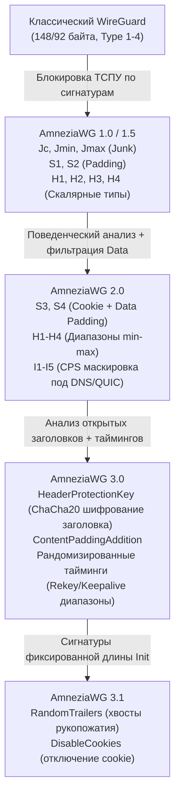

# Глобальный всесторонний технический отчет: исследование и оптимизация протокола AmneziaWG 3 (3.0 / 3.1) и 2.0 в условиях блокировок ТСПУ / РКН в России

> **Статус документа:** Финальный исследовательский отчет и план внедрения  
> **Дата актуализации:** Октябрь 2026  
> **Целевая среда:** Серверы на базе Linux (Ubuntu 22.04 / 24.04, Debian 12 / 13), контейнеры Docker/Dokploy, панель 3X-UI (Xray-core AWG-модули), нативные клиенты Amnezia VPN, роутеры Keenetic, OpenWrt, MikroTik.

---

## 1. Введение и ландшафт блокировок ТСПУ в РФ (2024–2026)

В период 2024–2026 гг. технические средства противодействия угрозам (ТСПУ) РКН перешли от простой сигнатурной фильтрации к многоуровневому поведенческому и статистическому анализу:
1. **Сигнатурный детекшен классического WireGuard:** 100% блокировка по фиксированным размерам первого хендшейка (ровно 148 байт для Initiation, 92 байта для Response, 64 байта для Cookie) и статическим байтам заголовков (`0x01000000`–`0x04000000`).
2. **Анализ энтропии UDP-потоков:** Фильтрация высокоэнтропийного псевдослучайного мусора на мобильных операторах («Большая четвёрка»). Случайные неструктурированные пакеты отбрасываются эвристическими фильтрами ТСПУ.
3. **Фильтрация по автономным системам (AS):** Изоляция зарубежных хостингов (Hetzner AS24940, DigitalOcean, OVH, Cloudflare) через троттлинг или отбрасывание невалидированного UDP-трафика.
4. **PMTU Blackhole на сотовых сетях:** Блокировка ICMP Type 3 Code 4 («Packet Too Big»), приводящая к зависанию туннелей при открытии тяжелых веб-страниц и видео.

---

## 2. Архитектурная эволюция поколений AmneziaWG



---

## 3. Исчерпывающий реестр параметров и физика в проводе

| Параметр | Версия | Тип / Диапазон | Класс стороны | Поведение в сети и физический смысл |
|---|---|---|---|---|
| **`H1`–`H4`** | 1.0 (скаляр), 2.0+ (диапазон) | `uint32` (напр. `149419586` или `100000-200000`) | **Двусторонний** (обязан совпадать) | Подменяют байты типов сообщений WireGuard (1=Init, 2=Resp, 3=Cookie, 4=Data). Диапазоны H1–H4 **не должны пересекаться**. При активном `HeaderProtectionKey` официально рекомендовано оставлять `1, 2, 3, 4`. |
| **`S1`–`S4`** | 1.0+ (`S1, S2`), 2.0+ (`S3, S4`) | Байты (`15–150`, реком. `16, 20, 24, 16`) | **Двусторонний** (`S1 + 56 != S2`) | Смещение (паддинг) сообщений. Приемник вычитывает заголовок строго со смещения `S`. Требование `S1 + 56 != S2` предотвращает одинаковый размер Init и Response. |
| **`Jc`** | 1.0+ | `1–128` (реком. `2–5`) | Односторонний (клиент) | Количество мусорных пакетов перед хендшейком. Размывает временную метку старта сессии. |
| **`Jmin` / `Jmax`** | 1.0+ | Байты (`Jmin: 20`, `Jmax: 50`) | Односторонний | Мин./макс. размер пакетов `Jc`. Должно быть `Jmax >= Jmin`. |
| **`I1`–`I5`** | 2.0+ | Теги `<r N>`, `<b 0xHEX>`, `<t>` | Односторонний | Concealment Packet Sync (CPS) — предварительные пакеты-имитаторы легитимных протоколов (DNS, QUIC). |
| **`HeaderProtectionKey`** | **3.0+** | Base64 (32 байта) | **Двусторонний** (строго синхронен) | Симметричное шифрование открытых полей заголовков ChaCha20. Nonce берется из первых 12 байт `S1–S4`. |
| **`RandomTrailers`** | **3.1+** | `on` / `off` (bool) | **Двусторонний** | Дописывает случайный хвост к хендшейкам. **Критический баг просадки скорости** (см. раздел 4). |
| **`DisableCookies`** | **3.1+** | `on` / `off` (bool) | Односторонний (сервер) | Отключает отправку Cookie-ответов сервером при высокой нагрузке, убирая тип H3 из эфира. |
| **`RekeyAfterTime`** | **3.0+** | Диапазон сек (`120-180`) | Односторонний | Рандомизированный интервал пересогласования ключей (устраняет тайминг-сигнатуру). |
| **`KeepaliveTimeout`** | **3.0+** | Диапазон сек (`15-20`) | Односторонний | Случайный интервал отправки служебных пакетов поддержания NAT. |
| **`MaxHandshakeAttempts`** | **3.0+** | Диапазон (`20-25`) | Односторонний | Число попыток хендшейка до сброса пира. |
| **`MTU`** | Все | Число (строго `1280`) | Обе стороны | Гарантирует прохождение пакетов через сотовые сети без фрагментации. |

---

## 4. Критические технические проблемы и найденные решения

### 🔴 Проблема 1: Баг `RandomTrailers` — падение скорости в 100–300 раз
* **Механика:** При активации `RandomTrailers = on` в сочетании с паддингом данных `S4` в коде `amneziawg-go` и модуля ядра пропускная способность канала обваливается с **12–45 МБ/с до 0.09–0.14 МБ/с** (Issue #186, Issue #208). Возникают коллизии IP-паддинга и отбрасывание транспортных пакетов.
* **Решение:**  
  > [!IMPORTANT]
  > Параметр `RandomTrailers` должен быть **принудительно выключен** (`RandomTrailers = false` / `off`) во всех генерируемых клиентских и серверных конфигурациях!

---

### ⚠️ Проблема 2: Падение ядра при `S1..S4 < 12` с активным `HeaderProtectionKey`
* **Механика:** В архитектуре AWG 3.0+ Nonce для ChaCha20 берется из первых 12 байт `S1–S4`. Если в конфигурации указать значения меньше 12, ядро Linux отвергает интерфейс с фатальной ошибкой `Invalid argument` (`dmesg: HeaderProtectionKey requires S1-S4 to be more than 12`).
* **Решение:**  
  При включенном `HeaderProtectionKey` гарантировать значения `S1–S4 >= 12`.  
  **Золотой стандарт проекта:** `S1 = 16`, `S2 = 20`, `S3 = 24`, `S4 = 16` (удовлетворяет условию `S1 + 56 != S2` и оставляет полезный пэддинг сверх 12 байт).

---

### 📡 Проблема 3: Блокировка чистого шума ТСПУ и маскировка через `I1` (DNS-мимикрия)
* **Механика:** Полевые испытания сентября 2026 на сетях МТС, Tele2 и Мегафон показали, что пакет инициализации `I1 = <r 128>` (128 байт случайного шума) блокируется эвристическим фильтром ТСПУ как аномальный UDP. В то же время пакет формата DNS-ответа той же длины проходит без помех.
* **Решение:** Использовать DNS-мимикрию с обязательным префиксом `<r 2>`:
  ```ini
  I1 = <r 2><b 0x858000010001000000000669636c6f756403636f6d0000010001c00c000100010000105a00044d583737>
  ```
  Префикс `<r 2>` генерирует случайный DNS Transaction ID, устраняя статическую сигнатуру пакета.

---

### 📱 Проблема 4: PMTU Blackhole и дроп на сотовых операторах
* **Механика:** В сетях LTE эффективный MTU часто опускается до 1350–1400. Блокировка ICMP Type 3 Code 4 приводит к зависанию TCP-соединений при передаче больших пакетов.
* **Решение:**
  1. Зафиксировать `MTU = 1280` на сервере и у всех клиентов;
  2. Активировать MSS Clamping на сервере:
     ```bash
     iptables -t mangle -A FORWARD -p tcp --tcp-flags SYN,RST SYN -j TCPMSS --clamp-mss-to-pmtu
     ```

---

### 🔌 Проблема 5: Несовместимость старых роутеров и клиентов с `HeaderProtectionKey`
* **Механика:** Клиенты на роутерах (Keenetic до v5.2, старый OpenWrt, RouterOS) и клиенты AWG 1.0/2.0 не поддерживают `HeaderProtectionKey`. Если включить HPK на единственном порту, роутеры перестают подключаться со 100% потерями.
* **Решение (Двухпортовая архитектура):**
  * **Порт 8443/UDP (AWG v3.1):** `HeaderProtectionKey`, рандомизированные тайминги — для ПК и смартфонов с актуальным Amnezia VPN;
  * **Порт 8444/UDP (AWG v2.0 Legacy):** без HPK, со скалярными `H1–H4` (`149419586`, `878791997`, `1251051976`, `1657628296`) — для роутеров Keenetic / OpenWrt.

---

## 5. Матрица совместимости клиентов и сетевого оборудования

| Клиент / Платформа | Версия | Поддержка AWG 2.0 | Поддержка AWG 3.1 | Особенности и требования к настройке |
|---|---|---|---|---|
| **Amnezia VPN (Desktop/Mobile)** | `>= 4.8.12` / `5.0+` | ✅ Полная | ✅ Полная | Основной флагманский клиент. Полная поддержка `vpn://` URI и HPK. |
| **AmneziaWG Android (APK с GitHub)** | `>= v3.1.20260814` | ✅ Полная | ✅ Полная | Легковесный клиент, поддерживает `HeaderProtectionKey` и тайминги. |
| **AmneziaWG в Google Play** | Срез `2.0.1` | ✅ Полная | ⚠️ Ограничена | Задерживается в обновлении; безопаснее использовать порт AWG v2.0. |
| **KeeneticOS (Встроенный)** | `KeeneticOS 4.x` | ✅ Полная | ❌ Нет | Работает только через порт AWG v2.0 со скалярными `H1–H4`. |
| **Keenetic (AWG Manager / Entware)**| `>= v2.17.4` | ✅ Полная | ✅ (c `awg_proxy` 1.4+) | Распознает бейдж `awg3`, умеет работать с `HeaderProtectionKey`. |
| **OpenWrt (`kmod-amneziawg`)** | Релизы `v3.1.20260906` | ✅ Полная | ✅ Полная | Требует обновленного пакета `kmod-amneziawg` под целевое ядро. |
| **MikroTik (RouterOS v7 Container)**| `Containers_3.1` | ✅ Полная | ✅ Полная | Запуск userspace-модуля внутри контейнера RouterOS. |
| **Cloudflare WARP (через AWG)** | Любая | ⚠️ Частично | ❌ Нет | Сервер Cloudflare не поддерживает AWG. Работает **только `Jc`** (`S1=0, S2=0, H1=1..4`). |

---

## 6. Использованные источники данных

Анализ базируется исключительно на верифицированных официальных источниках, исходных кодах актуальных релизов и профильных технических исследованиях:

### 1. Официальные ресурсы и кодовая база Amnezia VPN
* **Официальный портал:** [amnezia.org/docs](https://amnezia.org/docs) — спецификации протоколов AmneziaWG 2.0 и 3.1, архитектура `HeaderProtectionKey`, рекомендации по выравниванию `S1–S4` при `RandomTrailers`.
* **Ядро Linux:** [amnezia-vpn/amneziawg-linux-kernel-module](https://github.com/amnezia-vpn/amneziawg-linux-kernel-module) — теги `v1.0.20260725`, `v3.0.20260731-04`, `v3.1.20260812`, реализация `u16_range_t` и ChaCha20 Nonce (`src/type.h`, `src/device.h`). Баг-трекинг: Issue #186, #204, #208, #222.
* **Userspace-движок:** [amnezia-vpn/amneziawg-go](https://github.com/amnezia-vpn/amneziawg-go) — реализация UAPI и генерация диапазонов.
* **Клиентские релизы:** [amnezia-vpn/amnezia-client](https://github.com/amnezia-vpn/amnezia-client), [amneziawg-windows-client](https://github.com/amnezia-vpn/amneziawg-windows-client), [amneziawg-android](https://github.com/amnezia-vpn/amneziawg-android).

### 2. Популярные установщики и инструменты автоматизации (GitHub)
* **[wiresock/amneziawg-install](https://github.com/wiresock/amneziawg-install)** (автор Vadim Smirnov / WireSock) — нативный инсталлятор AWG 2.0 / 3.1 под Linux; исследование несовместимости `amneziawg-proxy` с `HeaderProtectionKey`.
* **[ImMALWARE/bash-warp-generator](https://github.com/ImMALWARE/bash-warp-generator)** — генератор конфигураций Cloudflare WARP с обфускацией `Jc` под AmneziaWG.
* **[bivlked/amneziawg-installer](https://github.com/bivlked/amneziawg-installer)** (версии v5.10–v5.31+) — тесты и документация по поведению на сотовых операторах РФ, пресеты `--preset=mobile`, скрипты обхода ТСПУ.

### 3. Проекты для сетевых маршрутизаторов
* **[hoaxisr/awg-manager](https://github.com/hoaxisr/awg-manager)** — веб-интерфейс и модуль `awg_proxy` v1.4.0+ для роутеров Keenetic (поддержка бейджа `awg3` и HPK).
* **[Slava-Shchipunov/awg-openwrt](https://github.com/Slava-Shchipunov/awg-openwrt)** и **[2Grey/awg-openwrt](https://github.com/2Grey/awg-openwrt)** — сборочные пакеты `kmod-amneziawg` под OpenWrt ветки 3.1 (релиз `v3.1.20260906`).
* **[timbrs/amneziawg-mikrotik-c](https://github.com/timbrs/amneziawg-mikrotik-c)** — контейнерный клиент AmneziaWG 3.1 для MikroTik RouterOS v7.

### 4. Исследовательские площадки и статьи
* **Форум [ntc.party](https://ntc.party)** — топики #12845 (обход AS-блокировок Hetzner), #45, #81 (особенности парсинга заголовков в KeeneticOS), анализ работы DPI ТСПУ по UDP.
* **Хабр:** статьи независимых исследователей (включая публикации аналитика 0ka о белых списках 72 AS и деградации трафика).
* **Форум [4PDA.to](https://4pda.to)** — опыт пользователей по настройке AWG на мобильных клиентах и роутерах в РФ.
* **RFC 8200 & WireGuard Whitepaper** — спецификации MTU 1280 и протокола Noise.

---

## 7. Конкретный план внедрения изменений в наш скрипт

На основе проведенного анализа сформирован список точечных правок для кодовой базы нашего проекта:

1. **Исправление `manage_amneziawg.py`:**
   * **Выключить `RandomTrailers`:** заменить строки `RandomTrailers = on` (строки 205 и 229) на `RandomTrailers = off` (или `false`), предотвращая катастрофическую просадку скорости у клиентов.
   * **Исправить интерполяцию DNS:** в строке 185 заменить литерал `DNS = $PRIMARY_DNS, $SECONDARY_DNS` на реальные значения переменных окружения `AWG_PRIMARY_DNS` (`9.9.9.9`) и `AWG_SECONDARY_DNS` (`76.76.2.0`).
   * **Оптимизировать дефолтные `S1–S4`:** в строках 120–123 заменить значения по умолчанию с `12` на безопасные `S1=16, S2=20, S3=24, S4=16`.
   * **Оптимизировать мусорные пакеты:** зафиксировать дефолтные `JC=2`, `JMIN=20`, `JMAX=50` для максимально быстрого согласования сессии без задержек.

2. **Сохранение и контроль в `configure_3xui.sh` и `src/xray/inbounds.py`:**
   * Проверить сохранение двухпортовой схемы: инбаунд 8443 (AWG v3.1 с HPK) и инбаунд 8444 (AWG v2.0 Legacy без HPK со скалярными H1–H4).
   * Сохранить активное правило авто-сброса `randomTrailers -> False` в функции `smart_reconcile_inbound`.

3. **Сетевой уровень (`setup_mask.sh`):**
   * Обеспечить безусловное добавление правила TCPMSS Clamping в `FORWARD` таблицу iptables для предотвращения PMTU Blackhole.
