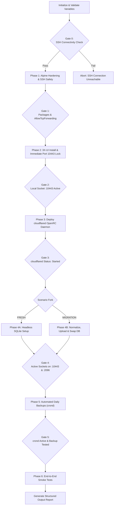

# AI Agent Runbook: Autonomous Deployment of 3X-UI Master Node on Alpine Linux NAT VPS

## 1. Document Purpose & Operational Directives

This runbook is an operational specification designed for autonomous AI coding and DevOps agents (such as Antigravity, Claude Code, Cursor, OpenCode, etc.) tasked with deploying or migrating a **3X-UI Master Node** on **Alpine Linux (NAT VPS)** published securely through **Cloudflare Tunnel**.

### Core Execution Invariants:
1. **Headless-First Principle:** The agent MUST NOT require a web browser or GUI interactions. All settings (`webPort`, `subPort`, `subURI`, worker node bindings) MUST be applied **directly to the SQLite database** (`/etc/x-ui/x-ui.db`).
2. **Deterministic Verification Gates:** The agent MUST NOT proceed to Step `N+1` until the verification command for Step `N` exits with code `0` and matches the expected output pattern.
3. **Safety & Rollback Invariants:** Before modifying or overwriting any existing configuration file or database, the agent MUST create a backup with a `.bak` suffix or timestamp.
4. **Non-Interactive Execution:** All shell commands must be strictly non-interactive (e.g., `-o BatchMode=yes`, `--no-cache`, `DEBIAN_FRONTEND=noninteractive`).

---

## 2. Input Variable Contract

Before executing any commands on the target server, the agent **MUST** verify that the following variables are defined. If any are missing, the agent must halt and request them from the user in a single structured prompt:

| Variable Name | Type | Description | Example Value |
| :--- | :--- | :--- | :--- |
| `SERVER_IP` | IPv4 | Public IP of the NAT VPS | `198.51.100.2` |
| `SSH_PORT` | Integer | External forwarded SSH port | `22022` |
| `SSH_KEY_PATH` | Path | Local path to administrator private key | `~/.ssh/id_ed25519` |
| `DOMAIN` | FQDN | Domain name configured in Cloudflare | `yourdomain.com` |
| `CF_TUNNEL_TOKEN` | String | Cloudflare Zero Trust tunnel connector token (Base64) | `eyJhIjoiMTllODI0...` |
| `EXEC_SCENARIO` | Enum | Deployment type: `FRESH` or `MIGRATION` | `FRESH` / `MIGRATION` |
| `BACKUP_DB_PATH` | Path | Path to source SQLite backup file (required if `MIGRATION`) | `./x-ui_backup.db` |

---

## 3. Finite State Machine (Execution Workflow)



---

## 4. Execution Phases & Verification Gates

### Phase 0: Pre-Flight Connectivity
**Execution Command (Local Machine):**
```bash
ssh -o BatchMode=yes -o StrictHostKeyChecking=accept-new -o ConnectTimeout=10 -i <SSH_KEY_PATH> -p <SSH_PORT> root@<SERVER_IP> "cat /etc/alpine-release"
```
* **Verification Gate 0:** Output contains Alpine release string (e.g. `3.20.x`). Return code is `0`.
* **Failure Remediation:** Abort execution immediately. Prompt user to check the port forward rule and SSH key permissions.

---

### Phase 1: Alpine Hardening & System Packages
**Execution Commands (Remote VPS):**
```bash
# 1. Create safety backup of sshd_config before editing
cp /etc/ssh/sshd_config /etc/ssh/sshd_config.bak

# 2. Ensure AllowTcpForwarding is enabled (required for emergency tunneling)
grep -q "^AllowTcpForwarding" /etc/ssh/sshd_config && \
    sed -i 's/^AllowTcpForwarding.*/AllowTcpForwarding yes/' /etc/ssh/sshd_config || \
    echo "AllowTcpForwarding yes" >> /etc/ssh/sshd_config

rc-service sshd reload

# 3. Install core system packages
apk update && apk add --no-cache curl wget sqlite bash tar openrc ca-certificates
```
* **Verification Gate 1:**
  ```bash
  which sqlite3 && sshd -T | grep -i "allowtcpforwarding yes"
  ```
  Expected: `/usr/bin/sqlite3` returned, and output includes `allowtcpforwarding yes`.

---

### Phase 2: 3X-UI Installation & Instant Port Standardization
> [!IMPORTANT]
> The upstream `install.sh` assigns a random port for `webPort`. On a NAT VPS, this random port is unreachable from outside. The agent MUST standardize `webPort` to `10443` and `webBasePath` to `/` immediately via SQLite before launching Cloudflare Tunnel to avoid a 502 Bad Gateway loop.

**Execution Commands (Remote VPS):**
```bash
# Backup existing database if re-installing
[ -f /etc/x-ui/x-ui.db ] && cp /etc/x-ui/x-ui.db /etc/x-ui/x-ui.db.bak_preinstall

# Install 3X-UI non-interactively
bash <(curl -Ls https://raw.githubusercontent.com/mhsanaei/3x-ui/master/install.sh)

# Immediately lock webPort to 10443 and webBasePath to / in SQLite
sqlite3 /etc/x-ui/x-ui.db "UPDATE settings SET value='10443' WHERE key='webPort'; UPDATE settings SET value='/' WHERE key='webBasePath';"

# Safe restart under OpenRC
killall -9 x-ui 2>/dev/null
rc-service x-ui zap && rc-service x-ui start
rc-update add x-ui default
```
* **Verification Gate 2:**
  ```bash
  netstat -tlpn | grep 10443
  ```
  Expected: Process `x-ui` actively listening on port `10443`.

---

### Phase 3: Cloudflare Tunnel Deployment (`cloudflared`)
**Execution Commands (Remote VPS):**
```bash
# 1. Download static binary
wget -q -O /usr/local/bin/cloudflared https://github.com/cloudflare/cloudflared/releases/latest/download/cloudflared-linux-amd64
chmod +x /usr/local/bin/cloudflared

# 2. Deploy custom OpenRC service daemon
cat << 'EOF' > /etc/init.d/cloudflared
#!/sbin/openrc-run

name="cloudflared"
description="Cloudflare Tunnel Daemon"
command="/usr/local/bin/cloudflared"
command_args="tunnel --no-autoupdate run --token <CF_TUNNEL_TOKEN>"
command_background=true
pidfile="/run/${RC_SVCNAME}.pid"

depend() {
    need net
    after firewall
}
EOF

chmod +x /etc/init.d/cloudflared
rc-update add cloudflared default
rc-service cloudflared restart
```
* **Verification Gate 3:**
  ```bash
  rc-service cloudflared status
  ```
  Expected: Output strictly contains `status: started`.

---

### Phase 4: Database Configuration

#### Scenario 4A: Fresh Setup (`EXEC_SCENARIO=FRESH`)
The agent applies complete subscription and panel configuration directly into SQLite without needing a browser:

```bash
sqlite3 /etc/x-ui/x-ui.db << 'EOF'
UPDATE settings SET value = 'true' WHERE key = 'subEnable';
UPDATE settings SET value = 'https://sub.<DOMAIN>/' WHERE key = 'subURI';
UPDATE settings SET value = '2096' WHERE key = 'subPort';
UPDATE settings SET value = '/' WHERE key = 'subPath';
UPDATE settings SET value = '10443' WHERE key = 'webPort';
UPDATE settings SET value = '/' WHERE key = 'webBasePath';
UPDATE settings SET value = '0.0.0.0' WHERE key = 'webListen';
UPDATE settings SET value = '127.0.0.1' WHERE key = 'subListen';
UPDATE settings SET value = '' WHERE key = 'webCertFile';
UPDATE settings SET value = '' WHERE key = 'webKeyFile';
EOF

killall -9 x-ui 2>/dev/null
rc-service x-ui zap && rc-service x-ui start
```

#### Scenario 4B: Migration from Backup (`EXEC_SCENARIO=MIGRATION`)
1. **On Agent Host Machine (Python Pre-Processing):**
   ```python
   import sqlite3
   import shutil

   shutil.copyfile("<BACKUP_DB_PATH>", "ready_to_upload.db")
   con = sqlite3.connect("ready_to_upload.db")
   cur = con.cursor()

   # Standardize network ports and paths
   cur.execute("UPDATE settings SET value = '10443' WHERE key = 'webPort'")
   cur.execute("UPDATE settings SET value = '/' WHERE key = 'webBasePath'")
   cur.execute("UPDATE settings SET value = '2096' WHERE key = 'subPort'")
   cur.execute("UPDATE settings SET value = '/' WHERE key = 'subPath'")
   cur.execute("UPDATE settings SET value = 'https://sub.<DOMAIN>/' WHERE key = 'subURI'")
   cur.execute("UPDATE settings SET value = '0.0.0.0' WHERE key = 'webListen'")
   cur.execute("UPDATE settings SET value = '127.0.0.1' WHERE key = 'subListen'")

   # Clear stale TLS certificates (Cloudflare handles SSL termination)
   cur.execute("UPDATE settings SET value = '' WHERE key = 'webCertFile'")
   cur.execute("UPDATE settings SET value = '' WHERE key = 'webKeyFile'")

   # Disable local inbounds if old master node was also an exit node
   cur.execute("UPDATE inbounds SET enable = 0 WHERE node_id IS NULL")
   con.commit()

   # Flush WAL transactions and convert to DELETE journal mode
   cur.execute("PRAGMA wal_checkpoint(TRUNCATE);")
   cur.execute("PRAGMA journal_mode=DELETE;")
   cur.execute("VACUUM;")
   con.commit()
   con.close()
   ```

2. **Upload and Atomic Swap on VPS:**
   ```bash
   # Upload to temporary path
   scp -P <SSH_PORT> -i <SSH_KEY_PATH> ready_to_upload.db root@<SERVER_IP>:/tmp/x-ui_restore.db

   # On Remote VPS: Create rollback point and swap cleanly
   killall -9 x-ui 2>/dev/null
   rc-service x-ui zap

   # Create rollback point
   [ -f /etc/x-ui/x-ui.db ] && cp /etc/x-ui/x-ui.db /etc/x-ui/x-ui.db.bak_$(date +%s)

   # Purge old DB files to prevent SQLite truncation corruption
   rm -f /etc/x-ui/x-ui.db /etc/x-ui/x-ui.db-wal /etc/x-ui/x-ui.db-shm
   cp /tmp/x-ui_restore.db /etc/x-ui/x-ui.db
   chmod 644 /etc/x-ui/x-ui.db

   # Integrity verification
   sqlite3 /etc/x-ui/x-ui.db 'PRAGMA integrity_check;'
   rc-service x-ui start
   ```

* **Verification Gate 4:**
  ```bash
  netstat -tlpn | grep -E "10443|2096"
  ```
  Expected: Both port `10443` (`webPort`) and port `2096` (`subPort`) are in `LISTEN` state.

---

### Phase 5: Automated Daily Backups Setup
**Execution Commands (Remote VPS):**
```bash
cat << 'EOF' > /etc/periodic/daily/x-ui-backup
#!/bin/sh
BACKUP_DIR="/var/backups/x-ui"
mkdir -p "$BACKUP_DIR"
sqlite3 /etc/x-ui/x-ui.db "VACUUM INTO '$BACKUP_DIR/x-ui_$(date +%Y%m%d).db';"
find "$BACKUP_DIR" -type f -name "x-ui_*.db" -mtime +7 -delete
EOF

chmod +x /etc/periodic/daily/x-ui-backup
rc-update add crond default
rc-service crond restart

# Test execution
/etc/periodic/daily/x-ui-backup
```
* **Verification Gate 5:**
  File `/var/backups/x-ui/x-ui_$(date +%Y%m%d).db` exists and has size > 0.

---

### Phase 6: End-to-End Smoke Testing
**Execution Commands (Local Machine / Agent Host):**
```bash
# 1. Check web panel via Cloudflare Tunnel
PANEL_STATUS=$(curl -s -o /dev/null -w "%{http_code}" "https://panel.<DOMAIN>/")

# 2. Check subscription endpoint
SUB_STATUS=$(curl -s -o /dev/null -w "%{http_code}" "https://sub.<DOMAIN>/")

echo "Panel HTTP Status: $PANEL_STATUS"
echo "Sub HTTP Status: $SUB_STATUS"
```
* **Verification Gate 6:**
  - `PANEL_STATUS` is `200` or `302`.
  - `SUB_STATUS` is `200` (or `404` if no sub_id path was provided, but NOT `502` or connection error).

---

## 5. Anti-Hallucination Troubleshooting Matrix

When an error occurs, the agent MUST consult this deterministic decision matrix rather than improvising unverified fixes:

| Error Symptom | Root Cause | Automated Recovery Procedure |
| :--- | :--- | :--- |
| `start-stop-daemon: 1 process refused to stop` | 3X-UI takes longer to close sockets than OpenRC timeout; OpenRC marks service as `crashed`. | Execute: `killall -9 x-ui 2>/dev/null; rc-service x-ui zap && rc-service x-ui start`. Do NOT reboot the OS. |
| `database disk image is malformed` | Overwriting SQLite file with `cp` without removing target leaves trailing garbage bytes. | Execute rollback: `rm -f /etc/x-ui/x-ui.db* && cp /etc/x-ui/x-ui.db.bak_* /etc/x-ui/x-ui.db`. Never run `cp` without preceding `rm -f /etc/x-ui/x-ui.db*`. |
| `502 Bad Gateway` on `panel.<DOMAIN>` | 3X-UI is not listening on `10443`, or `cloudflared` daemon has crashed. | 1. Check `netstat -tlpn \| grep 10443`.<br/>2. Check `rc-service cloudflared status`.<br/>3. Verify Cloudflare Public Hostname routes to `localhost:10443`. |
| SSH connection timeout / banner drop | Excessive concurrent connections or rate-limiting by NAT provider. | Use single long-running SSH commands or persistent connections (`ControlMaster`). Ensure `ConnectTimeout=10`. |
| `sqlite3: database table is locked` | Uncommitted write transaction during Python preparation. | Ensure `con.commit()` is called prior to `PRAGMA wal_checkpoint` or `VACUUM`. |
