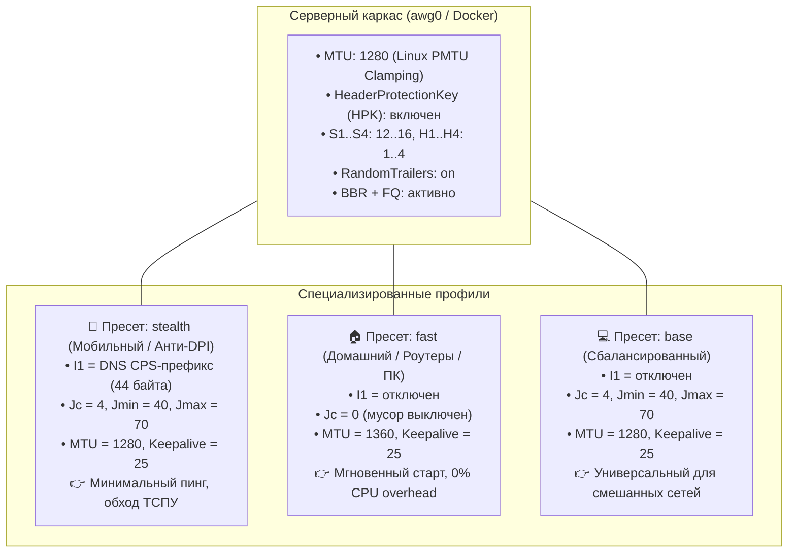

# Справочник эталонных конфигураций и лучших практик AmneziaWG 3.1

Данный документ представляет собой практическое руководство и свод результатов полевых испытаний, проведённых на инфраструктуре кластера. Он содержит проверенные параметры серверной и клиентской частей протокола AmneziaWG 3.1, результаты A/B-тестирования в сотовых сетях РФ, а также готовые спецификации пресетов для генерации профилей через [`manage_amneziawg.py`](../manage_amneziawg.py).

---

## 1. Архитектурный принцип: «Единый сервер — специализированные клиенты»

В архитектуре AmneziaWG 3.1 конфигурация разделена на два непересекающихся уровня:
1. **Симметричный серверный каркас (Wire Agreement):** фиксируется на сервере один раз и согласуется на уровне ядра со всеми клиентами. Сервер **не требует перезагрузки** и изменения сетевого интерфейса при подключении новых типов устройств.
2. **Асимметричные клиентские параметры (Client-Side Tuning):** настраиваются индивидуально под тип подключения клиента (сотовая сеть с DPI, домашний GPON/Ethernet или слабый процессор роутера).



---

## 2. Результаты полевого A/B-тестирования

Тестирование проводилось на сервере Дании (**DK**, `193.180.208.5:32626`) с использованием сотовой сети **МегаФон 4G / 4G+** и домашнего широкополосного Wi-Fi соединения.

### 2.1. Сводка замеров на сотовой сети МегаФон 4G

| Конфигурация / Пресет | Скорость Down | Скорость Up | Пинг (Latency) | Поведение и стабильность |
| :--- | :---: | :---: | :---: | :--- |
| **`test-dns` (`--preset=stealth`)**<br>*I1=dns, Jc=4, Jmin=40, Jmax=70, MTU=1280* | 21.4 – 38.6 Мбит/с | 12.0 – 16.8 Мбит/с | **107 – 109 мс** | **Идеально стабилен.** Разброс задержки всего 2 мс. Пинг ниже на 20–70 мс. Хэндшейк проходит с 1-й попытки. |
| **`1790409-DK_3` (Классический)**<br>*Без I1, Jc=6, Jmin=10, Jmax=50, MTU=1280* | 23.1 – **42.8** Мбит/с | 11.2 – 18.5 Мбит/с | **125 – 179 мс** | Скорость высокая, но пинг нестабилен (скачки до 179 мс). |
| **`test-base` (`--preset=base`)**<br>*Без I1, Jc=4, Jmin=40, Jmax=70, MTU=1280* | 18.5 – 34.2 Мбит/с | 10.5 – 15.1 Мбит/с | **127 – 130 мс** | Стабильный канал, но задержка выше на ~20 мс по сравнению с `test-dns`. |

### 2.2. Замеры на домашнем проводном канале (Wi-Fi)
* Скорость передачи данных (Downlink): **до 72.4 Мбит/с**.
* При профиле `fast` (`Jc=0`): установление сессии происходит **мгновенно (0 мс задержки на мусорные пакеты)**, веб-страницы открываются без характерной паузы первой секунды.

### 2.3. Почему CPS-префикс `I1=dns` побеждает на мобильных сетях
1. **Обман эвристики DPI:** ТСПУ мобильных операторов анализирует начальные пакеты UDP-потока. Префикс `I1=dns` отправляет фальшивый 44-байтный DNS-пакет, который DPI классифицирует как обычный DNS-запрос к доверенному серверу.
2. **Снижение количества мусора (`Jc=4` вместо `Jc=6`):** Слишком большое число мусорных пакетов увеличивает джиттер и задерживает полезный хэндшейк. Значение `Jc=4` с диапазоном `40–70` байт обеспечивает оптимальный баланс маскировки без задержки старта.

---

## 3. Спецификация серверного сетевого каркаса

Применяется ко всем интерфейсам `awg0` на узлах кластера:

```ini
[Interface]
# Сетевой адрес сервера внутри туннеля
Address = 10.8.1.1/22
# Порт прослушивания (например, 535 или кастомный 32626)
ListenPort = 535
PrivateKey = <ServerPrivateKey>

# Симметричные параметры сетевого соглашения
HeaderProtectionKey = <32-byte Base64 Key>
S1 = 12
S2 = 12
S3 = 12
S4 = 12
H1 = 1
H2 = 2
H3 = 3
H4 = 4
RandomTrailers = on
DisableCookies = off
MTU = 1280
```

### Обязательные правила ядра и фаервола (Хост):
```bash
# 1. Защита от фрагментации TCP-пакетов при отдаче данных (MTU Clamping)
iptables -t mangle -A FORWARD -p tcp --tcp-flags SYN,RST SYN -j TCPMSS --clamp-mss-to-pmtu

# 2. Включение BBR и планировщика FQ (/etc/sysctl.d/99-bbr.conf)
net.core.default_qdisc = fq
net.ipv4.tcp_congestion_control = bbr
```

---

## 4. Спецификация клиентских профилей

### 4.1. Пресет `stealth` (Смартфоны, сотовая связь, обход ТСПУ)
Рекомендуется для iOS / Android в сотовых сетях РФ:
```ini
[Interface]
PrivateKey = <ClientPrivateKey>
Address = 10.8.1.X/32
DNS = 1.1.1.1, 1.0.0.1
MTU = 1280

# Асимметричные параметры обхода
I1 = dns
Jc = 4
Jmin = 40
Jmax = 70

[Peer]
PublicKey = <ServerPublicKey>
PresharedKey = <PresharedKey>
HeaderProtectionKey = <ServerHPK>
S1 = 12
S2 = 12
S3 = 12
S4 = 12
H1 = 1
H2 = 2
H3 = 3
H4 = 4
Endpoint = <ServerIP>:<ServerPort>
AllowedIPs = 0.0.0.0/0, ::/0
PersistentKeepalive = 25
```

---

### 4.2. Пресет `fast` (Домашний интернет, ПК, роутеры Keenetic / OpenWrt, Smart TV)
Рекомендуется для устройств со стабильным оптоволоконным или кабельным интернетом:
```ini
[Interface]
PrivateKey = <ClientPrivateKey>
Address = 10.8.1.X/32
DNS = 1.1.1.1, 1.0.0.1
MTU = 1360

# Мусорные пакеты и имитатор отключены ради максимального быстродействия
Jc = 0
Jmin = 0
Jmax = 0

[Peer]
PublicKey = <ServerPublicKey>
PresharedKey = <PresharedKey>
HeaderProtectionKey = <ServerHPK>
S1 = 12
S2 = 12
S3 = 12
S4 = 12
H1 = 1
H2 = 2
H3 = 3
H4 = 4
Endpoint = <ServerIP>:<ServerPort>
AllowedIPs = 0.0.0.0/0, ::/0
PersistentKeepalive = 25
```

---

### 4.3. Пресет `base` (Сбалансированный универсальный)
Подходит для ноутбуков и рабочих станций, периодически переключающихся между офисным Wi-Fi и раздачей со смартфона:
```ini
[Interface]
PrivateKey = <ClientPrivateKey>
Address = 10.8.1.X/32
DNS = 1.1.1.1, 1.0.0.1
MTU = 1280

# Мусор включен, без префикса I1
Jc = 4
Jmin = 40
Jmax = 70

[Peer]
PublicKey = <ServerPublicKey>
PresharedKey = <PresharedKey>
HeaderProtectionKey = <ServerHPK>
S1 = 12
S2 = 12
S3 = 12
S4 = 12
H1 = 1
H2 = 2
H3 = 3
H4 = 4
Endpoint = <ServerIP>:<ServerPort>
AllowedIPs = 0.0.0.0/0, ::/0
PersistentKeepalive = 25
```

---

## 5. Справочные команды генератора `awg-cli`

Генерация и экспорт выполняются через CLI-утилиту [`manage_amneziawg.py`](../manage_amneziawg.py):

```bash
# 1. Генерация профиля для смартфона с выводом QR-кода прямо в терминал
awg-cli add user-phone --preset=stealth --dns=cloudflare --qr

# 2. Генерация профиля для домашнего роутера Keenetic / ПК
awg-cli add user-router --preset=fast --dns=quad9

# 3. Генерация универсального профиля со сроком действия 90 дней
awg-cli add user-laptop --preset=base --expires=90d

# 4. Просмотр списка активных пиров и статистики переданного трафика
awg-cli list

# 5. Проверка состояния интерфейса awg0 на сервере
awg-cli status
```

---

## 6. Текущая сводная таблица инфраструктуры кластера

| Узел / Локация | Порт SSH | Панель 3X-UI | Ядро Xray | Статус AmneziaWG | TCP Стек | Фаервол UFW |
| :--- | :---: | :---: | :---: | :---: | :---: | :---: |
| 🇵🇱 **PL Olsztyn** (Master) | **`1981`** | **v3.10.2** | **26.10.10** | Активна (хост, `25867/udp`) | `BBR + FQ` | Active |
| 🇺🇸 **NY New York** (Node 4) | **`1981`** | **v3.10.2** | **26.10.10** | **Активна (Docker AWG 3.1, `535` / `5443/udp`)** | `BBR + FQ` | Active |
| 🇮🇪 **IE Dublin** (Node 3) | **`1981`** | **v3.10.2** | **26.10.10** | Активна (хост, `51820/udp`, 20+ клиентов) | `BBR + FQ` | Active |
| 🇩🇰 **DK Copenhagen** (Node 5) | **`1981`** | **v3.10.2** | **26.10.10** | **Активна (Docker AWG 3.1, `32626/udp`)** | `BBR + FQ` | Active |
| 🇧🇬 **BG Sofia** (Node 2) | **`1981`** | **v3.10.2** | **26.10.10** | **Активна (Docker AWG 3.1, `535/udp`)** | `BBR + FQ` | Active |

Документ зафиксирован и доступен для обращения в любой момент при настройке и масштабировании инфраструктуры.
