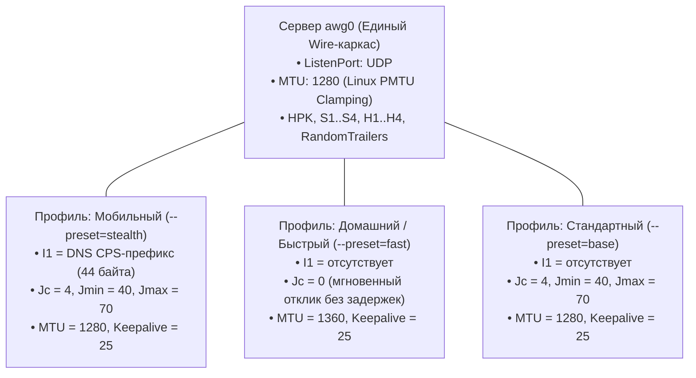

# Руководство по настройке клиентов AmneziaWG 3.1

В данном руководстве описаны архитектурные принципы разделения серверной и клиентской конфигураций AmneziaWG, генерация профилей с помощью утилиты `awg-cli` (контроллер [`manage_clients.py`](../src/awg/manage_clients.py)), а также развертывание и тонкая настройка туннелей на мобильных устройствах (iOS / Android), десктопных ОС (Windows / macOS / Linux) и сетевом оборудовании (Keenetic / OpenWrt).

---

## 1. Архитектурный принцип: Единый сервер — гибкие клиентские профили

В протоколе AmneziaWG параметры делятся на **симметричные (Wire Agreement)** и **асимметричные (Client-Only / Asymmetrical)**:



### 1.1. Симметричные параметры сетевого соглашения
Эти параметры настраиваются один раз в секции `[Interface]` сервера и **строго согласуются** со всеми клиентами на уровне ядра:
* **`HPK` (Header Protection Key)** — криптографический ключ обфускации заголовков пакетов.
* **`S1, S2, S3, S4`** — смещения заголовков (например, фиксированные значения `12` или `16`).
* **`H1, H2, H3, H4`** — сигнатуры типов пакетов (`1, 2, 3, 4`).
* **`RandomTrailers`** — рандомизация длины пакетов (`on`).
* **`DisableCookies`** — режим защиты от DoS (`off` или `on`).

### 1.2. Асимметричные клиентские параметры
Эти параметры настраиваются **индивидуально для каждого клиента** и не требуют изменения конфигурации серверного интерфейса:
* **`I1` (Имитатор протокола / CPS-префикс)** — отправляется исключительно клиентом перед инициализацией сессии. Сервер принимает префиксный пакет, отбрасывает его и ожидает стандартную инициализацию хэндшейка.
* **`Jc, Jmin, Jmax` (Мусорные пакеты)** — отправляются клиентом-инициатором. Разным клиентам можно назначать разное количество мусора или отключать его полностью.
* **`MTU`** — для сотовых сетей задается `1280` (или `1240`), для кабельного интернета — `1360`. На самом сервере интерфейс `awg0` фиксируется на `MTU = 1280` для предотвращения фрагментации при отдаче данных (Download) через правило `TCPMSS --clamp-mss-to-pmtu`.
* **`DNS`** — задается клиенту при генерации (`1.1.1.1`, `9.9.9.9`, AdGuard и др.). В серверном файле `awg0.conf` параметр `DNS` не используется.
* **`AllowedIPs`** — маршрутизация на стороне клиента (полный туннель `0.0.0.0/0, ::/0` или выборочные подсети).

---

## 2. Профили генерации на сервере (`awg-cli`)

Контроллер `awg-cli` поддерживает готовые пресеты и точечные флаги.

### 2.1. Базовые пресеты (`--preset=...`)

#### 1. Мобильный / Анти-DPI (`stealth`)
Рекомендуется для сотовых сетей со строгой фильтрацией трафика. Включает DNS CPS-префикс `I1`, 4 мусорных пакета, рандомизацию размера пакетов данных (`ContentPaddingAddition = 16-64`) и MTU 1280.
```bash
awg-cli add user-phone --preset=stealth --qr
```
*Эквивалентно:* `--i1=dns --jc=4 --jmin=40 --jmax=70 --cpa=16-64 --mtu=1280`

#### 2. Быстрый / Домашний (`fast`)
Рекомендуется для домашнего кабельного интернета, роутеров, ПК и Smart TV. Отключает генерацию мусорных пакетов (`Jc=0`), CPS-префикс и паддинг, обеспечивая мгновенный старт сессии без дополнительных задержек и 0% нагрузки на процессор.
```bash
awg-cli add user-pc --preset=fast
```
*Эквивалентно:* `--no-i1 --jc=0 --jmin=0 --jmax=0 --no-cpa --mtu=1360`

#### 3. Стандартный (`base`)
Сбалансированный профиль AmneziaWG 3.1 со стандартной защитой заголовков без дополнительного префикса `I1`.
```bash
awg-cli add user-tablet --preset=base
```
*Эквивалентно:* `--no-i1 --jc=4 --jmin=40 --jmax=70 --mtu=1280`

---

### 2.2. Флаги точечной настройки

Флаги можно указывать отдельно или комбинировать с пресетами:

| Флаг | Значения | Описание |
| :--- | :--- | :--- |
| `--preset=<name>` | `stealth`, `fast`, `base` | Применить готовый профиль настроек |
| `--cpa=<range>` | `16-64`, `32-128` | Рандомизация размера пакетов данных (`ContentPaddingAddition`) |
| `--no-cpa` | — | Исключить паддинг полезных пакетов (по умолчанию для fast) |
| `--i1=dns` | `dns` или hex-шаблон | Добавить DNS CPS-префикс имитации |
| `--no-i1` | — | Исключить параметр `I1` из клиентского профиля |
| `--jc=<N>` | `0` .. `128` | Количество мусорных пакетов (например, `0` или `4`) |
| `--jmin=<N>`, `--jmax=<N>` | байты | Диапазон размера мусорных пакетов |
| `--mtu=<N>` | `1240`, `1280`, `1360` | Индивидуальный MTU клиента |
| `--dns=<choice>` | `cloudflare`, `quad9`, `google`, `adguard`, `IP` | Выбор DNS-серверов |
| `--keepalive=<N>` | секунды (дефолт `25`) | Интервал поддержания NAT-сессии |
| `--allowed-ips=<IPs>` | `0.0.0.0/0` или CIDR | Маршрутизируемые диапазоны адресов |
| `--expires=<time>` | `30d`, `12h`, `YYYY-MM-DD` | Срок действия профиля |
| `--qr` / `-q` | — | Вывести ASCII QR-код в терминал |

**Пример команды:**
```bash
awg-cli add client-vip --preset=stealth --dns=cloudflare --cpa=16-64 --mtu=1280 --expires=90d --qr
```

---

## 3. Настройка клиентских устройств

После добавления клиента на сервере в каталоге `/root/awg/` формируются 3 артефакта:
* `<name>.conf` — файл конфигурации туннеля.
* `<name>.vpnuri` — URI-ссылка `vpn://...` для быстрого импорта в Amnezia VPN.
* `<name>.png` — графический QR-код.

---

### 3.1. Смартфоны (Android / iOS): Amnezia VPN

#### Вариант 1: Импорт через QR-код (рекомендуемый)
1. На сервере выполните:
   ```bash
   awg-cli qr <имя_клиента>
   ```
2. В приложении Amnezia VPN выберите: **«+» -> «Настроить вручную» -> «QR-код»**.
3. Наведите камеру на экран терминала. Все параметры протокола, ключи и адреса импортируются автоматически.

#### Вариант 2: Импорт по ссылке `vpn://`
1. Скопируйте строку из файла `/root/awg/<имя_клиента>.vpnuri`.
2. В приложении нажмите **«+» -> «Открыть из буфера»**.

#### Проверка параметров в приложении:
В разделе **«Настройки» -> «Серверы» -> «AmneziaWG» -> «Тонкие настройки»** можно увидеть переданные значения:
* `H1..H4`, `HPK`, `S1..S4`;
* `Jc`, `Jmin`, `Jmax`;
* `I1` (при использовании пресета `stealth`).

---

### 3.2. Компьютеры (Windows / macOS / Linux)

Для ПК используется клиент **AmneziaWG** (официальный форк WireGuard с поддержкой протокола обфускации).

1. Скопируйте файл `<имя_клиента>.conf` на устройство.
2. В приложении AmneziaWG нажмите **«Добавить туннель»** и укажите скачанный `.conf` файл.
3. Структура файла конфигурации:
   ```ini
   [Interface]
   Address = <CLIENT_IP>/32
   DNS = 1.1.1.1, 1.0.0.1
   PrivateKey = <CLIENT_PRIVATE_KEY>
   MTU = 1280
   Jc = 4
   Jmin = 40
   Jmax = 70
   S1 = 12
   S2 = 12
   S3 = 12
   S4 = 12
   H1 = 1
   H2 = 2
   H3 = 3
   H4 = 4
   I1 = <r 2><b 0x858000010001000000000669636c6f756403636f6d0000010001c00c000100010000105a00044d583737>
   HeaderProtectionKey = <HEADER_PROTECTION_KEY>
   RandomTrailers = on
   DisableCookies = on

   [Peer]
   PublicKey = <SERVER_PUBLIC_KEY>
   PresharedKey = <PRESHARED_KEY>
   AllowedIPs = 0.0.0.0/0
   Endpoint = <SERVER_HOST>:<PORT>
   PersistentKeepalive = 25
   ```
4. Активируйте туннель кнопкой **«Подключить»**.

---

### 3.3. Роутеры Keenetic (KeeneticOS)

Роутеры Keenetic поддерживают протокол AmneziaWG в штатном интерфейсе:

1. **Выбор профиля:** Для сетевого оборудования оптимальны пресеты `--preset=fast` или `--preset=base`, исключающие лишнюю нагрузку на CPU роутера при повторных установках сессий.
2. В веб-интерфейсе откройте **«Сетевые правила» -> «WireGuard VPN»**.
3. Нажмите **«Добавить подключение» -> «Загрузить из файла»** и выберите `<имя_клиента>.conf`.
4. В свойствах подключения:
   * Включите **«Использовать для выхода в Интернет»** (при необходимости заворачивать всю домашнюю сеть).
   * Проверьте значение **MTU** (рекомендуется `1280`).
5. В разделе **«Приоритеты подключений»** распределите устройства домашней сети по нужным маршрутам.

---

### 3.4. Роутеры OpenWrt

В OpenWrt поддержка протокола реализуется через пакеты `kmod-amneziawg` и `amneziawg-tools`:

1. Установите модули:
   ```bash
   opkg update
   opkg install kmod-amneziawg amneziawg-tools luci-proto-amneziawg
   ```
2. Сконфигурируйте интерфейс в `/etc/config/network`:
   ```ini
   config interface 'awg0'
       option proto 'amneziawg'
       option private_key '<CLIENT_PRIVATE_KEY>'
       list addresses '<CLIENT_IP>/32'
       option mtu '1280'
       option jc '4'
       option jmin '40'
       option jmax '70'
       option s1 '12'
       option s2 '12'
       option s3 '12'
       option s4 '12'
       option h1 '1'
       option h2 '2'
       option h3 '3'
       option h4 '4'
       option header_protection_key '<HEADER_PROTECTION_KEY>'

   config amneziawg_awg0
       option public_key '<SERVER_PUBLIC_KEY>'
       option preshared_key '<PRESHARED_KEY>'
       option endpoint_host '<SERVER_HOST>'
       option endpoint_port '<PORT>'
       option persistent_keepalive '25'
       list allowed_ips '0.0.0.0/0'
   ```
3. Примените настройки:
   ```bash
   ifup awg0
   ```
4. В настройках межсетевого экрана (Firewall) включите интерфейс `awg0` в зону `WAN` с обязательным флагом **MSS Clamping** (`mtu_fix`).

---

## 4. Общие принципы производительности и диагностика

### 4.1. Влияние параметров на производительность
* **Фаза передачи данных (Throughput):** После успешного хэндшейка передача данных происходит на нативной скорости WireGuard в ядре. Настройки `Jc` и `I1` не влияют на пропускную способность установившейся сессии.
* **Фаза инициализации (Latency / Handshake):** Пресет `fast` (`Jc=0`) минимизирует задержку установления первого пакета на стабильных линиях. Пресет `stealth` (`I1=dns`) предотвращает пенализацию и буферизацию сессии со стороны сотовых систем инспекции пакетов (DPI).
* **Сетевая стабильность (MTU):** Значение `MTU = 1280` является универсальным стандартом для мобильных туннелей, гарантирующим отсутствие фрагментации и проблем Path MTU Discovery.

### 4.2. Диагностика неполадок

Проверка статуса активных клиентов на сервере:
```bash
awg-cli show
```
Команда отображает список зарегистрированных пиров, метки времени последних хэндшейков (`latest_handshake`), объем переданных данных (`rx_bytes`, `tx_bytes`) и текущие внешние адреса клиентов.

| Проблема | Возможная причина | Решение |
| :--- | :--- | :--- |
| **Отправка идет (`tx > 0`), прием отсутствует (`rx = 0`)** | Несовпадение симметричных параметров (`HPK`, `S`, `H`, `PSK`) либо блокировка порта | Сгенерировать профиль заново через `awg-cli add`. Проверить доступность UDP-порта в файрволе |
| **Хэндшейк успешен, но сайты не открываются** | Заниженный MTU на маршруте (Blackhole MTU) | Уменьшить MTU на клиенте (`--mtu=1240`). Убедиться, что на сервере включен MSS Clamping |
| **Периодический разрыв туннеля при бездействии** | Закрытие NAT-трансляции промежуточным маршрутизатором | Убедиться, что в профиле клиента активен `PersistentKeepalive = 25` |
| **Нестабильный старт сессии на мобильных операторах** | Классификация начального пакета системой DPI | Использовать пресет `--preset=stealth` для маскировки начала сессии под DNS |
