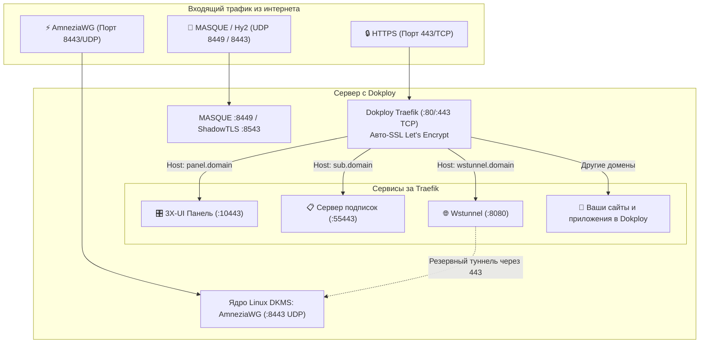

# 🚀 Руководство по настройке VPN и AmneziaWG на сервере с Dokploy

[← Назад к главному README](../README.md) | [⚙️ Архитектура системы](ARCHITECTURE.md) | [🚀 Протоколы следующего поколения & Dokploy](NEXTGEN_PROTOCOLS_DOKPLOY.md)

---

> **Полное практическое руководство:**  
> Как развернуть персональный VPN-сервер (**AmneziaWG**, **3X-UI**, **Wstunnel**, **VLESS xHTTP**, **MASQUE**) на одном VPS с платформой **Dokploy**, сохранив удобство развертывания веб-приложений и баз данных без конфликтов портов 80 и 443.

---

## 📋 Содержание

1. [Введение: как Dokploy сосуществует с VPN](#1-введение-как-dokploy-сосуществует-с-vpn)
2. [Выбор варианта установки (Сравнение)](#2-выбор-варианта-установки)
3. [Шаг 0: Настройка DNS-записей домена](#3-шаг-0-настройка-dns-записей-домена)
4. [Вариант А: Гибридный режим (Рекомендуемый для максимальной скорости)](#4-вариант-а-гибридный-режим-рекомендуемый)
5. [Вариант Б: All-in-One Compose (100% через веб-панель Dokploy)](#5-вариант-б-all-in-one-compose-100-через-веб-панель-dokploy)
6. [Настройка клиентских устройств](#6-настройка-клиентских-устройств)
7. [Диагностика и решение проблем (FAQ)](#7-диагностика-и-решение-проблем-faq)

---

## 1. Введение: как Dokploy сосуществует с VPN

**Dokploy** — это современная PaaS-панель (аналог Coolify/Heroku) для управления контейнерами Docker. В качестве обратного прокси Dokploy использует **Traefik**, который монопольно занимает порты **`80/TCP`** и **`443/TCP`**.

Наш стек решает проблему конкуренции за порты следующим образом:
* **Traefik (Dokploy)** остаётся единственным хозяином портов 80 и 443 для всех сайтов, API и баз данных.
* **AmneziaWG (AWG)** работает по собственному протоколу на **UDP-порту 8443** (или 51820). Traefik вообще не использует эти UDP-порты, поэтому AWG работает на полной скорости ядра Linux.
* **Панель 3X-UI и сервер подписок** работают локально на портах `10443` и `55443`, а Traefik проксирует к ним безопасные домены (`panel.yourdomain.online`, `sub.yourdomain.online`) с автоматическими SSL-сертификатами Let's Encrypt.
* **Wstunnel** позволяет пропускать трафик AmneziaWG и WireGuard через стандартный HTTPS-порт `443` через WebSocket, если оператор связи глушит UDP.



---

## 2. Выбор варианта установки

| Критерий | Вариант А: Гибридный (Хост + Traefik) | Вариант Б: All-in-One (100% Dokploy UI) |
| :--- | :--- | :--- |
| **Кому подходит** | Тем, кому нужна максимальная скорость и пинг | Тем, кто хочет развернуть всё из браузера без SSH |
| **Установка** | 1 команда в терминале SSH | Вставка YAML в разделе Compose панели Dokploy |
| **Драйвер AmneziaWG** | Ядерный модуль ядра Linux (**DKMS**) | Контейнерный драйвер (`/dev/net/tun`) |
| **Скорость AmneziaWG** | **Wire Speed** (до 1–2.5 Гбит/с, 0% CPU overhead) | До 300–600 Мбит/с (небольшой оверхед userspace) |
| **BBR и conntrack** | Настраиваются в ядре хоста автоматически | Настраиваются вручную на хосте (при желании) |
| **Обновление** | Через `./maintain.sh` | В 1 клик через веб-интерфейс Dokploy |

---

## 3. Шаг 0: Настройка DNS-записей домена

Перед началом настройки создайте у вашего DNS-провайдера (Cloudflare, Reg.ru, Beget и т.д.) следующие **A-записи**, указывающие на IP-адрес вашего VPS:

| Поддомен | Пример записи | Назначение |
| :--- | :--- | :--- |
| `panel` | `panel.yourdomain.online` ➜ `IP_ВАШЕГО_VPS` | Веб-интерфейс панели управления 3X-UI |
| `sub` | `sub.yourdomain.online` ➜ `IP_ВАШЕГО_VPS` | Сервер подписок (ссылки для v2rayN, Happ, Clash) |
| `wstunnel` | `wstunnel.yourdomain.online` ➜ `IP_ВАШЕГО_VPS` | WebSocket-туннель для обхода блокировок UDP |
| `@` / `*` | `yourdomain.online` ➜ `IP_ВАШЕГО_VPS` | Основной сайт и приложения Dokploy |

> [!TIP]
> В Cloudflare отключите оранжевое облако (режим **DNS Only / Проксирование выключено**) для поддоменов `panel`, `sub` и `wstunnel`, чтобы Traefik мог напрямую выпустить SSL-сертификаты Let's Encrypt через HTTP-01 challenge.

---

## 4. Вариант А: Гибридный режим (Рекомендуемый)

Этот метод гарантирует максимальную производительность AmneziaWG и алгоритма BBR.

### Шаг 1. Запуск установки на хосте

Подключитесь к VPS по SSH под пользователем `root` и запустите установку:

```bash
curl -sSL "https://raw.githubusercontent.com/torrua/Nginx-L4-Stream-Router-Mask-for-3x-ui/main/setup.sh?v=$(date +%s)" | sudo bash -s -- --dokploy
```

* Установщик автоматически обнаружит Dokploy, применит системные оптимизации ядра (BBR, conntrack), установит DKMS-модуль ядра AmneziaWG и панель 3X-UI на изолированный порт `10443`.
* Порты `80` и `443` **не будут затронуты** — они останутся за Dokploy Traefik.

### Шаг 2. Подключение панели к Dokploy Traefik

После завершения работы установщика сгенерируйте динамическую конфигурацию для Traefik:

```bash
cd /root/vpn-setup 2>/dev/null || cd /root
./manage-services.sh dokploy-traefik > /etc/dokploy/traefik/dynamic/vpn.yml
```

> [!NOTE]
> Traefik в Dokploy отслеживает папку `/etc/dokploy/traefik/dynamic/` и применяет конфигурацию **мгновенно без перезагрузки**.
> Теперь по адресам `https://panel.yourdomain.online` и `https://sub.yourdomain.online` откроются панель 3X-UI и сервер подписок с валидным SSL!

### Шаг 3. (Опционально) Запуск Wstunnel и вспомогательных протоколов

Чтобы развернуть Wstunnel, MASQUE и ShadowTLS в Dokploy:

1. Откройте веб-панель **Dokploy** (`https://IP-СЕРВЕРА:3000`).
2. Перейдите в **Compose** ➜ **Create Compose** (назовите проект, например, `vpn-nextgen`).
3. Скопируйте содержимое файла [`compose/docker-compose.dokploy.yml`](../compose/docker-compose.dokploy.yml) или выполните на сервере `./manage-services.sh dokploy-export` и вставьте результат.
4. В разделе **Environment Variables** укажите:
   ```env
   PRIMARY_DOMAIN=yourdomain.online
   WSTUNNEL_DOMAIN=wstunnel.yourdomain.online
   ```
5. Нажмите **Deploy**.

---

## 5. Вариант Б: All-in-One Compose (100% через веб-панель Dokploy)

Этот метод не требует работы в консоли SSH — всё настраивается через браузер.

### Шаг 1. Создание Compose проекта в Dokploy

1. Откройте панель **Dokploy** (`https://IP-СЕРВЕРА:3000`).
2. В левом меню выберите ваш проект или нажмите **Create Project**.
3. Нажмите **Create Service** ➜ выберите **Compose**.
4. Введите имя сервиса, например: `vpn-all-in-one`.

### Шаг 2. Конфигурация Docker Compose

В редактор Compose вставьте содержимое файла [`compose/docker-compose.dokploy-all-in-one.yml`](../compose/docker-compose.dokploy-all-in-one.yml):

```yaml
services:
  x-ui:
    image: ghcr.io/mhsanaei/3x-ui:latest
    container_name: 3x-ui-dokploy
    restart: unless-stopped
    volumes:
      - xui_data:/etc/x-ui
      - /lib/modules:/lib/modules:ro
    ports:
      - "${AWG_PORT:-8443}:${AWG_PORT:-8443}/udp"
      - "${TUIC_PORT:-8448}:${TUIC_PORT:-8448}/udp"
      - "${SS2022_PORT:-8388}:${SS2022_PORT:-8388}/tcp"
      - "${SS2022_PORT:-8388}:${SS2022_PORT:-8388}/udp"
      - "${MTPROTO_PORT:-8444}:${MTPROTO_PORT:-8444}/tcp"
    cap_add:
      - NET_ADMIN
      - SYS_MODULE
    devices:
      - /dev/net/tun:/dev/net/tun
    sysctls:
      - net.ipv4.ip_forward=1
    environment:
      - XRAY_VMESS_AEAD_FORCED=false
    networks:
      - dokploy-network
    labels:
      - "traefik.enable=true"
      - "traefik.http.routers.xui-panel.rule=Host(`${PANEL_DOMAIN}`)"
      - "traefik.http.routers.xui-panel.entrypoints=websecure"
      - "traefik.http.routers.xui-panel.tls=true"
      - "traefik.http.routers.xui-panel.tls.certresolver=letsencrypt"
      - "traefik.http.services.xui-panel.loadbalancer.server.port=2053"
      - "traefik.http.routers.xui-sub.rule=Host(`${SUB_DOMAIN}`)"
      - "traefik.http.routers.xui-sub.entrypoints=websecure"
      - "traefik.http.routers.xui-sub.tls=true"
      - "traefik.http.routers.xui-sub.tls.certresolver=letsencrypt"
      - "traefik.http.services.xui-sub.loadbalancer.server.port=2096"

  wstunnel-dokploy:
    image: ghcr.io/erebe/wstunnel:latest
    container_name: wstunnel-dokploy
    restart: unless-stopped
    command:
      - "server"
      - "--restrict-to=3x-ui-dokploy:8443,3x-ui-dokploy:51820,3x-ui-dokploy:8388,host.docker.internal:51820"
      - "ws://0.0.0.0:8080"
    networks:
      - dokploy-network
    labels:
      - "traefik.enable=true"
      - "traefik.http.routers.wstunnel.rule=Host(`${WSTUNNEL_DOMAIN}`)"
      - "traefik.http.routers.wstunnel.entrypoints=websecure"
      - "traefik.http.routers.wstunnel.tls=true"
      - "traefik.http.routers.wstunnel.tls.certresolver=letsencrypt"
      - "traefik.http.services.wstunnel.loadbalancer.server.port=8080"

volumes:
  xui_data:

networks:
  dokploy-network:
    external: true
```

### Шаг 3. Переменные окружения (Environment)

Перейдите во вкладку **Environment** сервиса и добавьте переменные:

```env
PANEL_DOMAIN=panel.yourdomain.online
SUB_DOMAIN=sub.yourdomain.online
WSTUNNEL_DOMAIN=wstunnel.yourdomain.online
AWG_PORT=8443
TUIC_PORT=8448
SS2022_PORT=8388
MTPROTO_PORT=8444
```

### Шаг 4. Развертывание

Нажмите кнопку **Deploy**. Dokploy подтянет образы, запустит контейнеры и автоматически настроит Traefik.  
Через 1–2 минуты откройте браузер: `https://panel.yourdomain.online`.

> **Данные для первого входа в 3X-UI по умолчанию:**  
> Логин: `admin`  
> Пароль: `admin`  
> *(Сразу после первого входа перейдите в «Настройки панели» и смените логин и пароль!)*

---

## 6. Настройка клиентских устройств

### 1. Подключение AmneziaWG (Напрямую через UDP)
1. В панели 3X-UI перейдите в раздел **«Подключения» (Inbounds)**.
2. Создайте инбаунд протокола **WireGuard / AmneziaWG** на порту `8443`.
3. Задайте параметры обфускации:
   * `Jc = 2..4`, `Jmin = 20`, `Jmax = 50`
   * `S1 = 16`, `S2 = 20`, `S3 = 24`, `S4 = 16`
   * `H1 = 1`, `H2 = 2`, `H3 = 3`, `H4 = 4`
4. Добавьте клиента и экспортируйте `.conf` файл или отсканируйте QR-код в приложении **AmneziaWG** на смартфоне или компьютере.
5. Адрес подключения: `yourdomain.online:8443` или `IP_СЕРВЕРА:8443`.

### 2. Подключение AmneziaWG через Wstunnel (Обход блокировок UDP)
Если сотовый оператор глушит UDP-трафик:
1. Установите клиент **wstunnel** на клиентское устройство или роутер (Keenetic, OpenWrt, Windows, macOS).
2. Запустите wstunnel-клиент:
   ```bash
   wstunnel client -L udp://127.0.0.1:51820:3x-ui-dokploy:8443 wss://wstunnel.yourdomain.online
   ```
3. В конфиге AmneziaWG замените строчку `Endpoint`:
   ```ini
   [Peer]
   Endpoint = 127.0.0.1:51820
   ```
4. Весь VPN-трафик пойдет через стандартный порт `443` Traefik под видом обычного веб-трафика!

### 3. Подключение через сервер подписок
1. Скопируйте персональную ссылку подписки клиента из панели 3X-UI.
2. Ссылка будет иметь вид: `https://sub.yourdomain.online/sub-xxxx/xxxx`.
3. Вставьте ссылку в любое поддерживаемое приложение: **v2rayN** (Windows), **Happ Proxy** (iOS/Android), **v2rayNG** (Android), **FoXray** (macOS/iOS).
4. Все доступные профили (VLESS, TUIC, Shadowsocks, MASQUE) загрузятся автоматически.

---

## 7. Диагностика и решение проблем (FAQ)

### ❓ Что делать при ошибке 404 / 502 Bad Gateway в Traefik?
1. Убедитесь, что DNS A-записи доменов указывают прямо на IP вашего сервера (без Cloudflare Proxy).
2. Проверьте логи Traefik:
   ```bash
   docker logs dokploy-traefik --tail 50
   ```
3. Для Варианта А (Гибридного): убедитесь, что в файле `/etc/dokploy/traefik/dynamic/vpn.yml` в поле `servers.url` указан адрес `http://host.docker.internal:10443`.
4. Для Варианта Б (All-in-One): убедитесь, что контейнер `3x-ui-dokploy` находится в сети `dokploy-network`.

### ❓ Конфликтует ли порт 3000 (Dokploy vs AdGuard Home)?
* Панель Dokploy по умолчанию работает на порту `3000`.
* Наш установщик автоматически проверяет занятость порта `3000`. Если порт занят Dokploy, веб-интерфейс AdGuard Home автоматически переносится на свободный порт из диапазона `3001..3053`, исключая любые сбои.

### ❓ Нужно ли открывать порты в файрволе облачного провайдера?
Да, в панели управления вашего облачного провайдера (Hetzner Firewall, Selectel, Beget, VK Cloud) должны быть открыты:
* **`80/TCP`** и **`443/TCP`** — для Dokploy Traefik и выпуска SSL.
* **`8443/UDP`** (или ваш порт) — для AmneziaWG.
* **`8448/UDP`** — для TUIC v5 (если используется).
* **`8449/UDP`** — для MASQUE (если используется).
* **`8388/TCP,UDP`** — для Shadowsocks 2022 (если используется).
