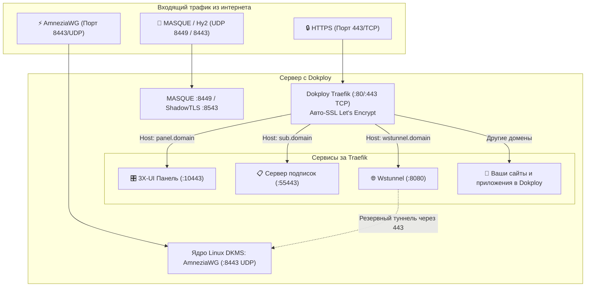

# 🚀 Руководство по настройке VPN и AmneziaWG на сервере с Dokploy

[← Назад к главному README](../README.md) | [⚙️ Архитектура системы](ARCHITECTURE.md) | [🚀 Протоколы следующего поколения & Dokploy](NEXTGEN_PROTOCOLS_DOKPLOY.md)

---

> **Полное практическое руководство:**  
> Как развернуть персональный VPN-сервер (**AmneziaWG**, **3X-UI**, **Wstunnel**, **VLESS xHTTP**, **MASQUE**) на одном VPS с платформой **Dokploy**, сохранив удобство развертывания веб-приложений и баз данных без конфликтов портов 80 и 443.

---

## 📋 Содержание

1. [Введение: как Dokploy сосуществует с VPN](#1-введение-как-dokploy-сосуществует-с-vpn)
2. [Выбор варианта установки (Сравнение)](#2-выбор-варианта-установки)
3. [Шаг 0: Настройка DNS-записей домена](#3-шаг-0-настройка-dns-записей-домена)
4. [Вариант А: Гибридный режим (Рекомендуемый для максимальной скорости)](#4-вариант-а-гибридный-режим-рекомендуемый)
5. [Вариант Б: All-in-One Compose (100% через веб-панель Dokploy)](#5-вариант-б-all-in-one-compose-100-через-веб-панель-dokploy)
6. [Настройка клиентских устройств](#6-настройка-клиентских-устройств)
7. [Диагностика и решение проблем (FAQ)](#7-диагностика-и-решение-проблем-faq)

---

## 1. Введение: как Dokploy сосуществует с VPN

**Dokploy** — это современная PaaS-панель (аналог Coolify/Heroku) для управления контейнерами Docker. В качестве обратного прокси Dokploy использует **Traefik**, который монопольно занимает порты **`80/TCP`** и **`443/TCP`**.

Наш стек решает проблему конкуренции за порты следующим образом:
* **Traefik (Dokploy)** остаётся единственным хозяином портов 80 и 443 для всех сайтов, API и баз данных.
* **AmneziaWG (AWG)** работает по собственному протоколу на **UDP-порту 8443** (или 51820). Traefik вообще не использует эти UDP-порты, поэтому AWG работает на полной скорости ядра Linux.
* **Панель 3X-UI и сервер подписок** работают локально на портах `10443` и `55443`, а Traefik проксирует к ним безопасные домены (`panel.yourdomain.online`, `sub.yourdomain.online`) с автоматическими SSL-сертификатами Let's Encrypt.
* **Wstunnel** позволяет пропускать трафик AmneziaWG и WireGuard через стандартный HTTPS-порт `443` через WebSocket, если оператор связи глушит UDP.



---

## 2. Выбор варианта установки

| Критерий | Вариант А: Гибридный (Хост + Traefik) | Вариант Б: All-in-One (100% Dokploy UI) |
| :--- | :--- | :--- |
| **Кому подходит** | Тем, кому нужна максимальная скорость и пинг | Тем, кто хочет развернуть всё из браузера без SSH |
| **Установка** | 1 команда в терминале SSH | Вставка YAML в разделе Compose панели Dokploy |
| **Драйвер AmneziaWG** | Ядерный модуль ядра Linux (**DKMS**) | Контейнерный драйвер (`/dev/net/tun`) |
| **Скорость AmneziaWG** | **Wire Speed** (до 1–2.5 Гбит/с, 0% CPU overhead) | До 300–600 Мбит/с (небольшой оверхед userspace) |
| **BBR и conntrack** | Настраиваются в ядре хоста автоматически | Настраиваются вручную на хосте (при желании) |
| **Обновление** | Через `./maintain.sh` | В 1 клик через веб-интерфейс Dokploy |

---

## 3. Шаг 0: Настройка DNS-записей домена

Перед началом настройки создайте у вашего DNS-провайдера (Cloudflare, Reg.ru, Beget и т.д.) A-записи, указывающие на IP-адрес вашего VPS.

### Реестр поддоменов по функциональным группам:

#### 1. Основные сервисы Dokploy и управления
| Поддомен | Пример записи | Порт / Маршрут | Назначение |
| :--- | :--- | :---: | :--- |
| **`@`** *(корень)* | `yourdomain.online` ➜ `IP_ВАШЕГО_VPS` | `80/443` | Основной сайт-маскировка или ваши веб-приложения в Dokploy. |
| **`www`** | `www.yourdomain.online` ➜ `IP_ВАШЕГО_VPS` | `80/443` | Алиас основного сайта для корректного выпуска SSL. |
| **`panel`** | `panel.yourdomain.online` ➜ `IP_ВАШЕГО_VPS` | `10443` *(Hybrid)* / `2053` *(Compose)* ➜ Traefik | Веб-интерфейс панели 3X-UI с Let's Encrypt SSL. Поддерживает корень `/` (`--panel-path /`). |
| **`sub`** | `sub.yourdomain.online` ➜ `IP_ВАШЕГО_VPS` | `55443` *(Hybrid)* / `2096` *(Compose)* ➜ Traefik | Сервер подписок (чистые ссылки для v2rayN, Happ, Clash, Sing-box). |

#### 2. Туннели и прокси через Traefik (порт 443 TCP)
| Поддомен | Пример записи | Порт / Маршрут | Назначение |
| :--- | :--- | :---: | :--- |
| **`vless`** | `vless.yourdomain.online` ➜ `IP_ВАШЕГО_VPS` | `50443` (h2c) ➜ Traefik | VLESS xHTTP поток через Dokploy Traefik с валидным SSL без конфликта портов. |
| **`wstunnel`** | `wstunnel.yourdomain.online` ➜ `IP_ВАШЕГО_VPS` | `443` (WS) ➜ `8080` | **Wstunnel:** туннелирование AmneziaWG / WireGuard UDP внутри WebSocket over TLS 443. |

#### 3. REALITY Маскировка (Traefik TCP Passthrough на порту 443)
| Поддомен | Пример записи | Порт / Маршрут | Назначение |
| :--- | :--- | :---: | :--- |
| **`cdn`** / **`reality`** | `cdn.yourdomain.online` ➜ `IP_ВАШЕГО_VPS` | `45443` (TCP Passthrough) | Основной SNI-камуфляж для режима REALITY Steal-Oneself (маршрутизируется Traefik по SNI без расшифровки TLS). |
| **`static`** | `static.yourdomain.online` ➜ `IP_ВАШЕГО_VPS` | `47443` (TCP Passthrough) | Резервный SNI-камуфляж для статических ресурсов REALITY (Steal Backup). |

#### 4. Специализированные протоколы следующего поколения (Выделенные порты)
| Поддомен / Хост | Порт и протокол | Транспорт / Механизм | Назначение |
| :--- | :---: | :--- | :--- |
| **`@` / IP** | `8443/UDP` (или `51820`) | Ядро Linux DKMS (AmneziaWG 3.1) | **AmneziaWG:** Wire-speed VPN с обфускацией заголовков `HeaderProtectionKey`. |
| **`@` / IP** | `8444/UDP` | Ядро Linux DKMS (AmneziaWG 2.0) | **AmneziaWG v2.0:** совместимость с legacy-клиентами. |
| **`@` / IP** | `8448/UDP` | QUIC 0-RTT BBR | **TUIC v5:** сверхбыстрый протокол с миграцией соединений при смене сотовых вышек. |
| **`@` / IP** | `8449/UDP` | HTTP/3 Datagrams (RFC 9484) | **MASQUE:** туннелирование UDP/IP с нативной поддержкой в iOS 17+ и macOS 14+. |
| **`@` / IP** | `8388/TCP,UDP` | Shadowsocks-2022 AEAD | **Shadowsocks-2022:** `2022-blake3-aes-256-gcm` с защитой от replay-атак. |
| **`@` / IP** | `8543/TCP` | ShadowTLS v4 -> SS-2022 | **ShadowTLS v4:** подлинный TLS Apple (`gateway.icloud.com`) с защитой от активных зондов. |
| **`@` / IP** | `8444/TCP` | FakeTLS | **Telegram MTProxy:** прокси для прямого подключения в Telegram. |
| **`naive`** | `8446/TCP,UDP` | Chromium Network Stack | **NaïveProxy (Caddy):** маскировка под Google Chrome с выпуском SSL через Cloudflare DNS-01. |
| **`@` / IP** | `8450/TCP,UDP` | XChaCha20-Poly1305 | **Mieru Proxy:** криптографически стойкий прокси, устойчивый к TLS JA3/JA4 блокировкам. |
| **`t`** | `53053/UDP,DoH` | Noise Protocol | **DNSTT Tunnel:** туннелирование трафика внутри DNS-запросов (пробивает белые списки). |
| **`dns`** | `3000/TCP` (или `3001..3053`) / `10053/UDP` | AdGuard Home DNS / DoH | **AdGuard Home:** блокировка рекламы и локальный DNS-фильтр (порт изолирован от Dokploy). |

> [!TIP]
> **Как настроить все поддомены за 30 секунд:**  
> Создайте всего **две записи** у вашего DNS-провайдера:
> 1. `@` ➜ `IP_ВАШЕГО_VPS` (для корня)
> 2. `*` ➜ `IP_ВАШЕГО_VPS` (Wildcard-запись — автоматически покроет `panel`, `sub`, `wstunnel`, `vless`, `cdn`, `static`, `naive`, `dns`, `t` и любые будущие сайты в Dokploy!).
>
> В Cloudflare обязательно выключите оранжевое облако (режим **DNS Only**) для записей, чтобы Traefik мог напрямую подтвердить владение доменом и выпустить SSL-сертификаты Let's Encrypt через HTTP-01 challenge.

---

## 4. Вариант А: Гибридный режим (Рекомендуемый)

Этот метод гарантирует максимальную производительность AmneziaWG и алгоритма BBR.

### Шаг 1. Запуск установки на хосте

Подключитесь к VPS по SSH под пользователем `root` и запустите установку:

```bash
curl -sSL "https://raw.githubusercontent.com/torrua/Nginx-L4-Stream-Router-Mask-for-3x-ui/main/setup.sh?v=$(date +%s)" | sudo bash -s -- \
  --dokploy \
  --panel-path / \
  --domain yourdomain.online \
  --panel-domain panel.yourdomain.online \
  --sub-domain sub.yourdomain.online \
  --vless-domain vless.yourdomain.online
```

> [!TIP]
> **Параметры командной строки для Dokploy:**
> * `--dokploy`: активирует режим бесконфликтного сосуществования. Установщик оставляет порты `80` и `443` за Dokploy Traefik и не устанавливает локальный Certbot/Nginx.
> * `--panel-path /`: настраивает открытие панели прямо в корне поддомена `https://panel.yourdomain.online/` без добавления длинного случайного пути вроде `/panel-1a2b3c/`.
> * `--panel-domain`: указывает поддомен панели управления (по умолчанию `panel.<domain>`).
> * `--sub-domain`: указывает поддомен сервера подписок (по умолчанию `sub.<domain>`).
> * `--vless-domain`: поддомен для VLESS xHTTP потока (по умолчанию `vless.<domain>` или `sub.<domain>`).
> * `--no-hy2`: опционально, если UDP-порт 443 занят HTTP/3 сервисами в Traefik.

* Установщик автоматически обнаружит Dokploy, применит системные оптимизации ядра (BBR, conntrack), установит DKMS-модуль ядра AmneziaWG и панель 3X-UI на изолированный порт `10443` (подписки — на `55443`, xHTTP — на `50443`).
* Порты `80` и `443` **не будут затронуты** — они останутся за Dokploy Traefik.

### Шаг 2. Подключение панели к Dokploy Traefik

Установщик **автоматически создаёт** файл `/etc/dokploy/traefik/dynamic/vpn.yml` со всеми HTTP и TCP маршрутами, если директория `/etc/dokploy` существует.

При необходимости перегенерировать конфигурацию вручную выполните:

```bash
cd /root/vpn-setup 2>/dev/null || cd /root
./manage-services.sh dokploy-traefik > /etc/dokploy/traefik/dynamic/vpn.yml
```

> [!NOTE]
> Traefik в Dokploy отслеживает папку `/etc/dokploy/traefik/dynamic/` и применяет конфигурацию **мгновенно без перезагрузки**.
> Файл `vpn.yml` автоматически настраивает:
> * **HTTP Роутеры:** `panel.yourdomain.online` ➜ `10443`, `sub.yourdomain.online` ➜ `55443`, `vless.yourdomain.online` ➜ `h2c://...:50443`.
> * **TCP Passthrough Роутеры:** `cdn.yourdomain.online` / `reality.yourdomain.online` ➜ `45443` (REALITY Steal-Oneself без расшифровки TLS), `static.yourdomain.online` ➜ `47443` (Steal Backup) и `reality-classic` ➜ `46443`.
> Теперь по адресам `https://panel.yourdomain.online` и `https://sub.yourdomain.online` откроются панель 3X-UI и сервер подписок с валидным SSL!

### Шаг 3. (Опционально) Запуск Wstunnel и вспомогательных протоколов

Чтобы развернуть Wstunnel, MASQUE и ShadowTLS в Dokploy:

1. Откройте веб-панель **Dokploy** (`https://IP-СЕРВЕРА:3000`).
2. Перейдите в **Compose** ➜ **Create Compose** (назовите проект, например, `vpn-nextgen`).
3. Скопируйте содержимое файла [`compose/docker-compose.dokploy.yml`](../compose/docker-compose.dokploy.yml) или выполните на сервере `./manage-services.sh dokploy-export` и вставьте результат.
4. В разделе **Environment Variables** укажите:
   ```env
   PRIMARY_DOMAIN=yourdomain.online
   WSTUNNEL_DOMAIN=wstunnel.yourdomain.online
   ```
5. Нажмите **Deploy**.

---

## 5. Вариант Б: All-in-One Compose (100% через веб-панель Dokploy)

Этот метод не требует работы в консоли SSH — всё настраивается через браузер.

### Шаг 1. Создание Compose проекта в Dokploy

1. Откройте панель **Dokploy** (`https://IP-СЕРВЕРА:3000`).
2. В левом меню выберите ваш проект или нажмите **Create Project**.
3. Нажмите **Create Service** ➜ выберите **Compose**.
4. Введите имя сервиса, например: `vpn-all-in-one`.

### Шаг 2. Конфигурация Docker Compose

В редактор Compose вставьте содержимое файла [`compose/docker-compose.dokploy-all-in-one.yml`](../compose/docker-compose.dokploy-all-in-one.yml):

```yaml
services:
  x-ui:
    image: ghcr.io/mhsanaei/3x-ui:latest
    container_name: 3x-ui-dokploy
    restart: unless-stopped
    volumes:
      - xui_data:/etc/x-ui
      - /lib/modules:/lib/modules:ro
    ports:
      - "${AWG_PORT:-8443}:${AWG_PORT:-8443}/udp"
      - "${TUIC_PORT:-8448}:${TUIC_PORT:-8448}/udp"
      - "${SS2022_PORT:-8388}:${SS2022_PORT:-8388}/tcp"
      - "${SS2022_PORT:-8388}:${SS2022_PORT:-8388}/udp"
      - "${MTPROTO_PORT:-8444}:${MTPROTO_PORT:-8444}/tcp"
    cap_add:
      - NET_ADMIN
      - SYS_MODULE
    devices:
      - /dev/net/tun:/dev/net/tun
    sysctls:
      - net.ipv4.ip_forward=1
    environment:
      - XRAY_VMESS_AEAD_FORCED=false
    networks:
      - dokploy-network
    labels:
      - "traefik.enable=true"
      # Веб-панель управления 3X-UI (в контейнере порт 2053)
      - "traefik.http.routers.xui-panel.rule=Host(`${PANEL_DOMAIN}`)"
      - "traefik.http.routers.xui-panel.entrypoints=websecure"
      - "traefik.http.routers.xui-panel.tls=true"
      - "traefik.http.routers.xui-panel.tls.certresolver=letsencrypt"
      - "traefik.http.services.xui-panel.loadbalancer.server.port=2053"
      # Сервер подписок 3X-UI (в контейнере порт 2096)
      - "traefik.http.routers.xui-sub.rule=Host(`${SUB_DOMAIN}`)"
      - "traefik.http.routers.xui-sub.entrypoints=websecure"
      - "traefik.http.routers.xui-sub.tls=true"
      - "traefik.http.routers.xui-sub.tls.certresolver=letsencrypt"
      - "traefik.http.services.xui-sub.loadbalancer.server.port=2096"
      # VLESS xHTTP поток через Traefik (h2c, порт 50443)
      - "traefik.http.routers.xray-xhttp.rule=Host(`${VLESS_DOMAIN}`)"
      - "traefik.http.routers.xray-xhttp.entrypoints=websecure"
      - "traefik.http.routers.xray-xhttp.priority=1000"
      - "traefik.http.routers.xray-xhttp.tls=true"
      - "traefik.http.routers.xray-xhttp.tls.certresolver=letsencrypt"
      - "traefik.http.services.xray-xhttp.loadbalancer.server.port=50443"
      - "traefik.http.services.xray-xhttp.loadbalancer.server.scheme=h2c"

  wstunnel-dokploy:
    image: ghcr.io/erebe/wstunnel:latest
    container_name: wstunnel-dokploy
    restart: unless-stopped
    entrypoint: ["/usr/bin/dumb-init", "--", "/home/app/wstunnel"]
    command:
      - "server"
      - "--restrict-to=3x-ui-dokploy:8443,3x-ui-dokploy:51820,3x-ui-dokploy:8388,host.docker.internal:51820"
      - "ws://0.0.0.0:8080"
    networks:
      - dokploy-network
    labels:
      - "traefik.enable=true"
      - "traefik.http.routers.wstunnel.rule=Host(`${WSTUNNEL_DOMAIN}`)"
      - "traefik.http.routers.wstunnel.entrypoints=websecure"
      - "traefik.http.routers.wstunnel.tls=true"
      - "traefik.http.routers.wstunnel.tls.certresolver=letsencrypt"
      - "traefik.http.services.wstunnel.loadbalancer.server.port=8080"

volumes:
  xui_data:

networks:
  dokploy-network:
    external: true
```

### Шаг 3. Переменные окружения (Environment)

Перейдите во вкладку **Environment** сервиса и добавьте переменные:

```env
PRIMARY_DOMAIN=yourdomain.online
PANEL_DOMAIN=panel.yourdomain.online
SUB_DOMAIN=sub.yourdomain.online
VLESS_DOMAIN=vless.yourdomain.online
WSTUNNEL_DOMAIN=wstunnel.yourdomain.online
AWG_PORT=8443
TUIC_PORT=8448
SS2022_PORT=8388
MTPROTO_PORT=8444
```
AWG_PORT=8443
TUIC_PORT=8448
SS2022_PORT=8388
MTPROTO_PORT=8444
```

### Шаг 4. Развертывание

Нажмите кнопку **Deploy**. Dokploy подтянет образы, запустит контейнеры и автоматически настроит Traefik.  
Через 1–2 минуты откройте браузер: `https://panel.yourdomain.online`.

> **Данные для первого входа в 3X-UI по умолчанию:**  
> Логин: `admin`  
> Пароль: `admin`  
> *(Сразу после первого входа перейдите в «Настройки панели» и смените логин и пароль!)*

---

## 6. Автоматическая настройка маршрутизации и подключение клиентов

> [!IMPORTANT]
> **Вам НЕ нужно создавать инбаунды и прописывать правила маршрутизации вручную!**  
> При установке скрипт `configure-panel.sh` и движок `reconcile.py` делают это **на 100% автоматически**:
> 1. Создают инбаунд **AmneziaWG 3.1** (`8443/udp`) со всеми параметрами обфускации (`Jc=2`, `S1=16..S4=16`), защитой `HeaderProtectionKey` и `MTU 1280`.
> 2. Создают инбаунды **AmneziaWG 2.0**, **VLESS xHTTP**, **Hysteria 2**, **TUIC v5** и **Shadowsocks-2022**.
> 3. Настраивают **Умную маршрутизацию (Smart Outbound Routing)** в ядре Xray:
>    * Российские сервисы (`.ru`, Госуслуги, банки, VK, Яндекс) ➜ **DIRECT** (выход с IP сервера, без блокировок и капч).
>    * Видеосерверы YouTube ➜ **DIRECT** (максимальная скорость без буферизации).
>    * Заблокированные AI-сервисы (ChatGPT, Claude, Gemini) ➜ **Cloudflare WARP** (автоматический обход геоблока).
>    * Защита от спама (блокировка 25 порта) и защита от SSRF-атак на локальные службы хоста.
> 4. Создают единый клиентский профиль `Client` с персональной ссылкой подписки и QR-кодами.

### 1. Подключение AmneziaWG (Напрямую через UDP)
* В терминале сервера сразу после установки отображается готовый **ASCII QR-код** первого клиента.
* Также QR-код и файлы `.conf` / `vpn://` можно вывести в любой момент командой:
  ```bash
  awg-mgr qr client-1
  ```
* Отсканируйте QR-код в приложении **AmneziaWG** на смартфоне или импортируйте файл в клиент для Windows/macOS/Keenetic. Подключение произойдет на полной скорости ядра Linux.

### 2. Подключение AmneziaWG через Wstunnel (Обход блокировок UDP через порт 443)
Если сотовый оператор глушит UDP-трафик:
1. Запустите wstunnel на клиенте или роутере (Keenetic, OpenWrt, Windows, macOS):
   ```bash
   wstunnel client -L udp://127.0.0.1:51820:host.docker.internal:8443 wss://wstunnel.yourdomain.online
   ```
2. В файле конфигурации AmneziaWG укажите:
   ```ini
   [Peer]
   Endpoint = 127.0.0.1:51820
   ```
3. Весь трафик пойдет через стандартный порт `443` Dokploy Traefik под видом легитимного веб-трафика!

### 3. Подключение через сервер подписок
1. Откройте панель 3X-UI (`https://panel.yourdomain.online`) и скопируйте персональную ссылку подписки.
2. Ссылка имеет вид: `https://sub.yourdomain.online/sub-xxxx/xxxx` (или `https://sub.yourdomain.online/clash-xxxx/xxxx` для Clash/Mihomo).
3. Вставьте ссылку в любое приложение: **v2rayN** (Windows), **Happ Proxy** (iOS/Android), **v2rayNG** (Android), **FoXray** (macOS/iOS) или **Clash/Mihomo**.
4. Все доступные протоколы (VLESS xHTTP, Hysteria 2, TUIC, Shadowsocks, MASQUE) загрузятся и будут автоматически обновляться.

### 4. Подключение VLESS xHTTP (Порт 443 с валидным SSL)
* **Хост подключения:** `vless.yourdomain.online`
* **Порт:** `443`
* **Транспорт:** `xHTTP` (`mode: auto`), путь: `/xhttp/` (или ваш `XHTTP_STREAM_PATH`)
* **Безопасность:** `TLS` (валидный сертификат Let's Encrypt от Traefik), `ALPN: h2`
* **Преимущество:** трафик идет через стандартный веб-порт `443` Dokploy Traefik. Полная неотличимость от легитимного HTTP/2 веб-трафика для любых DPI-фильтров.

### 5. Подключение VLESS REALITY (Порт 443 через Traefik TCP Passthrough)
* **Хост:** `yourdomain.online` (или IP VPS)
* **Порт:** `443`
* **SNI:** `cdn.yourdomain.online` (или `reality.yourdomain.online`) для Steal-Oneself, либо внешние домены (`www.uni-frankfurt.de`, `www.sap.com`) для Classic
* **Механизм:** Traefik маршрутизирует TCP-соединение по SNI напрямую в Xray (порты `45443` и `46443`) без терминации TLS (`tls.passthrough=true`), что сохраняет целостность ключей REALITY.

---

## 7. Диагностика и решение проблем (FAQ)

### ❓ Как открывать панель 3X-UI: в корне `/` или по секретному пути?
* **В корне:** При установке с флагом `--panel-path /` панель открывается прямо по адресу: `https://panel.yourdomain.online/`.
* **По секретному пути:** Если путь не был сброшен в корень, в целях безопасности панель доступна по случайно сгенерированному пути: `https://panel.yourdomain.online/panel-xxxxxxxx/`.
* Полный адрес панели и реквизиты администратора всегда сохраняются в файле `/root/vpn_credentials.txt`.
* Сбросить путь панели в корень можно в любой момент командой:
  ```bash
  ./maintain.sh --panel-path /
  ```

### ❓ Что делать при ошибке 404 / 502 Bad Gateway в Traefik?
1. Убедитесь, что DNS A-записи доменов указывают прямо на IP вашего сервера (в Cloudflare режим **DNS Only**, серое облако).
2. Проверьте логи Traefik:
   ```bash
   docker logs dokploy-traefik --tail 50
   ```
3. Для Варианта А (Гибридного): убедитесь, что в файле `/etc/dokploy/traefik/dynamic/vpn.yml` в блоке `services` указаны корректные порты:
   * `xui-panel-service`: `http://host.docker.internal:10443`
   * `xui-sub-service`: `http://host.docker.internal:55443`
   * `xray-xhttp-service`: `h2c://host.docker.internal:50443`
   * `reality-steal-service`: `host.docker.internal:45443`
4. Для Варианта Б (All-in-One): убедитесь, что контейнер `3x-ui-dokploy` находится в сети `dokploy-network`.

### ❓ Конфликтует ли порт 3000 (Dokploy vs AdGuard Home)?
* Панель Dokploy по умолчанию работает на порту `3000`.
* Наш установщик автоматически проверяет занятость порта `3000`. Если порт занят Dokploy, веб-интерфейс AdGuard Home автоматически переносится на свободный порт из диапазона `3001..3053`, исключая любые сбои.

### ❓ Какие порты нужно открыть в файрволе облачного провайдера?
В панели управления вашего облачного провайдера (Hetzner Firewall, Selectel, Beget, VK Cloud) должны быть открыты:
* **`80/TCP`** и **`443/TCP`** — для Dokploy Traefik, выпуска SSL и всех прокси/туннелей (Wstunnel, VLESS xHTTP, REALITY TCP Passthrough).
* **`8443/UDP`** (или `51820/UDP`) — для AmneziaWG v3.1.
* **`8444/UDP`** — для AmneziaWG v2.0 (если включен).
* **`8448/UDP`** — для TUIC v5 (если используется).
* **`8449/UDP`** — для MASQUE (если используется).
* **`8388/TCP,UDP`** — для Shadowsocks-2022 (если используется).
* **`8543/TCP`** — для ShadowTLS v4 (если используется).
* **`8444/TCP`** — для Telegram MTProxy (если используется).
* **`8446/TCP,UDP`** — для NaïveProxy Caddy (если используется).
* **`8450/TCP,UDP`** — для Mieru Proxy (если используется).
* **`53053/UDP`** — для DNSTT Tunnel (если используется).
*(Внутренние порты `10443`, `55443`, `50443`, `45443`, `46443`, `47443` и `8080` наружу открывать не нужно — они доступны только локально через Traefik).*
