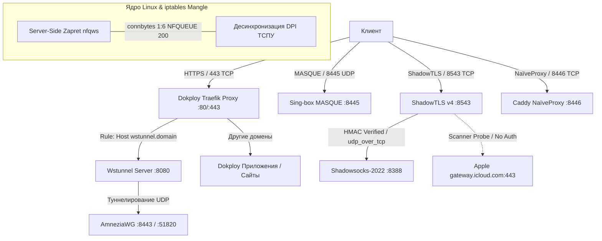

# 🚀 Протоколы следующего поколения и интеграция с Dokploy

[← Назад к главному README](../README.md) | [⚙️ Архитектура системы](ARCHITECTURE.md) | [🚀 Пошаговое руководство](BEGINNER_GUIDE.md)

---

> **Инженерное руководство по развертыванию передовых протоколов противодействия цензуре:**  
> **MASQUE** (RFC 9484 / RFC 9298), **ShadowTLS v4** + **Shadowsocks-2022** (`udp_over_tcp`), **NaïveProxy** с Caddy (Cloudflare DNS-01), **Server-Side Zapret** (`nfqws` с `connbytes 1:6`) и **Wstunnel** поверх **Dokploy Traefik** (WebSocket / HTTP/3) в режиме нулевого конфликта портов.

---

## 📋 Содержание

1. [Введение и матрица устойчивости к DPI](#1-введение-и-матрица-устойчивости-к-dpi)
2. [Архитектура бесконфликтного сосуществования с Dokploy (Zero-Conflict Traefik)](#2-архитектура-бесконфликтного-сосуществования-с-dokploy)
3. [Протокол 1: MASQUE (RFC 9484 / RFC 9298 via Sing-box 1.14+)](#3-протокол-1-masque-rfc-9484--rfc-9298)
4. [Протокол 2: ShadowTLS v4 + Shadowsocks-2022 (udp_over_tcp)](#4-протокол-2-shadowtls-v4--shadowsocks-2022)
5. [Протокол 3: NaïveProxy + Caddy (Cloudflare DNS-01 ACME)](#5-протокол-3-naïveproxy--caddy)
6. [Протокол 4: Server-Side Zapret (nfqws с iptables connbytes 1:6)](#6-протокол-4-server-side-zapret)
7. [Протокол 5: Wstunnel поверх Dokploy Traefik (WebSocket / 443)](#7-протокол-5-wstunnel-поверх-dokploy-traefik)
8. [Развертывание в панели Dokploy (Пошаговая инструкция)](#8-развертывание-в-панели-dokploy)
9. [Управление через скрипт `manage-services.sh`](#9-управление-через-скрипт-manage-servicessh)
10. [Настройка клиентских приложений](#10-настройка-клиентских-приложений)

---

## 1. Введение и матрица устойчивости к DPI

Традиционные методы маскировки (обычный Shadowsocks, OpenVPN, WireGuard) и даже базовый VLESS без Vision подвержены обнаружению эвристическими анализаторами современных ТСПУ (DPI РКН). В этом репозитории реализован набор протоколов следующего поколения, обеспечивающих математически доказуемую защиту от активного зондирования (*Active Probing*) и поведенческого анализа:

| Протокол / Стек | Порт / Транспорт | Механизм маскировки | Защита от активного зонда (Active Probing) | Устойчивость к блокировкам UDP | Совместимость с Dokploy |
| :--- | :--- | :--- | :--- | :--- | :--- |
| **MASQUE (RFC 9484/9298)** | UDP `8445` (HTTP/3 Datagram) | Стандартизированный IETF CONNECT-UDP/IP | Защита TLS 1.3 / QUIC хэндшейка | Средняя (требует открытый UDP) | 100% (независимый UDP-порт) |
| **ShadowTLS v4 + SS-2022** | TCP `8543` (L4 TLS) | Настоящий TLS-сертификат Apple (`gateway.icloud.com`) | **Абсолютная**: при неверном HMAC соединение пересылается на реальный сервер Apple | **100%**: `udp_over_tcp` инкапсулирует UDP в TCP | 100% (независимый TCP-порт) |
| **NaïveProxy (Caddy)** | TCP/UDP `8446` | Сетевой стек Chromium (Google Chrome) | **Абсолютная**: `probe_resistance` отдает статический сайт без заголовков прокси | Высокая (HTTP/2 / HTTP/3 fallback) | 100% (DNS-01 ACME без портов 80/443) |
| **Server-Side Zapret** | L3/L4 NFQUEUE | Десинхронизация DPI в первые 6 пакетов (`split2`, `md5sig`) | Прозрачная подмена TCP-сегментов для ТСПУ | Высокая для TCP-потоков | 100% (работает на уровне iptables mangle) |
| **Wstunnel over Dokploy** | TCP `443` (WebSocket HTTPS) | Легитимный веб-трафик Dokploy Traefik | **Абсолютная**: трафик неотличим от обычных WebSockets | **100%**: туннелирует WireGuard/AWG внутри TCP/443 | **Нативная** (управляется Traefik) |

---

## 2. Архитектура бесконфликтного сосуществования с Dokploy

[Dokploy](https://dokploy.com/) — это открытая платформа PaaS для управления приложениями и базами данных в Docker. Dokploy использует **Traefik** в качестве входного шлюза (Reverse Proxy), который монопольно занимает внешние порты **80/tcp** и **443/tcp**.

При попытке запустить стандартный Nginx Stream Router на таком сервере возникает фатальный конфликт портов (`die "Порт 443 занят сторонним процессом: docker-proxy"`).

### Решение: Dokploy Coexistence Architecture
1. **Traefik сохраняет контроль над портами 80 и 443.** Никакие существующие веб-сайты, API и базы данных Dokploy не нарушаются.
2. **Wstunnel подключается к внутренней сети Dokploy (`dokploy-network`).** Traefik перехватывает запросы к `wstunnel.yourdomain.online` на порту 443, выполняет автоматический выпуск SSL Let's Encrypt и проксирует WebSocket на порт 8080 контейнера Wstunnel.
3. **MASQUE, ShadowTLS и NaïveProxy слушают изолированные порты** (`8445/udp`, `8543/tcp`, `8446/tcp`).
4. **NaïveProxy использует Cloudflare DNS-01 ACME Challenge.** Сертификаты выпускаются через API Cloudflare (TXT-записи), поэтому Caddy не требует портов 80 или 443.
5. **Server-Side Zapret работает в пространстве ядра (iptables NFQUEUE).** Не открывает сетевых портов, десинхронизируя DPI ТСПУ для всех исходящих и транзитных TCP-пакетов.



---

## 3. Протокол 1: MASQUE (RFC 9484 / RFC 9298)

Протокол MASQUE стандартизирован IETF и реализует туннелирование датаграмм поверх HTTP/3 QUIC:
- **`CONNECT-UDP` (RFC 9298)**: пересылка UDP-датаграмм с динамическим выделением контекстов.
- **`CONNECT-IP` (RFC 9484)**: туннелирование полноразмерных IPv4/IPv6 пакетов.

### Конфигурация Sing-box 1.14+ (`compose/sing-box-masque/config.json`)
```json
{
  "log": { "level": "warn" },
  "inbounds": [
    {
      "type": "masque",
      "tag": "masque-in",
      "listen": "::",
      "listen_port": 8445,
      "users": [
        {
          "username": "client",
          "password": "GENERATED_PASSWORD"
        }
      ],
      "tls": {
        "enabled": true,
        "server_name": "yourdomain.online",
        "certificate_path": "/etc/letsencrypt/live/yourdomain.online/fullchain.pem",
        "key_path": "/etc/letsencrypt/live/yourdomain.online/privkey.pem",
        "alpn": ["h3"]
      },
      "connect_udp": {
        "enabled": true,
        "uri_template": "/.well-known/masque/udp/{target_host}/{target_port}/"
      }
    }
  ]
}
```

---

## 4. Протокол 2: ShadowTLS v4 + Shadowsocks-2022

ShadowTLS решает проблему активного зондирования (*Active Probing*):

1. Когда DPI-сканер пытается установить TLS-соединение с портом ShadowTLS (`8543`), ShadowTLS выступает прозрачным TCP-ретранслятором к легитимному серверу Apple (`gateway.icloud.com:443`). Сканер получает настоящий сертификат Apple и не может обнаружить прокси.
2. Легитимный клиент внедряет HMAC-хэш пароля в TLS Session Ticket / ClientHello. ShadowTLS валидирует хэш и перенаправляет поток локальному бэкенду Shadowsocks-2022 (`127.0.0.1:8388`).
3. **`udp_over_tcp: true` (UoT)**: так как ShadowTLS работает по TCP, протокол Shadowsocks инкапсулирует UDP-пакеты (DNS, игры) в защищенные TCP-фреймы AEAD-2022. Это полностью защищает от деградации UDP сотовыми операторами.

---

## 5. Протокол 3: NaïveProxy + Caddy

NaïveProxy использует форк сетевого стека Chromium:
- Снаружи сессия абсолютно идентична обычному посещению защищенного сайта через браузер Google Chrome (согласование шифров, отпечаток TLS JA3/JA4, поведение окна TCP).
- Директива `probe_resistance` гарантирует, что неавторизованные запросы получают ответ `404 Not Found` или стандартный статический HTML-сайт без выдачи прокси-заголовков.
- **Выпуск SSL через Cloudflare DNS-01 API**: Caddy запрашивает сертификат через проверку TXT-записи в DNS Cloudflare, устраняя необходимость занимать 80/443 порты.

---

## 6. Протокол 4: Server-Side Zapret

Вместо установки zapret на каждое клиентское устройство серверный `nfqws` десинхронизирует ТСПУ прямо на VPS:

```bash
# Правило iptables перехватывает первые 6 пакетов сессии с защитой от циклов:
iptables -t mangle -I POSTROUTING -p tcp \
  -m connbytes --connbytes 1:6 --connbytes-mode packets --connbytes-dir original \
  -m mark ! --mark 0x40000000/0x40000000 \
  -j NFQUEUE --queue-num 200 --queue-bypass
```

- Опция `--queue-bypass` гарантирует 100% аптайм: при перезапуске контейнера трафик не блокируется.
- Режим `--dpi-desync=split2` и `--dpi-desync-fooling=md5sig,badseq` сбивает трекинг DPI цензора, предотвращая инъекции RST-пакетов при открытии заблокированных ресурсов.

---

## 7. Протокол 5: Wstunnel поверх Dokploy Traefik

Wstunnel упаковывает трафик AmneziaWG / WireGuard в HTTPS WebSocket.

### Маршрутизация через Dokploy Traefik
В файле `compose/docker-compose.dokploy.yml`:
```yaml
services:
  wstunnel-dokploy:
    image: ghcr.io/erebe/wstunnel:latest
    restart: unless-stopped
    extra_hosts:
      - "host.docker.internal:host-gateway"
    command:
      - "server"
      - "--restrict-to=host.docker.internal:51820,host.docker.internal:8388,host.docker.internal:10443,127.0.0.1:51820,127.0.0.1:8388,127.0.0.1:10443"
      - "ws://0.0.0.0:8080"
    networks:
      - dokploy-network
    labels:
      - "traefik.enable=true"
      - "traefik.http.routers.wstunnel.rule=Host(`wstunnel.yourdomain.online`)"
      - "traefik.http.routers.wstunnel.entrypoints=websecure"
      - "traefik.http.routers.wstunnel.tls=true"
      - "traefik.http.routers.wstunnel.tls.certresolver=letsencrypt"
      - "traefik.http.services.wstunnel.loadbalancer.server.port=8080"
```
Traefik самостоятельно выпускает SSL для `wstunnel.yourdomain.online` и перенаправляет WebSocket на порт `8080` контейнера wstunnel!

---

## 8. Развертывание в панели Dokploy

1. Откройте веб-панель **Dokploy** (`https://your-dokploy-ip:3000`).
2. Перейдите в раздел **Compose** → **Create Compose**.
3. Задайте имя проекта: `nextgen-protocols`.
4. Вставьте содержимое файла [`compose/docker-compose.dokploy.yml`](../compose/docker-compose.dokploy.yml).
5. В разделе **Environment Variables** добавьте параметры из `compose/.env.example`:
   - `PRIMARY_DOMAIN`: ваш основной домен
   - `WSTUNNEL_DOMAIN`: поддомен для wstunnel (например, `wstunnel.yourdomain.online`)
   - `SHADOWTLS_PASSWORD`: сгенерированный пароль ShadowTLS
   - `MASQUE_PASS`: пароль для MASQUE
   - `CLOUDFLARE_API_TOKEN`: API токен Cloudflare (при использовании NaïveProxy)
6. Нажмите **Deploy**.
7. Все сервисы развернутся автоматически с привязкой к Traefik.

---

## 9. Управление через скрипт `manage-services.sh`

В репозитории предоставлена утилита быстрого управления:

```bash
# Проверка статуса контейнеров, сетей и портов
./manage-services.sh status

# Запуск всех сервисов (автоматически определяет Dokploy)
./manage-services.sh up

# Вывод клиентских конфигураций и ссылок
./manage-services.sh clients

# Просмотр логов конкретного сервиса
./manage-services.sh logs shadow-tls
./manage-services.sh logs wstunnel

# Экспорт стека для Dokploy
./manage-services.sh dokploy-export
```

---

## 10. Настройка клиентских приложений

### 1. Sing-box 1.14+ / Happ Proxy (MASQUE & ShadowTLS)
Выполните команду `./manage-services.sh clients` для получения персонального JSON-блока `outbounds`. Скопируйте его в профиль клиента.

### 2. Подключение WireGuard / AmneziaWG через Wstunnel
На компьютере или роутере запустите wstunnel клиент:
```bash
wstunnel client -L udp://127.0.0.1:51820:host.docker.internal:51820 wss://wstunnel.yourdomain.online
```
В файле конфигурации WireGuard / AmneziaWG укажите:
```ini
[Peer]
Endpoint = 127.0.0.1:51820
```
Весь трафик пойдет через стандартный порт `443` Dokploy Traefik, защищенный от всех видов DPI-блокировок!
