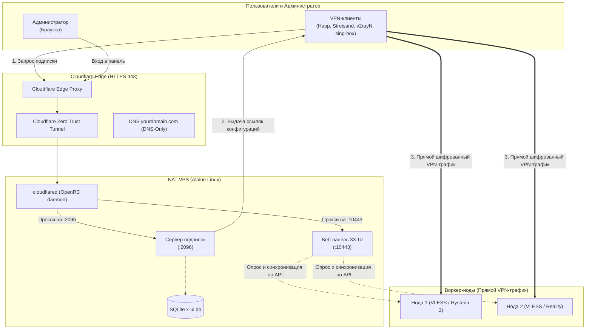

# Развёртывание мастер-ноды 3X-UI на дешёвом NAT VPS через Cloudflare Tunnel

## Назначение и концепция архитектуры

При построении распределённой VPN-сети (VLESS Reality, Hysteria 2, TUIC) разделяются две роли серверов:
* **Рабочие серверы (воркер-ноды):** узлы в разных странах, принимающие основной шифрованный сетевой трафик пользователей.
* **Центр управления (мастер-нода):** сервер с панелью 3X-UI для централизованного управления учётными записями, мониторинга и автоматической генерации клиентских конфигураций (подписок).

Использование отдельного сервера с выделенным IPv4 под мастер-ноду экономически и технически нецелесообразно:
1. **Избыточные затраты:** мастер-нода обрабатывает только веб-интерфейс и текстовые файлы подписок, не потребляя канал и ресурсы CPU.
2. **Уязвимость к блокировкам:** при блокировке публичного IP-адреса мастера все клиенты одновременно теряют доступ к получению обновлений конфигураций.

### Архитектурное решение:
Мастер-нода развёртывается на **сверхдешёвом NAT VPS** (например, TierHive с почасовой тарификацией от доли цента в час) под управлением легковесной системы Alpine Linux и публикуется через **бесплатный сервис Cloudflare Tunnel**.

* **Оптимизация расходов:** мастер-нода потребляет менее 150 МБ оперативной памяти и работает на минимальном тарифе (256 МБ RAM), так как весь транзитный VPN-трафик замыкается на воркер-нодах.
* **Защита от блокировок:** на сервере отсутствуют открытые входящие порты в публичную сеть. Соединение с Cloudflare инициируется изнутри сервера. Реальный IP-адрес скрыт, а доставка подписок защищена сетью Cloudflare.
* **Автоматический TLS/HTTPS:** веб-панель и ссылки подписок получают валидные TLS-сертификаты без локальной генерации сертификатов.

В руководстве используются нейтральные примеры доменов:
- Домен подписок: `sub.yourdomain.com`
- Домен панели управления: `panel.yourdomain.com`
- Домены рабочих серверов: `node1.yourdomain.com`, `node2.yourdomain.com`

---

## Что понадобится и бюджет

Перед тем как начинать, подготовьте следующие компоненты:

### 1. Что нужно подготовить заранее:
* **Собственный домен:** зарегистрированный у любого регистратора (Porkbun, Namecheap, Reg.ru и др.).
* **Аккаунт Cloudflare:** бесплатный тариф Cloudflare (включая доступ к разделу Cloudflare Zero Trust, привязка банковской карты не требуется).
* **NAT VPS сервер:** минимальный сервер с операционной системой Alpine Linux (256–512 МБ RAM, 2 ГБ NVMe). В руководстве рассматривается провайдер TierHive.
* **SSH-ключ:** пара ключей на компьютере администратора для безопасного подключения к серверу без пароля.
* *(Опционально)* **Рабочие VPN-серверы (воркер-ноды):** адреса серверов и доступ к их панелям 3X-UI (при объединении нескольких стран).

### 2. Бюджет (Сколько это стоит):
| Компонент | Сервис | Примерная стоимость |
| :--- | :--- | :--- |
| **Домен** | Porkbun / Namecheap | **1–3 USD в год** (в зонах `.top`, `.xyz`) или ~10 USD в год (`.com`) |
| **Мастер-нода (NAT VPS)** | TierHive | **~4–5 USD в год** (почасовая тарификация от 0.000135 USD / час) |
| **Cloudflare Tunnel & SSL** | Cloudflare Zero Trust | **Бесплатно** (тариф Free) |
| **ПО (3X-UI, Linux, OpenRC)** | GitHub Open Source | **Бесплатно** (открытый исходный код) |
| **ИТОГО:** | | **~5–15 USD за целый год работы** (менее 1 USD в месяц) |

⏱️ **Время выполнения:** около 15–20 минут по инструкции.

---

## Архитектурная схема



---

## Блок 1. Подготовка NAT VPS (Alpine Linux)

Настройка системы и сетевого доступа на сервере без выделенного внешнего IPv4.

### 1.1. Настройка проброшенных портов у провайдера
На NAT VPS сервер разделяет общий IPv4-адрес с другими клиентами хостинга.
- В панели управления хостинга откройте раздел **Forwarded Ports** (Проброшенные порты).
- Сохраните только одну строку: `<ВНЕШНИЙ_ПОРТ_SSH> -> 22 TCP` (например, `22022 -> 22 TCP`).
- Все остальные пробросы портов (включая порт `443`) **не требуются и могут быть удалены**, так как веб-трафик поступает через защищённое исходящее соединение Cloudflare Tunnel.

> [!CAUTION]
> **Предотвращение потери доступа к серверу:**
> Перед удалением лишних пробросов портов убедитесь, что правило для SSH сохранено и работает. Не удаляйте строку проброса порта SSH во избежание потери удалённого доступа к серверу.

### 1.2. Базовая настройка SSH
💻 **На локальном компьютере:**  
Подключитесь к серверу по SSH, используя приватный ключ:
```bash
ssh -i <ПУТЬ_К_КЛЮЧУ> -p <ВНЕШНИЙ_ПОРТ_SSH> root@<IP_СЕРВЕРА>
```
*(Укажите путь к приватному ключу, например `~/.ssh/id_ed25519` или `~/.ssh/id_rsa`)*.

🖥️ **В терминале сервера (VPS):**  
Создайте резервную копию файла конфигурации SSH:
```bash
cp /etc/ssh/sshd_config /etc/ssh/sshd_config.bak
```
Проверьте файл `/etc/ssh/sshd_config`:
```bash
AllowTcpForwarding yes
PermitRootLogin prohibit-password
```
Примените настройки:
```bash
rc-service sshd reload
```

> [!CAUTION]
> **Правило безопасности при настройке SSH:**
> После применения настроек **не закрывайте текущее окно терминала**. Откройте второе отдельное окно терминала на локальном компьютере и проверьте подключение. Если соединение не устанавливается, восстановите конфигурацию из файла `.bak` в первом окне.

> [!NOTE]
> Параметр `AllowTcpForwarding yes` разрешает создание локальных SSH-туннелей (`ssh -L`). Это аварийный способ входа в панель управления через SSH в обход публичной сети, если Cloudflare Tunnel временно недоступен:
> ```bash
> ssh -i <ПУТЬ_К_КЛЮЧУ> -L 10443:127.0.0.1:10443 -p <ВНЕШНИЙ_ПОРТ_SSH> root@<IP_СЕРВЕРА>
> ```
> *(после чего панель открывается в локальном браузере по адресу `http://localhost:10443`)*.

### 1.3. Установка системных утилит
🖥️ **В терминале сервера (VPS):**
```bash
apk update
apk add curl wget sqlite bash tar openrc ca-certificates
```

---

## Блок 2. Подготовка домена и DNS в Cloudflare

Перед настройкой туннелей домен должен быть делегирован в Cloudflare, а для серверов VPN-трафика созданы корректные записи.

### 2.1. Делегирование домена
> [!IMPORTANT]
> **Резервная копия DNS-записей:**
> Если домен уже используется для сайтов или почты, перед сменой NS-серверов экспортируйте текущую зону DNS в панели текущего регистратора (кнопка *Export DNS / Зона DNS*). Это защитит от потери существующих записей.

1. Добавьте домен в аккаунт [Cloudflare](https://dash.cloudflare.com/).
2. В панели регистратора доменных имён укажите выданные NS-серверы Cloudflare.
3. Дождитесь завершения делегирования (статус зоны: *Active*).

### 2.2. Разделение типов маршрутизации в DNS
> [!WARNING]
> **Принцип проксирования трафика:**
> - Для веб-сервисов (`sub.yourdomain.com` и `panel.yourdomain.com`) записи типа `CNAME` создаются автоматически службой Cloudflare Tunnel в режиме проксирования (оранжевое облако 🟠).
> - Для рабочих серверов с VPN-протоколами (VLESS Reality, Hysteria 2, TUIC) записи типа `A` создаются вручную и должны находиться **строго в режиме DNS-Only (серое облако ⚪)**. Проксирование Cloudflare нарушит работу шифрования Reality и протоколов на базе UDP.

### Пример конфигурации DNS-записей
| Тип записи | Имя записи | Значение | Режим Cloudflare | Назначение |
| :--- | :--- | :--- | :--- | :--- |
| `A` | `node1.yourdomain.com` | `<IP_НОДЫ_1>` | ⚪ **DNS-Only (серое облако)** | VPN-нода 1 |
| `A` | `node2.yourdomain.com` | `<IP_НОДЫ_2>` | ⚪ **DNS-Only (серое облако)** | VPN-нода 2 |
| `CNAME` | `sub.yourdomain.com` | Создаётся туннелем | 🟠 Проксирование | Подписки клиентов |
| `CNAME` | `panel.yourdomain.com` | Создаётся туннелем | 🟠 Проксирование | Админ-панель 3X-UI |

---

## Блок 3. Установка 3X-UI на Alpine Linux (OpenRC)

Установка панели управления на дистрибутив с системой инициализации OpenRC.

### 3.1. Установка
🖥️ **В терминале сервера (VPS):**
Если на сервере ранее уже настраивалась панель 3X-UI, создайте резервную копию существующей базы:
```bash
[ -f /etc/x-ui/x-ui.db ] && cp /etc/x-ui/x-ui.db /etc/x-ui/x-ui.db.bak_preinstall
```
Выполните установку:
```bash
apk add --no-cache bash curl ca-certificates
bash <(curl -Ls https://raw.githubusercontent.com/mhsanaei/3x-ui/master/install.sh)
```
После завершения установщик выведет в консоль сгенерированные учётные данные.

### 3.2. Архитектура портов 3X-UI и фиксация стандарта
Панель 3X-UI запускает внутри себя два независимых веб-сервера:
- **`webPort`**: локальный порт веб-интерфейса администратора (стандарт руководства: **`10443`**).
- **`subPort`**: локальный порт службы отдачи подписок клиентам (стандарт руководства: **`2096`**, поддерживаемый Cloudflare).

Инсталлятор назначает случайный порт только для веб-панели (`webPort`, например `34921`). Так как на NAT VPS этот порт закрыт извне, приведите `webPort` к стандарту `10443` и установите корень `/` сразу после установки прямо в консоли:

🖥️ **В терминале сервера (VPS):**
```bash
sqlite3 /etc/x-ui/x-ui.db "UPDATE settings SET value='10443' WHERE key='webPort'; UPDATE settings SET value='/' WHERE key='webBasePath';"
killall -9 x-ui 2>/dev/null; rc-service x-ui zap && rc-service x-ui start
```

> [!NOTE]
> Фиксация порта `10443` на данном этапе гарантирует, что создаваемый в **Блоке 4** туннель Cloudflare сразу установит соединение с веб-панелью без ошибки 502 Bad Gateway.

### 3.3. Управление службой и решение проблемы зависания процессов
Команды управления службой через OpenRC:
```bash
rc-service x-ui start      # Запуск
rc-service x-ui stop       # Остановка
rc-service x-ui status     # Проверка статуса
rc-update add x-ui default # Включение автозагрузки
```

> [!IMPORTANT]
> **Устранение ошибки `start-stop-daemon: 1 process refused to stop`:**  
> При выполнении стандартной команды `rc-service x-ui restart` служба закрывает сетевые сокеты дольше стандартного таймаута OpenRC. Утилита `start-stop-daemon` переводит службу в статус `crashed` и блокирует запуск.  
> 
> **Команда гарантированного перезапуска:**
> ```bash
> killall -9 x-ui 2>/dev/null; rc-service x-ui zap && rc-service x-ui start
> ```
> Команда `rc-service x-ui zap` сбрасывает статус OpenRC из `crashed` в `stopped`, позволяя службе стартовать без блокировок.

---

## Блок 4. Развёртывание Cloudflare Tunnel (`cloudflared`) на Alpine Linux

Настройка безопасного проксирования трафика. Позволяет публиковать веб-панель и ссылки подписок на стандартном порту 443 без выделенного IPv4 и без открытия входящих портов на VPS.

### 4.1. Создание туннеля в Cloudflare Zero Trust
1. В консоли Cloudflare откройте **Zero Trust** → **Networks** → **Tunnels**.
2. Нажмите **Add a tunnel** → выберите тип **Cloudflare (cloudflared)** → нажмите **Next**.
3. Укажите имя туннеля (например, `vps-master`) и нажмите **Save tunnel**.
4. В разделе *Install and run a connector* Cloudflare выведет команду вида:
   ```text
   cloudflared service install eyJhIjoiMTllODI0...
   ```
   Скопируйте **только строку токена** в кодировке Base64 (длинная строка, начинающаяся на `eyJh...`).

### 4.2. Установка бинарного файла `cloudflared`
🖥️ **В терминале сервера (VPS):**
```bash
wget -O /usr/local/bin/cloudflared https://github.com/cloudflare/cloudflared/releases/latest/download/cloudflared-linux-amd64
chmod +x /usr/local/bin/cloudflared
```

### 4.3. Создание OpenRC-службы (Адаптация для систем без systemd)
> [!NOTE]
> Команда `cloudflared service install` не поддерживается в Alpine Linux, так как рассчитана на утилиту `systemctl` (`systemd`). На Alpine служба оформляется стандартным скриптом инициализации OpenRC.

🖥️ **В терминале сервера (VPS):**  
Создайте файл `/etc/init.d/cloudflared`:
```bash
cat << 'EOF' > /etc/init.d/cloudflared
#!/sbin/openrc-run

name="cloudflared"
description="Cloudflare Tunnel Daemon"
command="/usr/local/bin/cloudflared"
command_args="tunnel --no-autoupdate run --token <ТОКЕН_ТУННЕЛЯ>"
command_background=true
pidfile="/run/${RC_SVCNAME}.pid"

depend() {
    need net
    after firewall
}
EOF
```

Замените `<ТОКЕН_ТУННЕЛЯ>` на скопированную строку токена, сделайте файл исполняемым и запустите службу:
```bash
chmod +x /etc/init.d/cloudflared
rc-update add cloudflared default
rc-service cloudflared start
```

### 4.4. Настройка публичных маршрутов (Public Hostnames)
В веб-интерфейсе Cloudflare Zero Trust перейдите во вкладку **Public Hostnames** созданного туннеля и добавьте два правила:

1. **Сервер подписок:**
   - **Subdomain:** `sub`
   - **Domain:** `yourdomain.com`
   - **Path:** *(оставьте пустым)*
   - **Service Type:** `HTTP`
   - **URL:** `localhost:2096`

2. **Веб-панель администратора:**
   - **Subdomain:** `panel`
   - **Domain:** `yourdomain.com`
   - **Path:** *(оставьте пустым)*
   - **Service Type:** `HTTP`
   - **URL:** `localhost:10443`

---

## Блок 5. Конфигурация подписок и базы данных: С нуля vs Из бэкапа

Выберите подходящий сценарий настройки:

---

### Сценарий 5.1. Первичная настройка ноды «С нуля» (через веб-интерфейс)
Используйте данный сценарий при развёртывании сервера без переноса существующей базы:

1. Откройте в браузере адрес панели:  
   👉 **`https://panel.yourdomain.com/`**
2. Авторизуйтесь с логином и паролем, выданными инсталлятором на шаге 3.1.
3. Перейдите в раздел **Настройки панели (Panel Settings) → Настройки подписки (Subscription Settings)**:
   - **Включить подписку (Enable subscription):** установите флаг (Вкл).
   - **URL подписки (Subscription URL / subURI):** укажите `https://sub.yourdomain.com/`  
     *(Панель будет подставлять именно этот домен в ссылки клиентов)*.
   - **Порт подписки (Subscription Port):** укажите `2096` *(соответствует порту в Cloudflare Tunnel)*.
   - **Путь подписки (Subscription Path):** укажите `/`.
4. В разделе **Общие настройки (General Settings)** убедитесь, что параметры согласованы:
   - **Порт панели (webPort):** `10443` *(установлен на шаге 3.2)*.
   - **Путь веб-интерфейса (webBasePath):** `/`.
5. Нажмите **Сохранить настройки** внизу страницы.
6. 🖥️ **В терминале сервера (VPS):** примените настройки перезапуском службы:
   ```bash
   killall -9 x-ui 2>/dev/null; rc-service x-ui zap && rc-service x-ui start
   ```

---

### Сценарий 5.2. Восстановление или миграция базы (`x-ui.db`)
Используйте данный сценарий при наличии резервной копии базы данных со списком клиентов, токенами и конфигурациями.

#### 5.2.1. Создание гарантированно целостного бэкапа на исходном сервере
Перед переносом создайте чистую резервную копию базы данных на старом сервере:
- **Через веб-панель:** перейдите в раздел **Настройки панели** → нажмите **Экспорт базы данных** (файл `x-ui.db` сохранится на локальный компьютер).
- **Или через терминал старого сервера:** выполните команду создания целостного снимка SQLite (исключает незавершённые транзакции WAL):
  ```bash
  sqlite3 /etc/x-ui/x-ui.db "VACUUM INTO '/tmp/x-ui_backup.db';"
  ```
  *(передайте полученный файл на локальный компьютер через `scp`)*.

#### 5.2.2. Пакетная подготовка базы на локальном компьютере
> [!NOTE]
> Скрипт подготовки работает с изолированной копией `ready_to_upload.db` и не изменяет исходный файл бэкапа `source_db`.

💻 **На локальном компьютере:**  
Создайте скрипт `prepare_db.py` рядом с файлом бэкапа. Скрипт использует только стандартную библиотеку Python 3 (`sqlite3`, `shutil`) и не требует сторонних пакетов:

```python
import sqlite3
import shutil

source_db = 'source_backup.db'   # Имя файла бэкапа (например, x-ui.db)
target_db = 'ready_to_upload.db'

shutil.copyfile(source_db, target_db)
con = sqlite3.connect(target_db)
cur = con.cursor()

# Согласование сетевых параметров под стандартные порты
cur.execute("UPDATE settings SET value = '10443' WHERE key = 'webPort'")
cur.execute("UPDATE settings SET value = '/' WHERE key = 'webBasePath'")
cur.execute("UPDATE settings SET value = '2096' WHERE key = 'subPort'")
cur.execute("UPDATE settings SET value = '/' WHERE key = 'subPath'")
cur.execute("UPDATE settings SET value = 'https://sub.yourdomain.com/' WHERE key = 'subURI'")
cur.execute("UPDATE settings SET value = '0.0.0.0' WHERE key = 'webListen'")
cur.execute("UPDATE settings SET value = '127.0.0.1' WHERE key = 'subListen'")

# Очистка путей локальных SSL-сертификатов (TLS обеспечивает Cloudflare)
cur.execute("UPDATE settings SET value = '' WHERE key = 'webCertFile'")
cur.execute("UPDATE settings SET value = '' WHERE key = 'webKeyFile'")

# Отключение локальных входящих подключений (трафик замыкается на воркер-нодах)
cur.execute("UPDATE inbounds SET enable = 0 WHERE node_id IS NULL")

con.commit()

# Сброс журнала WAL и физическое сжатие файла базы
cur.execute("PRAGMA wal_checkpoint(TRUNCATE);")
cur.execute("PRAGMA journal_mode=DELETE;")
cur.execute("VACUUM;")

con.commit()
con.close()
print("База успешно подготовлена к загрузке!")
```

Запустите скрипт:
```bash
python prepare_db.py
```

#### 5.2.3. Загрузка базы на VPS, защита от повреждения файлов и откат
> [!CAUTION]
> **Опасность повреждения базы (`cp` bug в Linux):**
> При перезаписи существующей базы SQLite файлом меньшего объёма командой `cp new.db /etc/x-ui/x-ui.db` Linux не обрезает остаток исходного файла. Образовавшийся мусор в конце файла приводит к фатальной ошибке `database disk image is malformed`.  
> **Перед копированием обязательно сохраняйте резервную копию текущей базы и удаляйте старый файл перед копированием нового!**

1. 💻 **На локальном компьютере:** передайте подготовленный файл на сервер:
   ```bash
   scp -P <ВНЕШНИЙ_ПОРТ_SSH> ready_to_upload.db root@<IP_СЕРВЕРА>:/tmp/x-ui_restore.db
   ```

2. 🖥️ **В терминале сервера (VPS):** создайте резервную копию текущего состояния и выполните безопасную замену:
   ```bash
   killall -9 x-ui 2>/dev/null
   rc-service x-ui zap

   # Резервная копия текущей базы перед удалением (точка отката)
   [ -f /etc/x-ui/x-ui.db ] && cp /etc/x-ui/x-ui.db /etc/x-ui/x-ui.db.bak_$(date +%Y%m%d_%H%M%S)

   # Полная очистка старых файлов базы и журналов
   rm -f /etc/x-ui/x-ui.db /etc/x-ui/x-ui.db-wal /etc/x-ui/x-ui.db-shm
   cp /tmp/x-ui_restore.db /etc/x-ui/x-ui.db
   chmod 644 /etc/x-ui/x-ui.db

   # Проверка целостности файла
   sqlite3 /etc/x-ui/x-ui.db 'PRAGMA integrity_check;'
   ```
   *Ожидаемый результат проверки:* `ok`.

> [!TIP]
> **План отката (Rollback):**
> Если утилита `sqlite3` вернула ошибку вместо `ok`, немедленно восстановите предыдущее состояние из созданной точки отката:
> ```bash
> cp /etc/x-ui/x-ui.db.bak_* /etc/x-ui/x-ui.db
> rc-service x-ui start
> ```

3. Запустите службу 3X-UI:
   ```bash
   rc-service x-ui start
   ```

---

## Блок 6. Подключение воркер-нод (Мультисерверная архитектура)

Мастер-нода не обрабатывает сам VPN-трафик пользователей — её задача управлять клиентами и раздавать актуальные подписки. Трафик идёт через независимые воркер-ноды.

### 6.1. Архитектурный принцип
- Связь инициирует **Мастер**: он отправляет исходящие запросы к API воркер-нод.
- Воркер-ноде **не требуется знать IP-адрес мастера**.
- Перенос, перезагрузка или смена IP-адреса мастера не влияют на работу активных VPN-туннелей на нодах.

### 6.2. Пошаговое добавление ноды
1. **На воркер-ноде (сервере с VPN-протоколами):**
   - Откройте панель 3X-UI воркер-ноды → **Настройки панели** → **API токены (API Tokens)**.
   - Создайте токен с правами `admin` и скопируйте его значение.
2. **На мастер-ноде:**
   - Откройте веб-панель мастера (`https://panel.yourdomain.com/`).
   - Перейдите в раздел **Узлы (Nodes)** → нажмите **Добавить узел (Add Node)**.
   - Заполните поля:
     - **Имя (Name):** например, `Node-1`
     - **Адрес (Address):** домен ноды из DNS (например, `node1.yourdomain.com`)
     - **Порт (Port):** `443` *(или порт веб-панели воркер-ноды, например `2053`)*
     - **Базовый путь (Base Path):** `/` *(или путь панели на воркер-ноде)*
     - **API Токен (API Token):** вставьте скопированный токен воркер-ноды
   - Нажмите **Сохранить**.
3. **Проверка статуса подключения:**
   - В списке узлов статус добавленной ноды должен отображаться как **Online** с текущим пингом.
   - 🖥️ **В терминале сервера (VPS):** статус можно проверить напрямую из базы данных:
     ```bash
     sqlite3 /etc/x-ui/x-ui.db 'SELECT id, name, address, status, latency_ms FROM nodes;'
     ```
     *Ожидаемый результат:* статус `online` для всех подключённых нод.

---

## Блок 7. Проверка работоспособности (Smoke Testing)

Итоговая верификация работоспособности всех компонентов:

### 7.1. Проверка сетевых портов
🖥️ **В терминале сервера (VPS):**
```bash
netstat -tlpn
```
*Ожидаемый результат:*
- Порт `10443` слушает процесс `x-ui` (панель).
- Порт `2096` слушает процесс `x-ui` (подписки).
- Процесс `cloudflared` запущен и держит соединения.

### 7.2. Проверка доступности панели администратора
💻 **На локальном компьютере:**
```bash
curl -s -o /dev/null -w "%{http_code}\n" "https://panel.yourdomain.com/"
```
*Ожидаемый результат:* `200`.

### 7.3. Проверка ссылки подписки клиента
💻 **На локальном компьютере:**
```bash
curl -i "https://sub.yourdomain.com/<SUB_ID_КЛИЕНТА>"
```
*(При настройке с нуля по Сценарию 5.1 предварительно создайте первого клиента в веб-панели в разделе «Клиенты» и скопируйте его Subscription ID)*.

*Ожидаемый результат:*
- Код ответа: `HTTP/1.1 200 OK`
- Заголовок `Profile-Title:` с названием профиля подписки.
- Заголовок `Subscription-Userinfo:` со статистикой трафика.
- Тело ответа: Base64-список рабочих VPN-конфигураций подключённых воркер-нод.

### 7.4. Настройка автоматического регулярного резервного копирования
Для защиты клиентских подписок от непредвиденных сбоев накопителя настройте ежедневное автоматическое создание резервных копий:

🖥️ **В терминале сервера (VPS):**
Создайте исполняемый скрипт ежедневной ротации бэкапов в службе планировщика Alpine Linux (`crond`):
```bash
cat << 'EOF' > /etc/periodic/daily/x-ui-backup
#!/bin/sh
BACKUP_DIR="/var/backups/x-ui"
mkdir -p "$BACKUP_DIR"
sqlite3 /etc/x-ui/x-ui.db "VACUUM INTO '$BACKUP_DIR/x-ui_$(date +%Y%m%d).db';"
# Удаление архивных копий старше 7 дней
find "$BACKUP_DIR" -type f -name "x-ui_*.db" -mtime +7 -delete
EOF
chmod +x /etc/periodic/daily/x-ui-backup
rc-service crond start
rc-update add crond default
```
*Каждые сутки в каталоге `/var/backups/x-ui/` будет создаваться целостный снимок базы данных с автоматическим хранением архива за последнюю неделю.*

---

## 8. Тонкости генерации подписок и исключение дублирования ссылок (Deduplication)

### Как 3X-UI формирует файл подписки клиента:
При запросе к ссылке подписки (`https://sub.yourdomain.com/<SUB_ID>`) генератор 3X-UI проходит по всем активным инбаундам:
1. Если у инбаунда есть связанные записи в таблице **`hosts`**, панель генерирует **отдельную ссылку для каждой строки** из этой таблицы.
2. Если в `hosts` записей нет, ссылка берётся из массива **`externalProxy`** в поле `stream_settings`.

### Проблема «дубликатов» при использовании пулов SNI (Multi-SNI):
Если для VLESS REALITY задан пул из нескольких маскировочных доменов (например, `appengine.google.com`, `dmi.dk`, `dl.google.com`), скрипты настройки могут по ошибке создать отдельную запись в `hosts` для каждого домена. В результате у клиента в приложении появляется 5–8 визуально одинаковых серверов (`NO Oslo • VLESS Classic`).

### Правило архитектуры:
* **Все альтернативные домены** должны находиться **только в `realitySettings.serverNames`** ядра Xray (на воркер-ноде). Это обеспечивает серверный приём TLS handshake с любого из этих доменов.
* В таблицах **`hosts`** и **`externalProxy`** на мастер-ноде должна быть **строго одна запись** (основной, самый быстрый SNI).

#### Команда для проверки и очистки дубликатов на мастер-ноде:
```bash
# Проверка наличия дубликатов в hosts
sqlite3 /etc/x-ui/x-ui.db "SELECT id, inbound_id, sni, remark FROM hosts ORDER BY inbound_id;"

# Удаление лишних записей для инбаунда (оставляя только id приоритетного хоста)
sqlite3 /etc/x-ui/x-ui.db "DELETE FROM hosts WHERE inbound_id = <ID_ИНБАУНДА> AND id != <ID_ОСНОВНОГО_ХОСТА>;"

# Перезапуск службы подписок для обновления выдачи
rc-service x-ui restart
```

